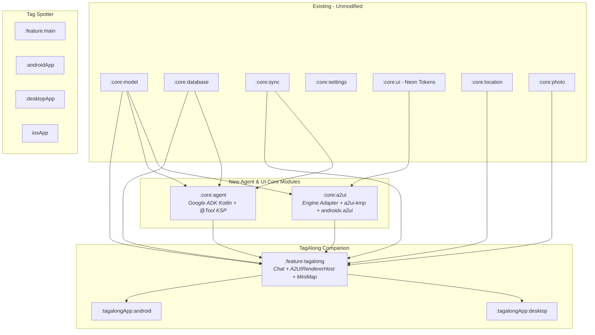
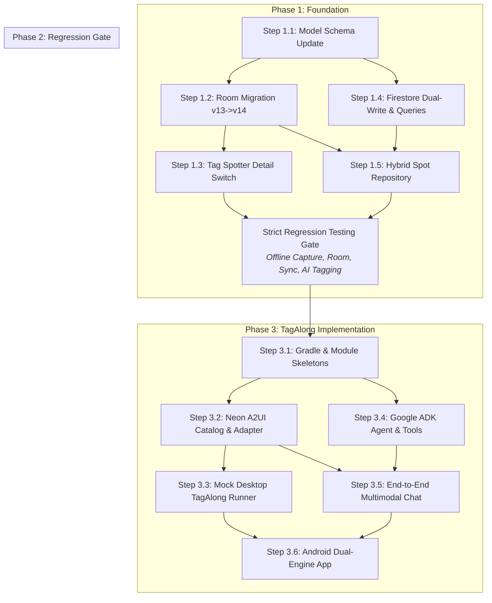

# Intent Document: TagAlong Agentic Showcase (Google ADK + A2UI + Firebase App Check)

> **Date:** 2026-11-11  
> **Task Tracker & Orchestration Board:** [tagalong-task-tracker.md](tagalong-task-tracker.md)

## 📑 Table of Contents

- [1. Executive Summary & Objective](#1-executive-summary--objective)
- [2. Reference Links & Ecosystem Sources](#2-reference-links--ecosystem-sources)
- [3. Spot Sharing & Visibility Architecture (Public vs. Private)](#3-spot-sharing--visibility-architecture-public-vs-private)
- [4. A2UI Library Evaluation & Selection Decision](#4-a2ui-library-evaluation--selection-decision)
- [5. Dual-Engine Feasibility & Android A/B Switcher](#5-dual-engine-feasibility--android-ab-switcher)
- [6. Target Multi-App Module Graph (Tag Spotter + TagAlong)](#6-target-multi-app-module-graph-tag-spotter--tagalong)
- [7. Full Urban Suite Neon A2UI Component Catalog & Error Resilience](#7-full-urban-suite-neon-a2ui-component-catalog--error-resilience)
- [8. Adaptive Desktop & Multiplatform Layout](#8-adaptive-desktop--multiplatform-layout)
- [9. Future Features & Architectural Considerations](#9-future-features--architectural-considerations)
- [10. Three-Phase Implementation Roadmap](#10-three-phase-implementation-roadmap)
  - [Step Dependency & Parallelization Matrix](#step-dependency--parallelization-matrix)
  - [🟢 PHASE 1: Foundation, Schema & Architecture Evolution](#-phase-1-foundation-schema--architecture-evolution)
    - [🔹 Step 1.1: Model Schema Evolution (`:core:model`)](#-step-11-model-schema-evolution-coremodel)
    - [🔹 Step 1.2: Room Database Migration v13→v14 & TagAlong DB (`:core:database`)](#-step-12-room-database-migration-v13v14--tagalong-db-coredatabase)
    - [🔹 Step 1.3: Tag Spotter Detail Screen UI Switch (`:feature:detail`)](#-step-13-tag-spotter-detail-screen-ui-switch-featuredetail)
    - [🔹 Step 1.4: Firestore Dual-Write & Public Spot Queries (`:core:sync`)](#-step-14-firestore-dual-write--public-spot-queries-coresync)
    - [🔹 Step 1.5: Hybrid Spot Repository (`:core:sync`)](#-step-15-hybrid-spot-repository-coresync)
  - [🛑 PHASE 2: Tag Spotter Comprehensive Regression Gate](#-phase-2-tag-spotter-comprehensive-regression-gate)
  - [🚀 PHASE 3: TagAlong Companion App Implementation](#-phase-3-tagalong-companion-app-implementation)
    - [🔹 Step 3.1: Monorepo Gradle Setup & Module Skeletons](#-step-31-monorepo-gradle-setup--module-skeletons)
    - [🔹 Step 3.2: Neon Catalog & Dual-Engine Adapter (`:core:a2ui`)](#-step-32-neon-catalog--dual-engine-adapter-corea2ui)
    - [🔹 Step 3.3: Mock Desktop TagAlong Runner (`:tagalongApp:desktop`)](#-step-33-mock-desktop-tagalong-runner-tagalongappdesktop)
    - [🔹 Step 3.4: Google ADK Agent & Tools Engine (`:core:agent`)](#-step-34-google-adk-agent--tools-engine-coreagent)
    - [🔹 Step 3.5: End-to-End Multimodal Chat & Map Sync (`:feature:tagalong`)](#-step-35-end-to-end-multimodal-chat--map-sync-featuretagalong)
    - [🔹 Step 3.6: Android Dual-Engine App (`:tagalongApp:android`)](#-step-36-android-dual-engine-app-tagalongappandroid)
- [11. Verification Checklist & Success Criteria](#11-verification-checklist--success-criteria)

---

## 1. Executive Summary & Objective

This document defines the complete architecture, design specifications, and phased implementation roadmap for introducing **TagAlong**—an Agentic Street Art Companion App—alongside the existing **Tag Spotter** app in the same Kotlin Multiplatform monorepo.

### Core Objectives:
1. **Safety First for Tag Spotter:** Perform all database schema and sharing architecture evolutions first across all existing Tag Spotter targets (`android`, `jvm`, `ios*`, `wasmJs`), validated by a strict **Regression Test Plan** to guarantee Tag Spotter's offline-first photo capture and single-shot AI tagging are completely unaffected.
2. **Showcase Google Agentic Ecosystem in Kotlin:** Co-locate **Google Agent Development Kit for Kotlin (`google/adk-kotlin`)** for agent orchestration and **`a2ui-kmp`** (dynamic generative UI rendering) in `commonMain` across **Android and Desktop (JVM)** (the platforms supported by `google/adk-kotlin`).
3. **Dual-Engine Android Evaluation:** Provide an architectural adapter on Android allowing a live runtime / build toggle between **`a2ui-kmp`** and Google's official **`androidx.a2ui`** for head-to-head benchmarking.
4. **Hybrid Spot Discovery:** Enable the agent to query both local user captures (Room DB) and shared community street art murals (Cloud Firestore `/public_spots/{uuid}`).
5. **Persistent & Multimodal Agent:** Support Room-backed conversation persistence (`TagAlongDatabase`), hybrid GPS location awareness, and multimodal photo attachments for image-based street art identification with latest Gemini Flash.
6. **Adaptive & Resilient UX:** Adaptive two-pane layout on Desktop (Chat/A2UI left, Map right), inline offline fallback banner, and graceful fallback rendering with an expandable raw JSON debug inspector.
7. **Full Urban Suite Catalog:** Deliver a rich set of neon-styled generative widgets (Spot Cards, Tour Waypoints, Artist Bios, Style Quizzes, Community Voting, and Map Pin Overlays).
8. **Zero-Backend Requirement:** Direct client execution protected by **Firebase App Check** on Android (`firebase-ai` + Play Integrity/Debug provider) and Gemini API key / Ktor REST fallback on Desktop JVM.
9. **Actionable Slices with Clear Verification:** Every step has a well-defined **Goal**, specific work items, and concrete **End-of-Step Tests** to prove completion before proceeding.

---

## 2. Reference Links & Ecosystem Sources

| Ecosystem Component | Reference / Repository Link | Description |
| :--- | :--- | :--- |
| **Google ADK for Kotlin** | [github.com/google/adk-kotlin](https://github.com/google/adk-kotlin) &bull; [adk.dev](https://adk.dev) | Google's official Agent Development Kit for Kotlin (KSP-powered `@Tool` schemas, multi-agent, MCP, & session state). |
| **Google Cloud ADK Docs** | [docs.cloud.google.com/.../adk](https://docs.cloud.google.com/gemini-enterprise-agent-platform/build/adk) | Official Enterprise Agent Platform documentation for the Agent Development Kit. |
| **A2UI Protocol Standard** | [a2ui.org](https://a2ui.org) | Official open standard and declarative JSON specification for Agent-to-User Interfaces. |
| **Jetpack `androidx.a2ui`** | [developer.android.com/.../a2ui](https://developer.android.com/jetpack/androidx/releases/a2ui) | Google's official Android Jetpack Compose A2UI library suite (`a2ui-engine`, `compose-ui`, `material3-a2ui`). |
| **`a2ui-kmp` (BinaryTape)** | [github.com/BinaryTape/a2ui-kmp](https://github.com/BinaryTape/a2ui-kmp) | Community Kotlin Multiplatform port by @xx2bab enabling Compose Multiplatform rendering on Android & Desktop. |
| **ClimateTrace CMP Sample** | [github.com/joreilly/ClimateTraceKMP](https://github.com/joreilly/ClimateTraceKMP) | John O'Reilly's reference sample integrating Google ADK, A2UI, and MCP in Kotlin Multiplatform. |

---

## 3. Spot Sharing & Visibility Architecture (Public vs. Private)

Currently, `Spot` in `:core:model` contains `ownerUid`, and `NonWebSyncManager` syncs private user spots to `users/{userId}/spots/{uuid}` (and thumbnails to `users/{userId}/thumbnails/{imageUuid}.jpg`). To support a **hybrid agent** that reasons over both the user's personal captures and community street art without exposing private user subcollections:

```mermaid
flowchart TD
    subgraph Data Sources
        RoomDB[(Local Room DB<br><i>SpotDatabase v14 in nonWebMain</i>)]
        Firestore[(Cloud Firestore<br><i>Top-Level /public_spots/{uuid}</i>)]
        Storage[(Firebase Storage<br><i>/public_spots/{uuid}/thumbnails/</i>)]
    end

    subgraph Shared Spot Repository [:core:sync]
        Repo[HybridSpotRepository]
    end

    subgraph Google ADK Agent Tools [:core:agent]
        Tool[StreetArtTools.getNearbySpots]
    end

    RoomDB --> Repo
    Firestore --> Repo
    Storage --> Repo
    Repo -->|Merged & Deduplicated Spots| Tool
```

### Schema & UI Specifications:
1. **`:core:model`**: Add `val isPublic: Boolean = false` to `Spot`.
2. **`:core:database`**:
   * Add `val isPublic: Boolean = false` to `SpotEntity` in `nonWebMain` (`SpotEntity.kt`).
   * Migrate `SpotDatabase` from **`version = 13` to `version = 14`** using manual `MIGRATION_13_14` (`ALTER TABLE spots ADD COLUMN isPublic INTEGER NOT NULL DEFAULT 0`) registered in `configureSpotDatabase()`.
   * Add `suspend fun updateSpotPublic(spotId: Long, isPublic: Boolean)` to `SpotRepository` (`commonMain`) and implement across `nonWebMain` (`OfflineFirstSpotRepository`) and `wasmJsMain` (`WasmSpotRepository`).
   * Create isolated `TagAlongDatabase` in `nonWebMain` for `ChatSessionEntity` and `ChatMessageEntity`.
3. **`:feature:detail` (Tag Spotter UI)**: Add an optional "Share as Public Spot" switch in `DetailMetadataCard.kt` defaulting to `false` (Private), bound to `DetailViewModel.togglePublic()`.
4. **`:core:sync`**: 
   * When syncing a spot where `spot.isPublic == true`, **dual-write** `SpotDetails` to top-level `/public_spots/{uuid}` in Firestore (and upload public thumbnails to `/public_spots/{uuid}/thumbnails/{imageUuid}.jpg` in Storage).
   * When a spot has `isPublic == false` or is deleted, remove `/public_spots/{uuid}` from Firestore.
   * Add `suspend fun fetchPublicSpots(minLat: Double, maxLat: Double, minLon: Double, maxLon: Double): List<SpotDetails>` to `SyncManager` (`commonMain`) and implement in `NonWebSyncManager` (Android/iOS GitLive), `JvmSyncManager` (Desktop Ktor REST), and `WasmSyncManager` (no-op/stub).
5. **`HybridSpotRepository` (in `:core:sync`)**: Lives in `:core:sync` (which already depends on `:core:database`) to avoid circular Gradle dependencies. Combines local `SpotRepository` spots and remote `SyncManager.fetchPublicSpots(...)`, deduplicating by `uuid` and prioritizing local image paths when present in both.

---

## 4. A2UI Library Evaluation & Selection Decision

| Evaluation Criteria | Official Google `androidx.a2ui` | Community `a2ui-kmp` (BinaryTape / @xx2bab) |
| :--- | :--- | :--- |
| **Multiplatform Support** | ❌ **Android Only** (bound to Android Jetpack Compose) | ✅ **Full KMP** (Android, iOS, Desktop JVM via Compose Multiplatform) |
| **Artifacts** | `androidx.a2ui:a2ui-engine`<br>`androidx.a2ui.compose:compose-ui`<br>`androidx.compose.material3:material3-a2ui` | `com.binarytape:a2ui-kmp-core`<br>`com.binarytape:a2ui-kmp-compose` |
| **Maintainer** | Google AndroidX Team | El / @xx2bab (Android GDE / BinaryTape) |
| **Release Stage** | Alpha (`1.0.0-alpha02`) | Active Open-Source KMP Port |
| **State Reactivity** | Jetpack Compose Snapshot State | Compose Multiplatform Snapshot State + JSON Pointer Binding |
| **Theme System** | AndroidX Material 3 | Shared Compose Multiplatform Material 3 Tokens |

### Architectural Decision:
* **Primary Cross-Platform Engine:** **`a2ui-kmp` (BinaryTape)** for Android, iOS, and Desktop.
* **Secondary Android Benchmark Engine:** **`androidx.a2ui` (Google)** available on Android via an adapter interface to compare developer experience, schema conformance, and rendering speed.

---

## 5. Dual-Engine Feasibility & Android A/B Switcher

```mermaid
flowchart TD
    subgraph Shared Feature [:feature:tagalong]
        Screen[TagAlongScreen] --> A2UIHost[A2UIRendererHost]
    end

    subgraph Core A2UI Module [:core:a2ui]
        A2UIHost --> EngineInterface[<<interface>> A2UIRendererEngine]
        
        KmpEngine[KmpA2UIEngine<br><i>commonMain (a2ui-kmp)</i>] -->|Implements| EngineInterface
        
        subgraph Android-Only Target [androidMain]
            JetpackEngine[JetpackA2UIEngine<br><i>androidx.a2ui</i>] -->|Implements| EngineInterface
        end
    end

    subgraph Runtime Selection [Android TagAlong App]
        Settings[Dev Settings / Toggle] -->|Selects Engine via Koin DI| EngineInterface
    end
```

### Adapter Interface Contract (`commonMain`)
```kotlin
// :core:a2ui/src/commonMain
interface A2UIRendererEngine {
    val engineType: A2UIEngineType

    @Composable
    fun RenderSurface(
        payloadJson: String,
        catalog: NeonA2UICatalog,
        onAction: (A2UIAction) -> Unit,
        modifier: Modifier
    )
}

enum class A2UIEngineType {
    A2UI_KMP_BINARYTAPE,
    ANDROIDX_JETPACK_OFFICIAL
}
```

---

## 6. Target Multi-App Module Graph (Tag Spotter + TagAlong)



---

## 7. Full Urban Suite Neon A2UI Component Catalog & Error Resilience

The TagAlong catalog in `:core:a2ui` implements the **Full Urban Suite**:

1. **`SpotCard`**: Mural thumbnail, title, artist, tags, distance, and action triggers (*"Star"*, *"View on Map"*).
2. **`TourCard` / `TourWaypoint`**: Ordered walking waypoints, total route distance, estimated walking time, and navigation trigger (*"Navigate to Next Stop"*).
3. **`ArtistBioCard`**: Artist avatar/bio, active years, street art style tags, and horizontal thumbnail carousel of historical pieces.
4. **`StyleQuizWidget`**: Interactive multiple-choice trivia widget with neon option chips, feedback animations, and score tracking.
5. **`CommunityVotingCard`**: Dynamic card allowing users to vote on unknown tag styles (e.g., *Stencil vs. Freehand* or *Artist Attribution*).
6. **`MapPinOverlayWidget`**: In-app mini map card rendering spot pins with MapLibre/OSMDroid and an *"Open in External Maps"* button.

### Error Handling & Debug Inspector:
* **Production Resilience:** If the LLM generates invalid JSON or references an uncataloged component, `A2UIRendererHost` renders a graceful **Neon Fallback Card** with the agent's textual summary and a "Retry" button.
* **Debug Inspector:** In debug builds, the fallback card includes an expandable **Raw JSON Payload Inspector** to inspect schema mismatches and agent hallucinations.
* **Offline Handling:** When no network is available for Gemini/Firestore, TagAlong renders an **Inline Offline Mode Banner** with one-tap chips to browse saved offline walking tours or open Tag Spotter.

---

## 8. Adaptive Desktop & Multiplatform Layout

* **Compact / Mobile Viewports (Android, iOS, Narrow Desktop):** Single-column layout with scrollable chat stream and collapsible mini map overlay.
* **Expanded Viewports (Desktop JVM):** Adaptive **two-pane split layout**:
  * **Left Pane (60%):** Multimodal chat input, conversational stream, and generative A2UI surfaces.
  * **Right Pane (40%):** Persistent live interactive map showing active tour waypoints, spot pins, and detail cards.

---

## 9. Future Features & Architectural Considerations

To ensure clean boundaries and prevent early architectural lock-in, the following features are planned for future iterations along with their architectural provisions:

| Future Feature | Description | Architectural Impact & Design Provision |
| :--- | :--- | :--- |
| **Agentic "Save as New Spot"** | User uploads photo in chat, Gemini identifies piece/artist, and user saves it directly to local/public spots via chat button or agent confirmation. | `HybridSpotRepository` in `:core:sync` must expose clean `saveSpot(spot, imageBytes)` API accessible to `:core:agent` tools without UI coupling. |
| **iOS & Web (Wasm) Targets for TagAlong** | Expanding TagAlong companion app beyond Android & Desktop JVM once `google/adk-kotlin` adds Kotlin/Native and Wasm targets. | Keep platform-specific dependencies isolated so `iosMain` and `wasmJsMain` can be added to `:core:agent`, `:core:a2ui`, and `:feature:tagalong` later. |
| **Audio Tour Guide (TTS Narration)** | Real-time spoken narration for walking tours as users navigate between waypoints. | A2UI payload schemas include optional `speechText` or SSML metadata; `:core:ui` / platform audio engine handles streaming TTS. |
| **Geofenced Live Exploration** | Proximity alerts and automated agent insights when the user walks within 25m of a mural. | `:core:location` must provide a reactive geofencing flow (`Flow<ProximityEvent>`) that `:feature:tagalong` can subscribe to. |
| **Curated Community Tour Packs** | Users create and publish custom walking routes to Firestore (`/shared_packs/{code}`). | Utilize existing `parentPackId` in `Spot` and `SharedPack` in `:core:model` & `:core:sync`. |
| **Cross-App Deep Link Bridge** | Seamless two-way handoff: Tag Spotter opens TagAlong for a spot; TagAlong launches Tag Spotter's camera capture. | Define URI scheme contracts (`tagspotter://capture?lat={lat}&lon={lon}` and `tagalong://spot/{uuid}`). |
| **Mural Time-Lapse & Evolution View** | Viewing historical photos of the same wall over time to see erased and layered artwork. | Group spots by spatial proximity threshold (~10m) in `HybridSpotRepository.getMuralHistory(lat, lon)`. |

---

## 10. Three-Phase Implementation Roadmap

### Step Dependency & Parallelization Matrix

| Step ID | Task Name | Module | Prerequisite Dependencies | Parallel Execution Capability |
| :--- | :--- | :--- | :--- | :--- |
| **Step 1.1** | Model Schema Update | `:core:model` | None | Sequential (Baseline) |
| **Step 1.2** | Room DB Migration v13→v14 & TagAlong DB | `:core:database` | Step 1.1 | 🔀 **Parallel with Step 1.4** |
| **Step 1.3** | Tag Spotter Detail Switch | `:feature:detail` | Step 1.2 (`SpotRepository.updateSpotPublic`) | 🔀 **Parallel with Step 1.4** |
| **Step 1.4** | Firestore Dual-Write & Public Queries | `:core:sync` | Step 1.1 | 🔀 **Parallel with Steps 1.2 / 1.3** |
| **Step 1.5** | Hybrid Spot Repository | `:core:sync` | Steps 1.2, 1.4 | Sequential (Merge point) |
| **Phase 2** | **Tag Spotter Regression Gate** | Full Monorepo | Steps 1.1–1.5 | 🛑 **Strict Blocking Gate** |
| **Step 3.1** | Monorepo Gradle & Module Skeletons | Root Gradle | Phase 2 Gate | Sequential (Phase 3 Baseline) |
| **Step 3.2** | Neon A2UI Catalog & Dual Engine | `:core:a2ui` | Step 3.1 | 🔀 **Parallel with Step 3.4** |
| **Step 3.3** | Mock Desktop TagAlong Runner | `:tagalongApp:desktop` | Step 3.2 | Sequential after 3.2 |
| **Step 3.4** | Google ADK Agent & Street Art Tools | `:core:agent` | Step 3.1, Step 1.5 | 🔀 **Parallel with Step 3.2 / 3.3** |
| **Step 3.5** | End-to-End Chat & Map Sync | `:feature:tagalong` | Steps 3.2, 3.4 | Integration Step |
| **Step 3.6** | Android Dual-Engine App | `:tagalongApp:android` | Step 3.5 | Final Packaging Step |



---

### 🟢 PHASE 1: Foundation, Schema & Architecture Evolution

#### 🔹 Step 1.1: Model Schema Evolution (`:core:model`)
* **Goal:** Extend the core domain model with spot visibility flags while preserving backwards compatibility.
* **Work Items:**
  1. Add `val isPublic: Boolean = false` to `Spot` in `core/model/src/commonMain/kotlin/net/maiatoday/tagspotter/core/model/Spot.kt`.
  2. Update serialization default values and copy constructors.
* **End-of-Step Tests to Confirm Complete:**
  * Run `./gradlew :core:model:allTests` — verify all JSON serialization and model tests pass.
  * Verify `Spot` instantiation without `isPublic` defaults to `false`.

#### 🔹 Step 1.2: Room Database Migration v13→v14 & TagAlong DB (`:core:database`)
* **Goal:** Safely evolve `SpotDatabase` (v13 → v14) with `isPublic`, update `SpotRepository` across all targets (`nonWebMain` & `wasmJsMain`), and create an isolated `TagAlongDatabase` for chat persistence.
* **Work Items:**
  1. Add `val isPublic: Boolean = false` to `SpotEntity` and update `.toDomain()` / `.toEntity()` in `core/database/src/nonWebMain/kotlin/net/maiatoday/tagspotter/core/database/SpotEntity.kt`.
  2. Bump `SpotDatabase` version from `13` to `14` and register manual `MIGRATION_13_14` (`ALTER TABLE spots ADD COLUMN isPublic INTEGER NOT NULL DEFAULT 0`) in `SpotDatabase.kt`.
  3. Add `updateSpotPublic(spotId: Long, isPublic: Boolean, lastEditedAt: Long)` to `SpotDao.kt` (`nonWebMain`) and `updateSpotPublic(spotId: Long, isPublic: Boolean)` to `SpotRepository.kt` (`commonMain`), implementing it in both `nonWebMain` and `wasmJsMain`.
  4. Create isolated `TagAlongDatabase` in `nonWebMain` holding `ChatSessionEntity` and `ChatMessageEntity` tables for conversation persistence.
* **End-of-Step Tests to Confirm Complete:**
  * Run `./gradlew :core:database:allTests` — verify Room DAO, migration, and repository tests pass across all targets.

#### 🔹 Step 1.3: Tag Spotter Detail Screen UI Switch (`:feature:detail`)
* **Goal:** Surface the optional "Share as Public Spot" switch in Tag Spotter's metadata card.
* **Work Items:**
  1. Add a neon-styled "Share as Public Spot" Switch in `DetailMetadataCard.kt`.
  2. Add `togglePublic()` / `updatePublic(isPublic: Boolean)` to `DetailViewModel.kt`, updating `_draftDetails` in draft mode or calling `repository.updateSpotPublic(spotId, isPublic)` for saved spots, and wire it in `DetailScreen.kt`.
* **End-of-Step Tests to Confirm Complete:**
  * Run `./gradlew :feature:detail:allTests` — verify detail view model tests pass.

#### 🔹 Step 1.4: Firestore Dual-Write & Public Spot Queries (`:core:sync`)
* **Goal:** Dual-write public spots to top-level `/public_spots/{uuid}` with author-only write access and open read access, and query public spots across Android/iOS and Desktop JVM.
* **Work Items:**
  1. Add `suspend fun fetchPublicSpots(minLat: Double, maxLat: Double, minLon: Double, maxLon: Double): List<SpotDetails> = emptyList()` to `SyncManager.kt` (`commonMain`).
  2. In `NonWebSyncManager.kt` (`nonWebMain`) and `JvmSyncManager.kt` (`jvmMain`):
     * When pushing/backing up a spot with `spot.isPublic == true`, upload public thumbnails to `/public_spots/{uuid}/thumbnails/{imageUuid}.jpg` and write `SpotDetails` to top-level `/public_spots/{uuid}`.
     * When `spot.isPublic == false` or `deleteSpot(uuid)` is called, delete `/public_spots/{uuid}` if present.
     * Implement `fetchPublicSpots(...)` querying `/public_spots` and filtering by bounding box.
  3. Update Firestore security rules (`firestore.rules` via `firestore-rules-author` subagent if present): public read on `/public_spots/{uuid}`, authenticated author-only write (`request.auth.uid == resource.data.spot.ownerUid`).
* **End-of-Step Tests to Confirm Complete:**
  * Run `./gradlew :core:sync:allTests` — verify sync serialization and public spot query tests pass.

#### 🔹 Step 1.5: Hybrid Spot Repository (`:core:sync`)
* **Goal:** Provide a unified repository layer in `:core:sync` that merges local `SpotRepository` spots with public Firestore spots from `SyncManager`.
* **Work Items:**
  1. Create `HybridSpotRepository` interface and `DefaultHybridSpotRepository(spotRepository: SpotRepository, syncManager: SyncManager)` in `:core:sync` (`commonMain`).
  2. Implement merge logic: deduplicate by `spot.uuid`, prioritizing local `SpotDetails` (with local high-res image paths) when a spot exists in both local Room and remote `/public_spots`.
  3. Register `HybridSpotRepository` in `syncModule` (`:core:sync`).
* **End-of-Step Tests to Confirm Complete:**
  * Run `./gradlew :core:sync:allTests` — unit test verifying deduplication, bounding-box filtering, and local-over-remote priority.

---

### 🛑 PHASE 2: Tag Spotter Comprehensive Regression Gate

> [!IMPORTANT]
> **Zero-Breakage Verification:** Before any TagAlong code or new agent modules are added, we must prove that the core **Tag Spotter** app is 100% functional and uncompromised.

#### Regression Test Matrix:
| Feature Area | Test Scenario | Expected Result |
| :--- | :--- | :--- |
| **Offline Capture** | Take a photo via CameraX on Android | Photo saves to disk, GPS resolves, spot record is created in Room DB with `isPublic = false`. |
| **Photo Picker** | Import photo with EXIF via Android Photo Picker | EXIF GPS is extracted, thumbnail generated, spot saved. |
| **Single-Shot AI Tagging** | Tap "Identify Style/Artist" on Detail Screen | Gemini API returns `AiSuggestion(artist, title, tags)` and populates form. |
| **Gallery & Detail** | Browse gallery grid, filter by category/tag, toggle "Make Public" | Grid scrolls smoothly, hero image loads, `isPublic` toggle saves immediately. |
| **Map View** | Open Map Tab, pan/zoom pins | Pins render with neon/muted colors, tap pin navigates to detail. |
| **Settings & Sync** | Toggle star, trigger manual cloud sync | Star state persists, private spots sync to `users/{uid}/spots` and public spots dual-write to `/public_spots/{uuid}`. |

#### Automated Regression Command:
```bash
./gradlew allTests :androidApp:assembleDebug :desktopApp:assemble
```
* **Exit Gate:** All tests pass, Android debug APK builds cleanly, Desktop app launches without errors.

---

### 🚀 PHASE 3: TagAlong Companion App Implementation (Android & Desktop JVM)

#### 🔹 Step 3.1: Monorepo Gradle Setup & Module Skeletons
* **Goal:** Configure monorepo dependencies (Google ADK Kotlin, KSP, `a2ui-kmp`, `androidx.a2ui`) and scaffold Android + Desktop JVM KMP modules for TagAlong.
* **Work Items:**
  1. Add `google-adk-kotlin`, `a2ui-kmp`, and `androidx.a2ui` (Android only) to `gradle/libs.versions.toml`.
  2. Register `:core:a2ui`, `:core:agent`, `:feature:tagalong`, `:tagalongApp:desktop`, and `:tagalongApp:android` in `settings.gradle.kts`.
  3. Create `build.gradle.kts` files for `:core:a2ui`, `:core:agent`, and `:feature:tagalong` targeting **`android` and `jvm` (Desktop)** only.
* **End-of-Step Tests to Confirm Complete:**
  * Run `./gradlew projects` — verify all new modules appear in the project graph.
  * Run `./gradlew :core:a2ui:assemble :core:agent:assemble :feature:tagalong:assemble` — verify skeleton modules compile without errors.

#### 🔹 Step 3.2: Neon Full Urban Catalog & Engine Adapter (`:core:a2ui`)
* **Goal:** Implement the `A2UIRendererEngine` adapter, debug JSON inspector, and custom Compose Multiplatform A2UI catalog for the Full Urban Suite.
* **Work Items:**
  1. Define `A2UIRendererEngine` interface in `commonMain`.
  2. Implement `KmpA2UIEngine` using `a2ui-kmp` in `commonMain`.
  3. Implement `JetpackA2UIEngine` using `androidx.a2ui` in `androidMain`.
  4. Implement Full Urban Suite renderers (`SpotCard`, `TourCard`, `ArtistBioCard`, `StyleQuizWidget`, `CommunityVotingCard`, `MapPinOverlayWidget`).
  5. Add graceful fallback card with expandable debug JSON inspector in debug builds.
* **End-of-Step Tests to Confirm Complete:**
  * Run `./gradlew :core:a2ui:allTests` — verify unit tests mapping sample A2UI JSON to Neon Compose widgets.

#### 🔹 Step 3.3: Mock Desktop TagAlong Runner (`:feature:tagalong` + `:tagalongApp:desktop`)
* **Goal:** Build the adaptive visual TagAlong shell and test A2UI rendering with static JSON fixtures on Desktop.
* **Work Items:**
  1. Create `TagAlongScreen` in `:feature:tagalong` with adaptive two-pane layout on Desktop, chat stream, photo attachment picker, and live mini map container.
  2. Add local JSON test fixtures (`tour_sample.json`, `spot_dossier.json`, `quiz_sample.json`, `voting_sample.json`).
  3. Wire up `:tagalongApp:desktop` entry point (`main.kt`) with Koin DI supplying `KmpA2UIEngine` and `TagAlongDatabase` session persistence.
* **End-of-Step Tests to Confirm Complete:**
  * Run `./gradlew :tagalongApp:desktop:run` — window boots in two-pane layout and renders all 6 Full Urban Suite mock cards interactively.

#### 🔹 Step 3.4: Google ADK Agent & Tools Engine (`:core:agent`)
* **Goal:** Implement the agent logic, session memory, and `@Tool` declarations using Google ADK for Kotlin.
* **Work Items:**
  1. Create `StreetArtTools` with `@Tool` and `@Param` annotations querying `HybridSpotRepository` and `:core:location`.
  2. Configure `google-adk-kotlin` Agent with Gemini Flash driver (Firebase AI + App Check on Android; Gemini API key via `SecretsProvider` / `local.properties` on Desktop JVM).
  3. Calibrate the system prompt with the exact A2UI Neon JSON schema and strict generation rules.
* **End-of-Step Tests to Confirm Complete:**
  * Run `./gradlew :core:agent:allTests` — headless unit test invoking the ADK agent with a mock query, verifying tool invocation and valid A2UI JSON generation.

#### 🔹 Step 3.5: End-to-End Chat Loop & Mini Map Integration (`:feature:tagalong`)
* **Goal:** Connect the live Google ADK agent stream to the `A2UIRendererHost` and handle bidirectional user actions.
* **Work Items:**
  1. Bind `TagAlongViewModel` to `StreetArtADKAgent.stream(prompt, optionalImage)`.
  2. Stream incoming A2UI state directly into the Compose snapshot state.
  3. Handle A2UI interactive callbacks (e.g. user taps "Next Stop", "Vote", or "View on Map") by updating the in-app mini map and dispatching actions back to the ADK agent.
  4. Display inline offline fallback banner when disconnected from network.
* **End-of-Step Tests to Confirm Complete:**
  * Run `./gradlew :feature:tagalong:allTests` and `./gradlew :tagalongApp:desktop:run` — perform a live conversation (*"Show me murals near Berlin Central"*), attach a photo for analysis, and interact with dynamic widgets.

#### 🔹 Step 3.6: Android Dual-Engine App (`:tagalongApp:android`)
* **Goal:** Wire the Android companion app with the runtime engine switcher (`a2ui-kmp` vs `androidx.a2ui`) and Firebase App Check.
* **Work Items:**
  1. Scaffold `:tagalongApp:android` application module linking `:feature:tagalong`.
  2. Add a Dev Menu / Settings toggle to switch the injected `A2UIRendererEngine` between `KmpA2UIEngine` and `JetpackA2UIEngine`.
  3. Activate Firebase App Check (Play Integrity in release, Debug provider in debug builds).
* **End-of-Step Tests to Confirm Complete:**
  * Run `./gradlew :tagalongApp:android:assembleDebug` — build succeeds.
  * Launch Android TagAlong app, toggle between both A2UI engines in dev settings, and verify dynamic rendering behaves consistently.
