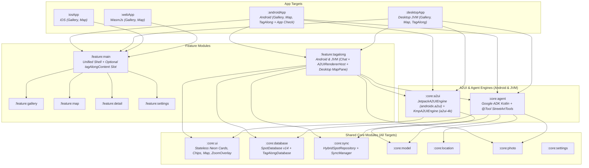
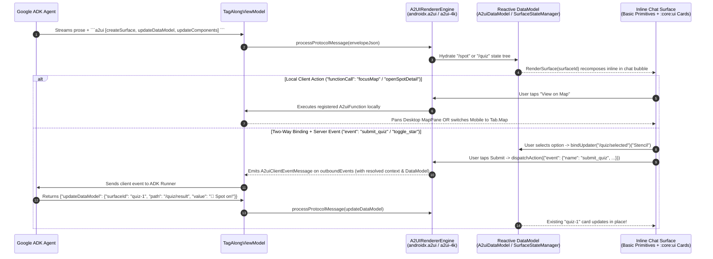
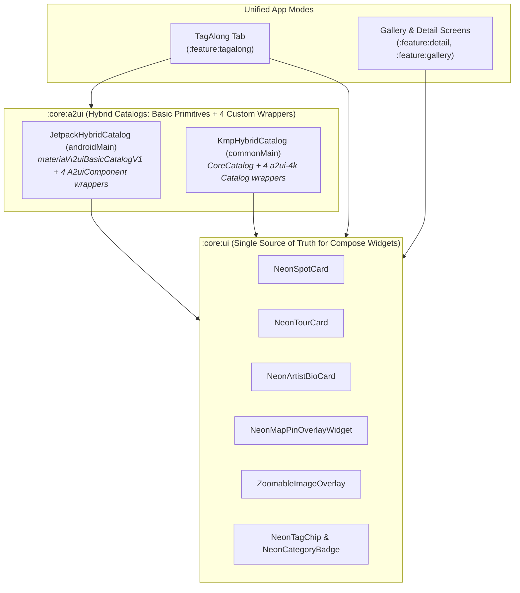
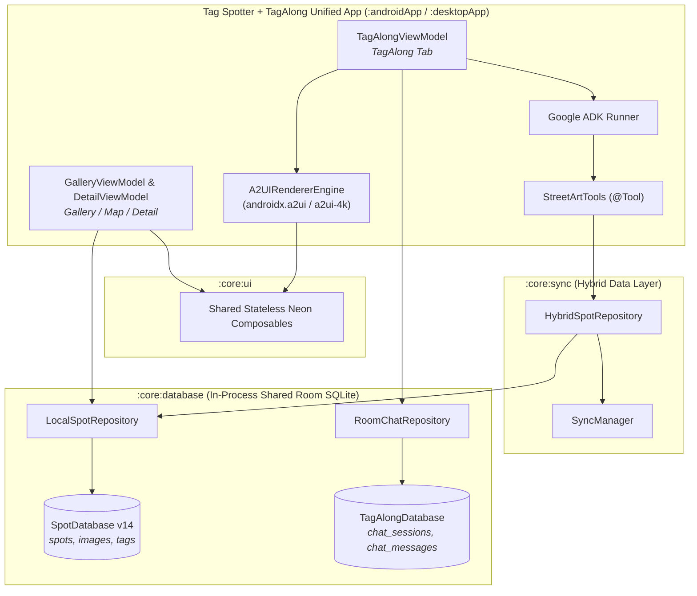

# Phase 4 and Beyond: Single-App Consolidation, Real A2UI Libraries & Test Plan

> **Document:** `docs/a2ui-phase-4-and-more.md`  
> **Master Intent Document:** [a2ui-kmp-intent-document.md](file:///Users/maia/workspace/maiatoday/tag-spotter/docs/a2ui-kmp-intent-document.md)  
> **Task Tracker:** [tagalong-task-tracker.md](file:///Users/maia/workspace/maiatoday/tag-spotter/docs/tagalong-task-tracker.md)  
> **ADK Runtime Guide:** [tagalong-adk-runtime-guide.md](file:///Users/maia/workspace/maiatoday/tag-spotter/docs/tagalong-adk-runtime-guide.md)  
> **Cross-Platform QA Plan:** [tagalong-qa-plan.md](file:///Users/maia/workspace/maiatoday/tag-spotter/docs/tagalong-qa-plan.md)  
> **Date:** 2026-11-21 (Updated post-implementation audit)  
> **Workspace:** `/Users/maia/workspace/maiatoday/tag-spotter`

---

## 📑 Table of Contents

1. [Executive Summary & Resolved Design Decisions](#1-executive-summary--resolved-design-decisions)
2. [Single-App Architecture & In-App Mode Switching](#2-single-app-architecture--in-app-mode-switching)
   - [2.1 Why Retire `:tagalongApp:android` and `:tagalongApp:desktop`?](#21-why-retire-tagalongappandroid-and-tagalongappdesktop)
   - [2.2 Target Module Graph (Single App Shell)](#22-target-module-graph-single-app-shell)
   - [2.3 KMP-Safe In-App Switching via Composable Slot (`:feature:main`)](#23-kmp-safe-in-app-switching-via-composable-slot-featuremain)
   - [2.4 Desktop vs. Mobile Map Layout & Android App Shortcut](#24-desktop-vs-mobile-map-layout--android-app-shortcut)
3. [Side-by-Side A2UI Library Architecture (`androidx.a2ui` vs `a2ui-4k`)](#3-side-by-side-a2ui-library-architecture-androidxa2ui-vs-a2ui-4k)
   - [3.1 Eliminating the Hand-Rolled Parser & Router](#31-eliminating-the-hand-rolled-parser--router)
   - [3.2 Head-to-Head Library Comparison Matrix (Blog Post Reference)](#32-head-to-head-library-comparison-matrix-blog-post-reference)
   - [3.3 Topic 1: Hybrid Catalog (Basic Primitives + 4 Custom Domain Cards) & `toJsonSchemaString()`](#33-topic-1-hybrid-catalog-basic-primitives--4-custom-domain-cards--tojsonschemastring)
   - [3.4 Topic 2: Inline Surface Render Loop, `updateDataModel` & Native `functionCall` vs `event` Routing](#34-topic-2-inline-surface-render-loop-updatedatamodel--native-functioncall-vs-event-routing)
   - [3.5 Unified `A2UIRendererEngine` Contract & 2-State Toggle](#35-unified-a2uirendererengine-contract--2-state-toggle)
4. [UI Component Reuse & Design System Unification (`:core:ui`)](#4-ui-component-reuse--design-system-unification-coreui)
   - [4.1 Shared Stateless Compose Widgets Across Engines and Modes](#41-shared-stateless-compose-widgets-across-engines-and-modes)
   - [4.2 Component Inventory & Sharing Matrix](#42-component-inventory--sharing-matrix)
   - [4.3 Bi-directional Reuse (`DetailScreen` Using Shared Cards)](#43-bi-directional-reuse-detailscreen-using-shared-cards)
5. [Data Access, Auth & Persistence in the Unified App](#5-data-access-auth--persistence-in-the-unified-app)
   - [5.1 Shared Local Storage (`SpotDatabase` & `TagAlongDatabase`)](#51-shared-local-storage-spotdatabase--tagalongdatabase)
   - [5.2 Desktop JVM Database Path Fix (`JvmSpotDatabase.kt`)](#52-desktop-jvm-database-path-fix-jvmspotdatabasekt)
   - [5.3 Shared Firebase Auth, App Check & `HybridSpotRepository`](#53-shared-firebase-auth-app-check--hybridspotrepository)
   - [5.4 Complete End-to-End Data Flow Diagram](#54-complete-end-to-end-data-flow-diagram)
6. [TagAlong UX Features & Session Architecture](#6-tagalong-ux-features--session-architecture)
   - [6.1 Light and Dark Mode Switching](#61-light-and-dark-mode-switching)
   - [6.2 "New Conversation" Lifecycle](#62-new-conversation-lifecycle)
   - [6.3 Conversation History Plan & Multi-Session Surface Replay](#63-conversation-history-plan--multi-session-surface-replay)
7. [Multimodal Photo Bytes, Category Mapping & 1-Tap Spot Creation](#7-multimodal-photo-bytes-category-mapping--1-tap-spot-creation)
   - [7.1 Fixing the Phase 3 Multimodal Photo Bug (Sending Real Image Bytes)](#71-fixing-the-phase-3-multimodal-photo-bug-sending-real-image-bytes)
   - [7.2 Category vs. Style Tags Alignment (`Spot.CATEGORIES`)](#72-category-vs-style-tags-alignment-spotcategories)
   - [7.3 Complete 1-Tap Agentic Spot Creation (`@Tool saveNewSpot` + Missing-Field A2UI Form)](#73-complete-1-tap-agentic-spot-creation-tool-savenewspot--missing-field-a2ui-form)
8. [Library-Specific Runtime Contracts & Integration Gotchas](#8-library-specific-runtime-contracts--integration-gotchas)
   - [8.1 Google ADK Kotlin (`0.2.0`): `staticInstruction`, Event Stream Filtering & Session Continuity](#81-google-adk-kotlin-020-staticinstruction-event-stream-filtering--session-continuity)
   - [8.2 Platform Model Provisioning (`gemini-4-hydrogen`), Desktop API Key & Settings Fallback](#82-platform-model-provisioning-gemini-4-hydrogen-desktop-api-key--settings-fallback)
   - [8.3 `androidx.a2ui` (`1.0.0-alpha02`) vs `a2ui-4k` (`0.10.0`) Schema & Action Parity](#83-androidxa2ui-100-alpha02-vs-a2ui-4k-0100-schema--action-parity)
   - [8.4 Inline Surface Navigation Bridge (`uuid` → `Spot.id: Long`), Single Room DB & Android Media Permissions](#84-inline-surface-navigation-bridge-uuid--spotid-long-single-room-db--android-media-permissions)
9. [Manual Configuration & Developer Action Prompts (`[PROMPT USER]` Gates)](#9-manual-configuration--developer-action-prompts-prompt-user-gates)
10. [Phase 4 Implementation Roadmap & Remediation Steps](#10-phase-4-implementation-roadmap--remediation-steps)
    - [Step 4.1: Retire `:tagalongApp:*` & Integrate TagAlong Tab into `:androidApp` & `:desktopApp`](#step-41-retire-tagalongapp--integrate-tagalong-tab-into-androidapp--desktopapp)
    - [Step 4.2: Shared UI Primitives & Stateless Card Consolidation (`:core:ui`)](#step-42-shared-ui-primitives--stateless-card-consolidation-coreui)
    - [Step 4.3: Replace Hand-Rolled A2UI with Hybrid `androidx.a2ui` & `a2ui-4k` Engines (`:core:a2ui`)](#step-43-replace-hand-rolled-a2ui-with-hybrid-androidxa2ui--a2ui-4k-engines-corea2ui)
    - [Step 4.4: Wire Agent Prompts to `toJsonSchemaString()`, Fix Photo Bytes & Connect Render Loop](#step-44-wire-agent-prompts-to-tojsonschemastring-fix-photo-bytes--connect-render-loop)
    - [Step 4.5: Theme Switching, Markdown Formatting, New Conversation Controls & Desktop DB Persistence Fix](#step-45-theme-switching-markdown-formatting-new-conversation-controls--desktop-db-persistence-fix)
    - [Step 4.6: 1-Tap Agentic Spot Saving, Navigation Bridge (`uuid` → `Long`), Permissions & DataModel Actions](#step-46-1-tap-agentic-spot-saving-navigation-bridge-uuid--long-permissions--datamodel-actions)
    - [Step 4.7: Conversation History Drawer / Sheet & ADK Session Continuity](#step-47-conversation-history-drawer--sheet--adk-session-continuity)
    - [Step 4.8: Full Monorepo Regression Gate](#step-48-full-monorepo-regression-gate)
11. [Future Phases Horizon (Phase 5+)](#11-future-phases-horizon-phase-5)
12. [Comprehensive Test Plan](#12-comprehensive-test-plan)
13. [Clean Context Handoff & Execution Prompt](#13-clean-context-handoff--execution-prompt)

---

## 1. Executive Summary & Resolved Design Decisions

Through our Phase 4 design review, we locked in **9 concrete architectural decisions**:

| # | Decision Area | Locked-In Design Choice |
| :-: | :--- | :--- |
| **1** | **App Consolidation** | Retire `:tagalongApp:android` and `:tagalongApp:desktop`. Embed `:feature:tagalong` directly into **`:androidApp`** and **`:desktopApp`** via an in-app `Tab.TagAlong` (using a KMP-safe composable slot in `:feature:main`) + a static Android App Shortcut (`res/xml/shortcuts.xml`). Shares one `SpotDatabase`, photo directory, and Firebase App Check setup. |
| **2** | **No Hand-Rolled A2UI** | Delete `A2UIPayloadParser.kt`, `A2UIComponents.kt`, and the manual `when` router in `NeonA2UICatalog.kt`. Implement official Jetpack **`androidx.a2ui` (`1.0.0-alpha02`)** in `androidMain` and KMP **`com.contextable:a2ui-4k` (`0.10.0`)** in `commonMain`. |
| **3** | **Protocol Emission** | Match Jetpack `androidx.a2ui`'s canonical design: inject `catalog.toJsonSchemaString()` into the system prompt so the agent emits standard A2UI v0.9 JSON envelopes (`createSurface`, `updateDataModel`, `updateComponents`) parsed by `A2uiJsonMessageParser` / `SurfaceStateManager`. |
| **4** | **Hybrid Catalog Strategy** | Combine **4 Custom Domain Components** (`SpotCard`, `TourCard`, `ArtistBioCard`, `MapPinOverlayWidget` backed by stateless composables in `:core:ui`) with the **Built-in Basic Catalog Primitives** (`materialA2uiBasicCatalogV1` / `CoreCatalog`: `Card`, `Column`, `Row`, `Text`, `Button`, `CheckBox`, `ChoicePicker`, `TextField`). Interactive quizzes, community voting, and missing-field forms are composed from Basic Catalog primitives + two-way data bindings. |
| **5** | **Inline Surface Rendering** | Render A2UI surfaces **inline inside the chat stream**, keyed by `surfaceId`. Subsequent `updateDataModel(surfaceId, ...)` messages or local two-way bindings mutate the existing surface in place without duplicating cards. |
| **6** | **Native Action Routing (`functionCall` vs `event`)** | Use A2UI v0.9's built-in `Action` split (`A2uiActionSchema`):<br>• **`functionCall`**: Executed locally on the client via `A2uiCatalog.functions` (`focusMap`, `openSpotDetail`).<br>• **`event`**: Emitted via `processor.outboundEvents` (`A2uiClientEventMessage` with `clientDataModel`) to the ADK `Runner` or handled by `TagAlongViewModel` for `SpotRepository` updates. |
| **7** | **Engine Switcher** | Simple **2-State Toggle (`ANDROIDX_JETPACK_OFFICIAL` ↔ `A2UI_KMP_4K`)** in the TagAlong top bar on Android, replaying the active session's A2UI v0.9 envelopes when toggled. |
| **8** | **Real Multimodal Bytes, 1-Tap Save & `Spot.CATEGORIES`** | • Fix Phase 3's bug that sent `"User attached photo URI: ..."` as text—pass real compressed image bytes (`Blob` / `inlineData`) via `:core:photo`.<br>• Support 1-tap direct save (`@Tool saveNewSpot` / `save_spot` event) once all required `Spot` fields are gathered (via EXIF + GPS + Gemini vision, or a Basic Catalog `TextField` form card if info is missing).<br>• Keep `spot.category` strictly within `Spot.CATEGORIES` (`"graffiti"`, `"sculpture"`, `"nature"`, `"architecture"`, `"public_place"`, `"food"`) and put street-art styles (`"mural"`, `"stencil"`, `"sticker"`, `"paste-up"`) in `spot.tags`. |
| **9** | **Map Layout (Desktop vs. Mobile)** | • **Desktop (`>= 760.dp`):** 2-pane split (Chat + A2UI left, live synchronized `SpotMapView` right).<br>• **Mobile (`< 760.dp`):** Remove the redundant inner `"Live Map"` sub-tab inside `TagAlongScreen`; render single-column Chat + A2UI, and when the user triggers *"View on Map"*, switch `MainContainer` to the main `Map` tab centered on that spot. |

---

## 2. Single-App Architecture & In-App Mode Switching

### 2.1 Why Retire `:tagalongApp:android` and `:tagalongApp:desktop`?

| Concern | Separate Apps (`:tagalongApp:*`) | Unified App with In-App Mode Switching (`:androidApp` & `:desktopApp`) |
| :--- | :--- | :--- |
| **Local `SpotDatabase` Access** | ❌ Isolated by Android OS sandbox; TagAlong cannot read/write Tag Spotter's local SQLite DB. | ✅ **Single shared `SpotDatabase` instance** injected by Koin in the same process. |
| **Local Photo Files** | ❌ Locked inside Tag Spotter's private `filesDir`. | ✅ Directly readable by Coil, `PhotoProcessor`, and Gemini multimodal prompts. |
| **Firebase App Check & Auth** | ⚠️ Requires registering a second Android package, second debug token, and duplicate sign-in. | ✅ Reuses `:androidApp`'s existing `google-services.json`, App Check attestation, and Google Sign-In session. |
| **Spot Detail & Map Navigation** | ⚠️ Requires cross-app `Intent` / URI deep-link handoff. | ✅ Direct in-process navigation (`backStack.add(DetailKey(spotId))` and switching to `Tab.Map`). |

---

### 2.2 Target Module Graph (Single App Shell)



---

### 2.3 KMP-Safe In-App Switching via Composable Slot (`:feature:main`)

Because [feature/main/build.gradle.kts](file:///Users/maia/workspace/maiatoday/tag-spotter/feature/main/build.gradle.kts) compiles for `android`, `jvm`, `ios*`, and `wasmJs`, while `:feature:tagalong` targets `android` and `jvm` (matching `google/adk-kotlin`), `:feature:main` (`commonMain`) does **not** depend on `:feature:tagalong` at the Gradle level.

Instead, `MainNavigation` and `MainContainer` expose an optional composable slot:

```kotlin
// In :feature:main (commonMain)
enum class Tab {
    Gallery,
    Map,
    TagAlong // Shown in NavigationBar and NavigationRail when tagAlongContent != null
}

@Composable
fun MainNavigation(
    initialSpotId: Long? = null,
    initialTab: Tab = Tab.Gallery,
    onNavigateToSpotHandled: () -> Unit = {},
    onTriggerFiles: (onPhotoPicked: (String) -> Unit) -> Unit,
    versionName: String,
    showToast: (String) -> Unit,
    onGoogleSignInClick: (() -> Unit)? = null,
    tagAlongContent: (@Composable (
        onOpenSpotDetail: (Long) -> Unit,
        onViewOnMainMap: (Double, Double) -> Unit
    ) -> Unit)? = null
)
```

- **On `:androidApp` and `:desktopApp`:** They pass `tagAlongContent = { onOpenSpotDetail, onViewOnMainMap -> TagAlongScreen(...) }`. Both the portrait `NavigationBar` and landscape/Desktop `NavigationRail` render the **TagAlong** tab (`Icons.Default.AutoAwesome`) right beside `Gallery` and `Map`.
- **On `iosApp` and `:webApp`:** `tagAlongContent` defaults to `null`, so only `Gallery` and `Map` are rendered and `iOS`/`wasmJs` builds require zero changes.

---

### 2.4 Desktop vs. Mobile Map Layout & Android App Shortcut

1. **Desktop / Wide Viewports (`maxWidth >= 760.dp`):**
   - `TagAlongScreen` renders its adaptive **2-pane split layout**:
     - **Left Pane (56%):** Conversational stream, inline A2UI surfaces, and multimodal input bar.
     - **Right Pane (44%):** Live synchronized `SpotMapView` showing active tour waypoints and spot markers.
2. **Mobile / Compact Viewports (`maxWidth < 760.dp`):**
   - Removes the redundant inner `"Live Map"` `TabRow` that existed in Phase 3.
   - Renders a clean, full-height single-column Chat + inline A2UI stream (including inline `MapPinOverlayWidget` mini-map cards).
   - When a user taps *"View on Map"* on a card on mobile, `onViewOnMainMap(lat, lon)` switches `MainContainer`'s `selectedTab` to `Tab.Map` centered on those coordinates.
3. **Android Static App Shortcut (`res/xml/shortcuts.xml`):**
   - Declares a static shortcut for **"TagAlong AI Guide"** targeting `tagspotter://tagalong` (`initialTab = Tab.TagAlong`). Users can long-press the Tag Spotter icon or pin TagAlong as a standalone shortcut icon on their home screen.

---

## 3. Side-by-Side A2UI Library Architecture (`androidx.a2ui` vs `a2ui-4k`)

### 3.1 Eliminating the Hand-Rolled Parser & Router

The following hand-rolled files in `:core:a2ui` will be **deleted**:
- ❌ `core/a2ui/src/commonMain/.../parser/A2UIPayloadParser.kt`
- ❌ `core/a2ui/src/commonMain/.../model/A2UIComponents.kt`
- ❌ `core/a2ui/src/commonMain/.../catalog/NeonA2UICatalog.kt`
- ❌ Hardcoded JSON schema strings in `TagAlongPrompts.kt`

---

### 3.2 Head-to-Head Library Comparison Matrix (Blog Post Reference)

| Dimension | Official Jetpack `androidx.a2ui` (`1.0.0-alpha02`) | KMP `Contextable/a2ui-4k` (`0.10.0`) |
| :--- | :--- | :--- |
| **Maven Artifacts** | `androidx.a2ui:a2ui-model`<br>`androidx.a2ui:a2ui-engine`<br>`androidx.a2ui.compose:compose-runtime`<br>`androidx.a2ui.compose:compose-ui`<br>`androidx.compose.material3:material3-a2ui` | `com.contextable:a2ui-4k` |
| **Supported Targets** | **Android Only** (`.aar` packages) | **Kotlin Multiplatform** (`android`, `jvm`, `ios*`, `wasmJs`) |
| **Protocol Version** | A2UI v0.9 (`createSurface`, `updateComponents`, `updateDataModel`, `deleteSurface`) | A2UI v0.9 (with transparent v0.8 transcoding) |
| **Built-In Basic Catalog** | `materialA2uiBasicCatalogV1(...)` (`Text`, `Image`, `Icon`, `Row`, `Column`, `List`, `Card`, `Tabs`, `Modal`, `Divider`, `Button`, `TextField`, `CheckBox`, `ChoicePicker`, `Slider`, `DateTimeInput`) | `CoreCatalog` (`Text`, `Image`, `Row`, `Column`, `Card`, `Button`, `TextField`, `CheckBox`, `ChoicePicker`, etc.) |
| **Custom Component API** | Implement `A2uiComponent` (`name`, `description`, `properties: List<A2uiProperty<*>>`, `@Composable fun A2uiComponentScope.Content(...)`) | Register custom widget renderer in a `Catalog` extending `CoreCatalog` |
| **Catalog Schema Generation** | **`catalog.toJsonSchemaString()`** via `A2uiCoreCatalogSerializer` (JSON Schema Draft 2020-12) | Catalog schema serializer / `A2UiRenderTool.parameters` |
| **Render Loop Engine** | **`A2uiMessageProcessor(catalogs)`** running `suspend fun collectMessages()` | **`SurfaceStateManager()`** processing inbound `JsonElement` messages via `processMessage(...)` |
| **Surface Host Composable** | **`A2uiSurface(surfaceModel, modifier, loadingContent, errorContent, transitionSpec)`** | **`A2UISurface(manager, surfaceId, catalog, onEvent)`** |
| **Reactive Data Model** | `A2uiDataModel` backed by Compose `SnapshotStateMap` & `SnapshotStateSparseList` | Path-based JSON Pointer reactive state store inside `SurfaceStateManager` |
| **1-Way & 2-Way Data Binding** | `properties.bind(DynamicA2uiProperty)` (read) and **`properties.bindUpdater(DynamicA2uiProperty)`** (write lambda `(T?) -> Unit`) | JSON Pointer `{ "path": "/..." }` resolution + `DataChangeEvent` |
| **Action Routing (`functionCall` vs `event`)** | • **`functionCall`**: Executed locally via `A2uiCatalog.functions`<br>• **`event`**: Emits `A2uiClientEventMessage` (with `clientDataModel`) to `processor.outboundEvents` | `onEvent` callback receives interaction events; `event.toClientMessage(version = "v0.9")` formats wire message |

---

### 3.3 Topic 1: Hybrid Catalog (Basic Primitives + 4 Custom Domain Cards) & `toJsonSchemaString()`

To showcase both **built-in A2UI primitives** (recursive child composition + two-way form bindings) and **custom domain components** in the blog post, our catalog uses a **Hybrid Catalog Strategy**:

1. **Built-In Basic Catalog Primitives (`materialA2uiBasicCatalogV1` / `CoreCatalog`):**
   - `Card`, `Column`, `Row`, `Text`, `Image`, `Divider`, `Button`, `CheckBox`, `ChoicePicker`, `TextField`.
   - Used by the agent to compose:
     - **Interactive Style Quizzes** (`Card` -> `Column` -> question `Text`, `ChoicePicker` bound to `/quiz/selectedAnswer`, and `Button` dispatching `{"event": {"name": "submit_quiz"}}`).
     - **Community Voting Cards** (`Card` -> `Column` -> option `Button`s / `ChoicePicker` bound to `/vote/selection`).
     - **Missing-Metadata Spot Forms** (`Card` -> `Column` -> `TextField`s bound to `/draft/description`, `/draft/artist`, and a Save `Button`).
2. **4 Custom Domain Components (Backed by Shared `:core:ui` Stateless Composables):**
   - **`SpotCard`**: Renders `NeonSpotCard` from `:core:ui` with two-way star binding (`isStarred`: `{"path": "/spots/{id}/isStarred"}`).
   - **`TourCard`**: Renders `NeonTourCard` from `:core:ui` with interactive waypoint list and route summary.
   - **`ArtistBioCard`**: Renders `NeonArtistBioCard` from `:core:ui` with style chips and notable works.
   - **`MapPinOverlay`**: Renders `NeonMapPinOverlayWidget` from `:core:ui` with embedded mini-map pins.
3. **Custom Client-Side `A2uiFunction`s Registered in the Catalog:**
   - **`focusMap(latitude, longitude, title)`**: Local `functionCall` that pans the Desktop `MapPane` or switches Mobile to `Tab.Map` without round-tripping to the server.
   - **`openSpotDetail(spotId)`**: Local `functionCall` that navigates directly to `DetailScreen(spotId)`.

```kotlin
// core/a2ui/src/androidMain/kotlin/net/maiatoday/tagspotter/core/a2ui/jetpack/JetpackNeonCatalog.kt
fun createJetpackHybridCatalog(
    context: Context,
    onFocusMap: (Double, Double, String) -> Unit,
    onOpenSpotDetail: (String) -> Unit
): A2uiCatalog {
    val basicM3Catalog = materialA2uiBasicCatalogV1(
        image = MaterialA2uiBasicCatalogV1Defaults.image { url, contentDesc, _, modifier, _ ->
            AsyncImage(model = url, contentDescription = contentDesc, modifier = modifier)
        },
        video = MaterialA2uiBasicCatalogV1Defaults.video { _, _, _ -> },
        audioPlayer = MaterialA2uiBasicCatalogV1Defaults.audioPlayer { _, _, _, _ -> },
        functions = A2uiBasicCatalogV1.Functions(context)
    )

    val customComponents = listOf(
        JetpackSpotCardComponent,
        JetpackTourCardComponent,
        JetpackArtistBioCardComponent,
        JetpackMapPinOverlayComponent
    )

    val customFunctions = listOf(
        FocusMapA2uiFunction(onFocusMap),
        OpenSpotDetailA2uiFunction(onOpenSpotDetail)
    )

    return A2uiCatalog(
        catalogId = "https://tagspotter.maiatoday.net/a2ui/neon_hybrid_catalog/v1/catalog.json",
        components = basicM3Catalog.components.toList() + customComponents,
        functions = basicM3Catalog.functions.toList() + customFunctions,
        isInline = true
    )
}
```

Calling **`hybridCatalog.toJsonSchemaString()`** automatically serializes all Basic Catalog primitives, all 4 custom Neon components, and all client functions into a single Draft 2020-12 JSON Schema string for the agent's system prompt!

---

### 3.4 Topic 2: Inline Surface Render Loop, `updateDataModel` & Native `functionCall` vs `event` Routing

#### A. Inline Surface Rendering by `surfaceId`
- Each `TagAlongMessage` in the chat stream stores `surfaceIds: List<String>` (extracted from any `createSurface` envelopes in that turn).
- Inside `ChatMessageItem`, for each `surfaceId`, we call `engine.RenderSurface(surfaceId = surfaceId)`.
- If a subsequent turn or user interaction sends `updateDataModel(surfaceId = "quiz-1", path = "/quiz/feedback", value = "Correct! Notice the multi-layer bridges.")`, `A2uiMessageProcessor` / `SurfaceStateManager` mutates `"quiz-1"`'s reactive data model and the existing card in the chat stream updates in place.

#### B. Native `functionCall` vs `event` Split (`A2uiActionSchema`)
In `androidx.a2ui` (`A2uiActionHandler.kt`), every component `Action` is a `oneOf`:
1. **Local Client Function (`{"functionCall": {"call": "focusMap", "args": {"lat": 52.49, "lon": 13.24, "title": "Teufelsberg"}}}`):**
   - Executed immediately on-device by `A2uiActionHandler` via `executionContext.executeFunction(...)`.
2. **Server/Agent Event (`{"event": {"name": "submit_quiz", "context": {"answer": {"path": "/quiz/selectedAnswer"}}}}`):**
   - `A2uiActionHandler` resolves the dynamic `{ "path": "/quiz/selectedAnswer" }` against the surface's `A2uiDataModel`, attaches `clientDataModel` (when `shouldSendDataModel = true`), and emits an `A2uiClientEventMessage` onto `processor.outboundEvents`.
   - `TagAlongViewModel` collects `engine.outboundEvents`:
     - For `toggle_star` and `save_spot`, it updates `SpotRepository` and confirms via `engine.updateDataModel(...)`.
     - For conversational events (`submit_quiz`, `cast_vote`, etc.) and validation errors (`A2uiClientErrorMessage`), it forwards the event JSON back to the Google ADK `Runner` so the agent responds or sends a delta `updateDataModel` message.



---

### 3.5 Unified `A2UIRendererEngine` Contract & 2-State Toggle

```kotlin
package net.maiatoday.tagspotter.core.a2ui

import androidx.compose.runtime.Composable
import androidx.compose.ui.Modifier
import kotlinx.coroutines.flow.Flow

interface A2UIRendererEngine {
    val engineType: A2UIEngineType

    /** Returns the JSON Schema (Draft 2020-12) describing all registered catalog components & functions. */
    fun getCatalogSchemaJson(): String

    /** Starts the engine's message collection loop (suspends while active; required by androidx.a2ui). */
    suspend fun runRenderLoop()

    /** Clears all active surfaces (called when starting a New Conversation or switching sessions). */
    fun clearSurfaces()

    /** Feeds an inbound A2UI v0.9 JSON message or array of messages, returning any created/updated surfaceIds. */
    fun processProtocolMessage(json: String): List<String>

    /** Mutates a JSON Pointer path in the surface's reactive data model directly. */
    fun updateDataModel(surfaceId: String, path: String, value: Any?)

    /** Outbound stream of client events and validation errors emitted by the engine. */
    val outboundEvents: Flow<A2UIClientEvent>

    /** Renders the active A2UI surface for [surfaceId] inline in the chat list. */
    @Composable
    fun RenderSurface(
        surfaceId: String,
        modifier: Modifier = Modifier
    )
}

enum class A2UIEngineType {
    A2UI_KMP_4K,
    ANDROIDX_JETPACK_OFFICIAL
}
```

- **2-State Engine Toggle on Android:** Tapping the engine badge in the TagAlong header switches between `ANDROIDX_JETPACK_OFFICIAL` and `A2UI_KMP_4K`, calling `clearSurfaces()` and replaying the current session's stored `a2uiPayloadJson` messages into the active engine.

---

## 4. UI Component Reuse & Design System Unification (`:core:ui`)

### 4.1 Shared Stateless Compose Widgets Across Engines and Modes

All visual domain components are written once in `:core:ui` as pure, stateless `@Composable` functions using our Neon design system tokens:



### 4.2 Component Inventory & Sharing Matrix

| UI Component | Location | How It Is Rendered in TagAlong | Reused in Tag Spotter (`Gallery` / `Detail`)? |
| :--- | :--- | :--- | :---: |
| **`NeonSpotCard`** | `:core:ui` | Custom `SpotCard` component in both A2UI catalogs wrapping `NeonSpotCard` | ✅ Yes |
| **`NeonTourCard`** | `:core:ui` | Custom `TourCard` component in both A2UI catalogs wrapping `NeonTourCard` | ✅ Yes |
| **`NeonArtistBioCard`** | `:core:ui` | Custom `ArtistBioCard` component in both A2UI catalogs wrapping `NeonArtistBioCard` | ✅ Yes (`DetailScreen`) |
| **`NeonMapPinOverlayWidget`** | `:core:ui` | Custom `MapPinOverlay` component in both A2UI catalogs wrapping `NeonMapPinOverlayWidget` | ✅ Yes (unifies `DetailMiniMapCard`) |
| **Style Quiz & Community Voting** | Built-in A2UI Basic Catalog | Composed dynamically by the agent using `Card`, `Column`, `Row`, `Text`, `ChoicePicker`, `CheckBox`, `Button` from `materialA2uiBasicCatalogV1` / `CoreCatalog` | ➖ N/A (Dynamic A2UI) |
| **`ZoomableImageOverlay`** | `:core:ui` | Used for full-screen pinch-to-zoom on chat & card images | ✅ Yes (`DetailScreen`) |
| **`NeonTagChip` & `NeonCategoryBadge`** | `:core:ui` | Used inside `NeonSpotCard`, `NeonArtistBioCard`, and `NeonTourCard` | ✅ Yes (`GalleryScreen`, `DetailMetadataCard`) |

---

## 5. Data Access, Auth & Persistence in the Unified App

### 5.1 Shared Local Storage (`SpotDatabase` & `TagAlongDatabase`)
- **`SpotDatabase` (`SpotDao.kt`):** Single in-process SQLite database (`spot_database`). Every spot captured in Tag Spotter or imported from `.zip` packs is immediately available to TagAlong's `StreetArtTools`.
- **`TagAlongDatabase` (`ChatDao.kt`):** Stores `chat_sessions` and `chat_messages` (including the A2UI v0.9 JSON envelopes per turn).

### 5.2 Desktop JVM Database Path Fix (`JvmSpotDatabase.kt`)
- Update [JvmSpotDatabase.kt](file:///Users/maia/workspace/maiatoday/tag-spotter/core/database/src/jvmMain/kotlin/net/maiatoday/tagspotter/core/database/JvmSpotDatabase.kt#L11) to store `spot_database.db` and `tagalong_database.db` in `File(System.getProperty("user.home"), ".tagspotter/")` (creating the directory if needed) instead of `java.io.tmpdir` (`/tmp`), so data persists across OS reboots.

### 5.3 Shared Firebase Auth, App Check & `HybridSpotRepository`
- `:androidApp` already configures Firebase and App Check in `TagSpotterApplication.kt`. Both `:core:ai` and `:core:agent` share this attestation automatically.
- `HybridSpotRepository` merges local `SpotRepository` records with Firestore `/public_spots/{uuid}`, deduplicating by `uuid` and prioritizing local image paths.

### 5.4 Complete End-to-End Data Flow Diagram



---

## 6. TagAlong UX Features & Session Architecture

### 6.1 Light and Dark Mode Switching
- Add `ThemeMode { SYSTEM, LIGHT, DARK }` in `:core:settings` and a theme toggle control in the top bar / settings, switching `MyApplicationTheme` between `UrbanDarkColorScheme` and `UrbanLightColorScheme`.

### 6.2 "New Conversation" Lifecycle
- Add a `+` ("New Chat") button in the TagAlong header calling `TagAlongViewModel.startNewConversation()`.
- Calls `engine.clearSurfaces()`, inserts a new `ChatSession` in `TagAlongDatabase`, and posts a fresh welcome message while preserving past sessions in SQLite.

### 6.3 Conversation History Plan & Multi-Session Surface Replay
- Expose `allSessions: StateFlow<List<ChatSession>>` in `TagAlongViewModel`.
- Provide a History Sheet/Drawer in `TagAlongScreen` to switch between past sessions (`switchSession(sessionId)` clears the engine and replays all `a2uiPayloadJson` envelopes from that session's messages into the active `A2UIRendererEngine`) or delete sessions (`deleteSessionById(sessionId)`).

---

## 7. Multimodal Photo Bytes, Category Mapping & 1-Tap Spot Creation

### 7.1 Fixing the Phase 3 Multimodal Photo Bug (Sending Real Image Bytes)
In Phase 3, `TagAlongViewModel.kt` sent `"User attached photo URI: $currentPhoto"` as plain text instead of image bytes.
- **Fix in Phase 4:** When `photoUri` is attached, use `:core:photo` (`PhotoProcessor`) to read/compress the image into a `ByteArray` and pass a real binary image `Part` (`Part.fromBytes(bytes, "image/jpeg")` / `InlineData`) into `runner.runAsync(...)` so Gemini Vision analyzes the actual mural photo.

### 7.2 Category vs. Style Tags Alignment (`Spot.CATEGORIES`)
To ensure 100% compatibility with Tag Spotter's Gallery and Map filters ([Spot.kt](file:///Users/maia/workspace/maiatoday/tag-spotter/core/model/src/commonMain/kotlin/net/maiatoday/tagspotter/core/model/Spot.kt#L29)):
- **`spot.category`** is strictly constrained to `Spot.CATEGORIES`:
  `["graffiti", "sculpture", "nature", "architecture", "public_place", "food"]` (street art murals/tags default to `"graffiti"`, 3D installations to `"sculpture"`).
- **Street-art styles and techniques** (`"mural"`, `"stencil"`, `"sticker"`, `"paste-up"`, `"wildstyle"`, `"throw-up"`) are stored in **`spot.tags: List<String>`**.

### 7.3 Complete 1-Tap Agentic Spot Creation (`@Tool saveNewSpot` + Missing-Field A2UI Form)

When a user attaches a photo in TagAlong and asks to identify or save it:
1. **Automatic Metadata Extraction (`:core:photo` + `:core:location` + `:core:settings`):**
   - `PhotoProcessor.extractMetadataFromUri(photoUri)` extracts EXIF `latitude`, `longitude`, and `timestamp`.
   - If EXIF GPS is absent, `LocationProvider.getCurrentLocation()` provides fallback coordinates.
   - `PhotoProcessor.createThumbnailFromUri(photoUri)` generates the local `thumbnailPath`.
   - `SettingsRepository.photographerName` and `SpotRepository.activeUid` supply `photographer` and `ownerUid`.
2. **Gemini Vision Analysis:**
   - Identifies `description` (title/summary), `artists` (`List<String>`), `category` (from `Spot.CATEGORIES`, e.g. `"graffiti"`), and `tags` (including style tags like `"mural"`, `"stencil"`).
3. **Completeness Check (1-Tap Save vs. A2UI Form Card):**
   - **If all required fields (`imagePath`, `thumbnailPath`, valid `latitude`/`longitude`, `description`, `category`) are present:**
     - The agent renders a preview `SpotCard` (or calls `@Tool saveNewSpot`) allowing **1-tap direct save** into `SpotRepository.saveSpot(...)`, updating `/spot/isSaved` to `true` in the surface data model.
   - **If required fields are missing (e.g., no EXIF/device GPS or ambiguous details):**
     - The agent renders an interactive **A2UI Form Card** using Basic Catalog `TextField` and `ChoicePicker` primitives bound to `/draftSpot/*` paths so the user can fill in the missing field and tap `[Save Spot]`.

---

## 8. Library-Specific Runtime Contracts & Integration Gotchas

During Phase 4 integration across `google-adk-kotlin:0.2.0`, `androidx.a2ui:1.0.0-alpha02`, `com.contextable:a2ui-4k:0.10.0`, `com.google.firebase:firebase-ai`, `com.google.genai:google-genai`, Room, and Koin, we audited every runtime boundary and identified critical contracts required for the TagAlong chat interface to work reliably end-to-end:

### 8.1 Google ADK Kotlin (`0.2.0`): `staticInstruction`, Event Stream Filtering & Session Continuity
1. **Use `staticInstruction` (NEVER `instruction = Instruction(...)`) When Injecting JSON Schemas or Examples:**
   - In `google-adk-kotlin:0.2.0`, `InstructionsProcessor` passes `LlmAgent.instruction` through `InstructionStateInjector`, which parses **every `{...}` token** as a required session-state template variable and throws `IllegalArgumentException: Context variable not found` whenever JSON Schemas (`catalog.toJsonSchemaString()`) or A2UI JSON examples appear in the prompt.
   - **Mandatory Fix in [TagAlongAgentFactory.kt](file:///Users/maia/workspace/maiatoday/tag-spotter/core/agent/src/commonMain/kotlin/net/maiatoday/tagspotter/core/agent/TagAlongAgentFactory.kt):** Pass the system prompt via `staticInstruction = Content(parts = listOf(Part(text = systemInstruction)))` (which ADK sends verbatim with zero `{...}` interpolation), reserving `instruction` strictly for plain text or intentional `{var}` placeholders.
2. **Inject Live Catalog Schema & All 5 Tools into Both Platform Runners:**
   - Both [AndroidTagAlongAgent.kt](file:///Users/maia/workspace/maiatoday/tag-spotter/core/agent/src/androidMain/kotlin/net/maiatoday/tagspotter/core/agent/AndroidTagAlongAgent.kt) (`createAndroidTagAlongRunner`) and [DesktopTagAlongAgent.kt](file:///Users/maia/workspace/maiatoday/tag-spotter/core/agent/src/jvmMain/kotlin/net/maiatoday/tagspotter/core/agent/DesktopTagAlongAgent.kt) (`createDesktopTagAlongRunner`) must inject `catalogSchemaJson` (`createJetpackHybridCatalog().toJsonSchemaString()` on Android; `KmpA2UIEngine().getCatalogSchemaJson()` on Desktop) into `TagAlongPrompts.buildSystemInstruction(catalogSchemaJson = ...)`.
   - [TagAlongPrompts.kt](file:///Users/maia/workspace/maiatoday/tag-spotter/core/agent/src/commonMain/kotlin/net/maiatoday/tagspotter/core/agent/TagAlongPrompts.kt) must document all **5 `@Tool` functions** (`getNearbySpots`, `generateWalkingTour`, `getArtistBio`, `identifyMuralByPhoto`, **`saveNewSpot`**) plus explicit A2UI v0.9 envelope rules (`createSurface` → `updateDataModel` → `updateComponents` with `"id": "root"`, `"event"` vs `"functionCall"` actions, and missing-field `TextField`/`ChoicePicker` form composition).
3. **Filter Intermediate & Duplicate Events in `runner.runAsync(...)`:**
   - During multi-turn tool execution (`LlmAgentTurn`), `runner.runAsync(...)` emits intermediate `FunctionCall` turns, `FunctionResponse` events, partial streaming chunks (`event.partial == true`), and final aggregated turns.
   - In [TagAlongViewModel.kt](file:///Users/maia/workspace/maiatoday/tag-spotter/feature/tagalong/src/commonMain/kotlin/net/maiatoday/tagspotter/feature/tagalong/ui/TagAlongViewModel.kt), ignore function-call/response-only events and handle partial vs. non-partial final `Event`s cleanly so final aggregated responses never duplicate streamed prose or overwrite valid A2UI surfaces.
4. **Seed & Clean Up `InMemoryRunner` Sessions Across Restarts and History Switches:**
   - `InMemoryRunner` (`InMemorySessionService`) holds conversation state in RAM, while `TagAlongDatabase` (`ChatRepository`) persists sessions in SQLite.
   - When loading an existing session on app startup or calling `switchSession(targetSessionId)`, ensure the session exists in `runner.sessionService` and seed prior user/agent messages if the in-memory session is empty so follow-up questions retain context. On `deleteSession(sessionId)`, also delete the session from `runner.sessionService`.

### 8.2 Platform Model Provisioning (`gemini-4-hydrogen`), Desktop API Key & Settings Fallback
- **Default Model (`"gemini-4-hydrogen"`):** Configured in `TagAlongAgentFactory.DEFAULT_MODEL_NAME` (`:core:agent`) and `AndroidFirebaseAiService` (`:core:ai`).
  - **Android:** `com.google.adk.firebase.models.Firebase.create(modelName, FirebaseApp.ai)` backed by Firebase AI Logic + Firebase App Check (`DebugAppCheckProviderFactory` in debug, `PlayIntegrityAppCheckProviderFactory` in release).
  - **Desktop JVM:** `com.google.adk.kt.models.Gemini(client, name)` backed by `com.google.genai:google-genai:1.44.0`.
- **Desktop API Key Lookup & Live Settings Reload ([Main.kt](file:///Users/maia/workspace/maiatoday/tag-spotter/desktopApp/src/jvmMain/kotlin/net/maiatoday/tagspotter/desktop/Main.kt)):**
  - `./gradlew :desktopApp:run` executes with `workingDir = desktopApp/`, so `File("local.properties")` misses the root `local.properties`! `DesktopSecretsProvider` must check:
    1. `System.getenv("GEMINI_API_KEY")`
    2. `File("local.properties")` and **`File("../local.properties")`** (`gemini.api.key`)
    3. **`SettingsRepository.geminiApiKey`** (in-app Settings screen)
  - Furthermore, instead of skipping `single<Runner>` permanently at boot if the key is initially blank, provide a lazy/dynamic `Runner` resolver (or re-create `Runner` when `SettingsRepository.geminiApiKey` changes) so entering an API key in Settings activates TagAlong chat immediately without restarting the app.

### 8.3 `androidx.a2ui` (`1.0.0-alpha02`) vs `a2ui-4k` (`0.10.0`) Schema & Action Parity
1. **Fix `MapPinOverlay` Component Name & Aliases:**
   - Both `JetpackHybridCatalog` and `KmpHybridCatalog` register the map widget as `"MapPinOverlay"`, whereas `TagAlongMockFixtures.MAP_OVERLAY_JSON` used `"type": "MapPinOverlayWidget"` (causing an unknown-component fallback!). Update the fixture to `"MapPinOverlay"` and normalize `"MapPinOverlayWidget"` → `"MapPinOverlay"` in both `JetpackA2UIEngine` and `KmpA2UIEngine` so LLM variations render cleanly.
2. **Fix Basic Catalog `Button` / `ChoicePicker` / `Text` Schemas Across Both Engines:**
   - `QUIZ_SAMPLE_JSON` and `VOTING_SAMPLE_JSON` in [TagAlongMockFixtures.kt](file:///Users/maia/workspace/maiatoday/tag-spotter/feature/tagalong/src/commonMain/kotlin/net/maiatoday/tagspotter/feature/tagalong/fixtures/TagAlongMockFixtures.kt) used `"action": {"functionCall": {"call": "clientEvent", ...}}`, which is **not** a registered function in `androidx.a2ui`. Update them to canonical A2UI v0.9 server events:
     `"action": {"event": {"name": "answer_quiz", "context": {"quizId": "...", "selectedOption": {"path": "/selectedOption"}}}}`.
   - Normalize Basic Catalog property differences (`Text` `variant` casing, `ChoicePicker` `options` `{label, value}` vs `{id, label}`, and `Button` `action`) across `JetpackA2UIEngine` and `KmpA2UIEngine`, and test **all 6 valid mock fixtures** in both `KmpA2UIEngineTest` and `JetpackA2UIEngineTest` (Robolectric).
3. **Wire `onFocusMap` & `onOpenSpotDetail` in `JetpackA2UIEngine`:**
   - In [JetpackA2UIEngine.kt](file:///Users/maia/workspace/maiatoday/tag-spotter/core/a2ui/src/androidMain/kotlin/net/maiatoday/tagspotter/core/a2ui/engine/JetpackA2UIEngine.kt), pass `onFocusMap = { lat, lon, title -> emitAction(A2UIAction.ViewOnMap(lat, lon, title ?: "")) }` and `onOpenSpotDetail = { spotId -> emitAction(A2UIAction.OpenSpotDetail(spotId)) }` when constructing `createJetpackHybridCatalog(...)` so local `A2uiFunction` invocations are never silent no-ops.
4. **Add 1-Tap Save (`isSaved` / `onSaveSpot`) to `NeonSpotCard` & Both Catalog Wrappers:**
   - Add `isSaved: Boolean = false` and `onSaveSpot: (() -> Unit)? = null` to [NeonSpotCard.kt](file:///Users/maia/workspace/maiatoday/tag-spotter/core/ui/src/commonMain/kotlin/net/maiatoday/tagspotter/core/ui/components/NeonSpotCard.kt), and bind `{"path": "/spot/isSaved"}` + `save_spot` action dispatch in both `SpotCardA2uiComponent` (`JetpackHybridCatalog.kt`) and `spotCardItem` (`KmpHybridCatalog.kt`).

### 8.4 Inline Surface Navigation Bridge (`uuid` → `Spot.id: Long`), Single Room DB & Android Media Permissions
1. **Inline Surface Navigation Events Must Flow Through `TagAlongViewModel` (`uuid` → `Long` Fix):**
   - Inline surfaces render via `engine.RenderSurface(surfaceId)` and emit actions on `engine.outboundEvents` directly into `TagAlongViewModel.handleAction(action)`, bypassing `TagAlongScreenContent`'s `wrappedOnAction`.
   - Moreover, A2UI cards (`SpotCard`, `ArtistBioCard`) identify spots by `spotId: String` (**UUID** from `StreetArtTools`), whereas `MainNavigation`'s `DetailKey(spotId: Long)` requires the local Room primary key `Spot.id: Long` (`uuid.toLongOrNull()` always returns `null`!).
   - **Fix:** Expose `val navigationEvents: SharedFlow<TagAlongNavEvent>` from `TagAlongViewModel` (`OpenSpotDetail(spotId: Long)` after resolving `uuid` → `spot.id` via `HybridSpotRepository`, and `ViewOnMainMap(latitude, longitude)`). Collect `navigationEvents` in `TagAlongScreen` to trigger `onOpenSpotDetail(localId)` and (on mobile `< 760.dp`) `onViewOnMainMap(lat, lon)`.
2. **Eliminate Duplicate `SpotDatabase` Instance on Android ([TagSpotterApplication.kt](file:///Users/maia/workspace/maiatoday/tag-spotter/androidApp/src/main/java/net/maiatoday/tagspotter/TagSpotterApplication.kt)):**
   - `TagSpotterApplication` previously built a separate `Room.databaseBuilder` instance (`app.database` / `app.repository` used by `ImportPackWorker`) alongside Koin's `platformDatabaseModule` (`AndroidSpotDatabase.kt`). Two Room instances on the same SQLite file break Room's invalidation tracker and risk lock contention. Delegate `TagSpotterApplication.database` and `repository` to `GlobalContext.get().get()`.
3. **Preserve EXIF GPS on Android Photo Attachments (`ACCESS_MEDIA_LOCATION` in [MainActivity.kt](file:///Users/maia/workspace/maiatoday/tag-spotter/androidApp/src/main/java/net/maiatoday/tagspotter/feature/main/MainActivity.kt)):**
   - Android 10+ strips EXIF GPS coordinates from picked photos unless `Manifest.permission.ACCESS_MEDIA_LOCATION` is granted. Update `TagAlongScreen`'s `onPickPhoto` callback in `MainActivity.kt` to check/request `ACCESS_MEDIA_LOCATION` before launching `pickTagAlongMedia` (matching Tag Spotter's `triggerFiles`), and feed extracted EXIF GPS + fallback `LocationProvider.getCurrentLocation()` into both `StreetArtTools` and the user turn context.
4. **Theme-Aware Colors, IME/Keyboard Ergonomics, Chat Photo Thumbnails & Markdown Rendering:**
   - Replace hardcoded `DarkBackground`, `DarkPrimaryContainer`, `DarkSecondaryContainer`, and `DarkTertiaryContainer` in `TagAlongScreen.kt` and `:core:ui` Neon cards with `MaterialTheme.colorScheme` tokens so `ThemeMode.LIGHT` and `ThemeMode.DARK` both render legibly (including `useDarkMap` in `MapPane`), and parse inline Markdown (`**bold**`, `*italic*`, `` `code` ``) into `AnnotatedString` in `ChatMessageItem`.
   - Apply `imePadding()` to the chat input area (since `MainActivity` enables edge-to-edge and `MainContainer` passes `WindowInsets(0, 0, 0, 0)`) so Android's soft keyboard never covers the composer, and wire `KeyboardOptions(imeAction = ImeAction.Send)` + `KeyboardActions(onSend = ...)` / Desktop Enter-to-send.
   - Render attached chat photos in `ChatMessageItem` with `AsyncImage` (opening `ZoomableImageOverlay` on tap) instead of raw `content://` / `file://` URI strings.
5. **Desktop `RealPhotoProcessor` URI Decoding & Real JPEG Downscaling ([RealPhotoProcessor.kt](file:///Users/maia/workspace/maiatoday/tag-spotter/core/photo/src/jvmMain/kotlin/net/maiatoday/tagspotter/core/photo/RealPhotoProcessor.kt)):**
   - Desktop's `FileDialog` passes `selectedFile.toURI().toString()` (URL-encoded, e.g. `file:/.../My%20Photo.png`), while `RealPhotoProcessor.cleanUriPath` currently only strips `file://`/`file:` without URL-decoding (`File(URI(uriString))`), breaking any file path containing spaces.
   - `RealPhotoProcessor.decodeScaledBitmap(..., maxDimension = 1024)` currently returns raw unscaled file bytes even for `.png`/`.webp` or multi-megabyte photos while `TagAlongViewModel` labels the ADK `Blob` as `image/jpeg`. Use `ImageIO` / `BufferedImage` to resize to `<= 1024px` and encode as JPEG so Desktop multimodal uploads always match `image/jpeg` and stay compact.

---

## 9. Manual Configuration & Developer Action Prompts (`[PROMPT USER]` Gates)

> [!IMPORTANT]
> **Agent Execution Rule:** Whenever an AI agent or developer works through Phase 4 verification or live testing, **DO NOT** guess, fabricate credentials, bypass security rules, or silently leave live features broken. Check for the configuration prerequisites below (inspecting **only key names**, never printing secret values, and **never committing API keys or `local.properties` to git**), and **explicitly prompt the user** at each `[PROMPT USER]` gate!

### Current Workspace Configuration Status (Audited 2026-11-21)

| Config Item | Location | Current Status | Needed For |
| :--- | :--- | :---: | :--- |
| `androidApp/google-services.json` | `:androidApp` | ✅ Present | Firebase initialization on Android |
| `firebase.api.key`, `firebase.project.id`, `firebase.storage.bucket` | Root `local.properties` | ✅ Present | Desktop JVM Firestore/Storage REST sync |
| `firestore.rules` & `storage.rules` (`/public_spots` rules) | Repo root | 🟡 Authored locally (verify deployed) | Community `/public_spots` read/write in Cloud Firestore & Storage |
| **`gemini.api.key`** (or `GEMINI_API_KEY` env var / in-app Settings key) | Root `local.properties` / Settings UI | ❌ **Missing in `local.properties`** | **Desktop JVM (`:desktopApp`) live TagAlong chat** (`google-genai` SDK) |
| **`firebase.appcheck.debug_token`** + Firebase Console registration | Root `local.properties` + Firebase Console | ❌ **Missing in `local.properties`** | **Android debug (`:androidApp`) live TagAlong chat** (`firebase-ai` + App Check) |
| **Firebase AI Logic API & `gemini-4-hydrogen` Model Availability** | Firebase Console | ⚠️ **Manual Console Check** | Android `Firebase.ai` generative calls |

---

### Mandatory `[PROMPT USER]` Checklist

1. **`[PROMPT USER — Gate M1: Desktop Gemini API Key]`**
   - **When to prompt:** Before running live agent tests on `:desktopApp` (`./gradlew :desktopApp:run`), check `cut -d= -f1 local.properties` for `gemini.api.key` or `GEMINI_API_KEY` in env.
   - **What to ask the user:**
     > *"To enable live Gemini responses in Desktop TagAlong (instead of Offline Mode), please either:*
     > *1. Add `gemini.api.key=YOUR_GEMINI_API_KEY` to your root `local.properties` (gitignored — never committed), **or***
     > *2. Paste your Gemini API key into **Settings → Gemini API Key** inside the Desktop app.*
     > *Let me know once it's set (or tell me if you prefer to test Offline/Mock A2UI mode only)."*

2. **`[PROMPT USER — Gate M2: Firebase Console AI Logic & Model Check]`**
   - **When to prompt:** Before testing live chat on `:androidApp` or if `Firebase.ai` returns an API-not-enabled / model-not-found error.
   - **What to ask the user:**
     > *"Please confirm in the [Firebase Console](https://console.firebase.google.com/) for your Tag Spotter project that:*
     > *1. **Firebase AI Logic** (Gemini Developer API / Vertex AI in Firebase) is enabled.*
     > *2. Your project/region has access to the configured model (`gemini-4-hydrogen`). If you need a different model ID (e.g. for your current tier/region), tell me which model ID to set in `TagAlongAgentFactory.DEFAULT_MODEL_NAME`."*

3. **`[PROMPT USER — Gate M3: Android Firebase App Check Debug Token]`**
   - **When to prompt:** When `firebase.appcheck.debug_token` is absent from `local.properties` prior to `:androidApp:installDebug` live testing, or if Logcat shows `403 App Check token is invalid`.
   - **What to ask the user:**
     > *"Android debug builds use `DebugAppCheckProviderFactory` for Firebase AI Logic. Please:*
     > *1. Launch `:androidApp` debug once and copy the debug secret from Logcat (`D DebugAppCheckProvider: Enter this debug secret into the allow list in the Firebase Console: <UUID>`), **or** generate a UUID v4.*
     > *2. Register that UUID in **Firebase Console → App Check → Apps (`net.maiatoday.tagspotter`) → Manage debug tokens**.*
     > *3. Add `firebase.appcheck.debug_token=<UUID>` to your root `local.properties` so the debug token persists across reinstalls."*

4. **`[PROMPT USER — Gate M4: Deploy Firestore & Storage Rules for `/public_spots`]`**
   - **When to prompt:** Before testing live community `/public_spots` sharing or cross-user discovery against production/staging Firebase.
   - **What to ask the user:**
     > *"`firestore.rules` and `storage.rules` include `/public_spots/{uuid}` rules locally. Have these rules been deployed to your Firebase project yet, or would you like me to run `firebase deploy --only firestore:rules,storage` (requires Firebase CLI login & your approval)?"*

5. **`[PROMPT USER — Gate M5: Android Device / Emulator Runtime Permissions & Mock GPS]`**
   - **When to prompt:** During live Android device/emulator testing of *"murals near me"* or photo attachment EXIF extraction.
   - **What to ask the user:**
     > *"On your Android device/emulator, please accept the **Location** (`Allow while using the app`) and **Photos & media location** prompts when opening TagAlong / attaching a photo. If using an Android Emulator, set a mock GPS coordinate (e.g., Berlin Mitte `52.5251, 13.4021` or near your saved spots) in **Extended Controls (…) → Location**."*

---

## 10. Phase 4 Implementation Roadmap & Remediation Steps

```mermaid
flowchart TD
    subgraph Phase 4: Single-App Consolidation, Real A2UI Libraries & Remediation
        S41["Step 4.1: Retire :tagalongApp:* & Wire Single Shared SpotDatabase<br>into :feature:main, :androidApp & :desktopApp"]
        S42["Step 4.2: Shared Stateless UI Consolidation & 1-Tap Save UI in :core:ui"]
        S43["Step 4.3: Hybrid androidx.a2ui & a2ui-4k Engines + Schema/Action Parity in :core:a2ui"]
        S44["Step 4.4: ADK staticInstruction, Schema Injection, Event Filtering & API Key Resolution"]
        S45["Step 4.5: Theme-Aware Light/Dark Colors, Markdown Bubbles & Desktop DB Fix"]
        S46["Step 4.6: 1-Tap Spot Saving, Navigation Bridge (uuid -> Long), Permissions & ClientEvents"]
        S47["Step 4.7: Conversation History Sheet & ADK InMemoryRunner Session Continuity"]
        S48["Step 4.8: Manual Config Verification Prompt + Full Monorepo Regression Gate"]
    end

    S41 --> S42 --> S43 --> S44 --> S45 --> S46 --> S47 --> S48
```

### Step 4.1: Retire `:tagalongApp:*` & Integrate TagAlong Tab into `:androidApp` & `:desktopApp`
- **Goal:** Consolidate TagAlong into the main Tag Spotter app on Android and Desktop so both modes share **one single `SpotDatabase` instance**, one photo storage directory, and one Firebase App Check configuration.
- **Work Items:**
  1. Add `Tab.TagAlong` and an optional `tagAlongContent` composable slot to `MainContainer` and `MainNavigation` in `:feature:main` (`commonMain`), keeping `iOS` and `wasmJs` untouched.
  2. Wire `:feature:tagalong`, `:core:a2ui`, and `:core:agent` dependencies and Koin modules into `:androidApp` and `:desktopApp`, passing `TagAlongScreen` into `MainNavigation`'s `tagAlongContent` slot.
  3. Delegate `TagSpotterApplication.database` and `TagSpotterApplication.repository` in `:androidApp` to Koin (`GlobalContext.get().get()`) so `ImportPackWorker`, `Gallery`, and `TagAlong` all share the exact same `SpotDatabase` singleton.
  4. Remove the redundant inner `"Live Map"` `TabRow` on mobile viewports (`< 760.dp`) in `TagAlongScreen.kt`, routing mobile *"View on Map"* actions to `MainContainer`'s `Tab.Map`.
  5. Add a static Android App Shortcut (`res/xml/shortcuts.xml` for `tagspotter://tagalong`) in `:androidApp`.
  6. Remove `:tagalongApp:android` and `:tagalongApp:desktop` from `settings.gradle.kts` and delete leftover `tagalongApp/` directories on disk.
- **Verification:**
  - `./gradlew :feature:main:allTests :androidApp:assembleDebug :desktopApp:assemble`

### Step 4.2: Shared UI Primitives & Stateless Card Consolidation (`:core:ui`)
- **Goal:** Move all reusable Compose UI components into `:core:ui` as stateless, theme-aware composables shared between Tag Spotter mode, TagAlong mode, `androidx.a2ui`, and `a2ui-4k`.
- **Work Items:**
  1. Move `ZoomableImageOverlay.kt` from `:feature:detail` to `:core:ui/src/commonMain/.../image/`.
  2. Create `NeonTagChip` and `NeonCategoryBadge` in `:core:ui/src/commonMain/.../chips/` using `CategoryExtensions.kt`.
  3. Move the 4 custom domain composables (`NeonSpotCard`, `NeonTourCard`, `NeonArtistBioCard`, `NeonMapPinOverlayWidget`) from `:core:a2ui` into `:core:ui/src/commonMain/.../components/`, refactored to take pure primitive parameters and event lambdas.
  4. Add `isSaved: Boolean = false` and `onSaveSpot: (() -> Unit)? = null` to `NeonSpotCard` so discovered spots have an inline 1-tap **"Save Spot"** / **"✓ Saved"** button.
  5. Refactor `DetailMetadataCard.kt` and `GalleryScreen.kt` to use `NeonTagChip` and `NeonCategoryBadge`.
- **Verification:**
  - `./gradlew :core:ui:allTests :feature:detail:allTests :feature:gallery:allTests`

### Step 4.3: Replace Hand-Rolled A2UI with Hybrid `androidx.a2ui` & `a2ui-4k` Engines (`:core:a2ui`)
- **Goal:** Delete all hand-rolled A2UI parsing/routing code and implement both real A2UI libraries side-by-side with full component, property, and action parity across `androidx.a2ui` and `a2ui-4k`.
- **Work Items:**
  1. Add `a2ui-4k = { module = "com.contextable:a2ui-4k", version = "0.10.0" }` to `gradle/libs.versions.toml` and `commonMain` of `:core:a2ui/build.gradle.kts` (alongside `androidx.a2ui:*:1.0.0-alpha02` in `androidMain`).
  2. **Delete** `A2UIPayloadParser.kt`, `A2UIComponents.kt`, and `NeonA2UICatalog.kt`.
  3. **Implement `JetpackHybridCatalog` & `JetpackA2UIEngine` (`androidMain`):**
     - Combine `materialA2uiBasicCatalogV1` with custom `A2uiComponent` wrappers (`SpotCard`, `TourCard`, `ArtistBioCard`, `MapPinOverlay`) and local `A2uiFunction`s (`focusMap`, `openSpotDetail`).
     - Wire `onFocusMap` and `onOpenSpotDetail` callbacks in `JetpackA2UIEngine` to emit `A2UIAction.ViewOnMap` / `A2UIAction.OpenSpotDetail` via `emitAction(...)`.
     - Bind `isSaved` (`{"path": "/spot/isSaved"}`) and `onSaveSpot` (`save_spot` event) in `SpotCardA2uiComponent`.
  4. **Implement `KmpHybridCatalog` & `KmpA2UIEngine` (`commonMain`):**
     - Combine `CoreCatalogItems.asCatalog()` from `com.contextable.a2ui4k` with custom `CatalogItem` renderers for the same 4 domain components, including `isSaved` / `onSaveSpot` on `SpotCard`.
     - Normalize component aliases (`"MapPinOverlayWidget"` → `"MapPinOverlay"`) and Basic Catalog properties across both engines.
  5. Update `TagAlongMockFixtures.kt` (`MAP_OVERLAY_JSON` → `"MapPinOverlay"`; `QUIZ_SAMPLE_JSON` and `VOTING_SAMPLE_JSON` → `"action": {"event": {"name": "...", "context": {...}}}`) and verify **all 6 valid fixtures** parse and hydrate cleanly in both `KmpA2UIEngineTest` and `JetpackA2UIEngineTest`.
- **Verification:**
  - `./gradlew :core:a2ui:allTests :feature:tagalong:allTests`

### Step 4.4: Wire Agent Prompts to `toJsonSchemaString()`, Fix ADK `staticInstruction`, Photo Bytes & API Keys
- **Goal:** Feed the library-generated catalog JSON Schema safely into `LlmAgent` via `staticInstruction`, filter ADK streaming/tool events cleanly, send real image bytes, and ensure Desktop & Android model drivers resolve credentials reliably.
- **Work Items:**
  1. In `TagAlongAgentFactory.createAgent`, pass `systemInstruction` via **`staticInstruction = Content(parts = listOf(Part(text = systemInstruction)))`** instead of `instruction = Instruction(...)` so `{...}` in JSON schemas and examples never crashes `InstructionStateInjector`.
  2. Update `TagAlongPrompts.buildSystemInstruction(...)` with all 5 tools (including `saveNewSpot`), missing-field A2UI form guidance, and concrete A2UI v0.9 envelope rules (`createSurface`, `updateDataModel`, `updateComponents` with `"id": "root"`), and pass `catalogSchemaJson` from `createAndroidTagAlongRunner` and `createDesktopTagAlongRunner`.
  3. In `TagAlongViewModel.sendMessage()`, filter `runner.runAsync(...)` events so intermediate tool calls/responses and final aggregated events do not duplicate or clobber streamed prose/surfaces.
  4. Update `DesktopSecretsProvider` (`Main.kt`) to check `GEMINI_API_KEY` env var → `local.properties` → `../local.properties` → `SettingsRepository.geminiApiKey`, dynamically creating/updating `Runner` when the user sets an API key in Settings.
  5. When a photo is attached, use `PhotoProcessor.decodeScaledBitmap(..., 1024)` to pass a binary `Blob("image/jpeg", bytes)` `Part` to `runner.runAsync(...)`, and fix JVM `RealPhotoProcessor.kt` to URL-decode `file:` URIs (`File(URI(uriString))`) and actually resize/encode images to JPEG (`<= 1024px`) via `ImageIO`.
  6. Support the 2-state engine toggle (`ANDROIDX_JETPACK_OFFICIAL` ↔ `A2UI_KMP_4K`) in the Android TagAlong header by replaying session envelopes into the newly selected engine.
- **Manual Config Check:** Check **Gates M1, M2, M3** in [Section 9](#9-manual-configuration--developer-action-prompts-prompt-user-gates) and prompt the user if `gemini.api.key` or `firebase.appcheck.debug_token` is missing!
- **Verification:**
  - `./gradlew :core:agent:allTests :feature:tagalong:allTests`

### Step 4.5: Theme Switching, Markdown Formatting, New Conversation Controls & Desktop DB Persistence Fix
- **Goal:** Provide full Light/Dark theme support across TagAlong and Neon cards, clean inline Markdown chat formatting, fresh conversation controls, and persistent Desktop SQLite storage.
- **Work Items:**
  1. Update `JvmSpotDatabase.kt` to store `spot_database.db` and `tagalong_database.db` in `File(System.getProperty("user.home"), ".tagspotter/")` instead of `java.io.tmpdir`.
  2. Introduce `ThemeMode { SYSTEM, LIGHT, DARK }` in `:core:settings` and replace hardcoded `DarkBackground`, `DarkPrimaryContainer`, `DarkSecondaryContainer`, and `DarkTertiaryContainer` in `TagAlongScreen.kt` and `:core:ui` Neon cards with `MaterialTheme.colorScheme` tokens (and theme-aware `useDarkMap` in `MapPane`).
  3. Render inline Markdown (`**bold**`, `*italic*`, `` `code` ``) via `AnnotatedString` in `ChatMessageItem`, render attached chat photos as `AsyncImage` thumbnails (opening `ZoomableImageOverlay` on tap) instead of raw URI strings, add `imePadding()` so Android's edge-to-edge soft keyboard never obscures the input bar, and wire `ImeAction.Send` / Enter-to-send.
  4. Add `+` ("New Chat") button in `TagAlongScreen` top bar calling `TagAlongViewModel.startNewConversation()`.
- **Verification:**
  - `./gradlew :core:database:allTests :core:settings:allTests :feature:tagalong:allTests`

### Step 4.6: 1-Tap Agentic Spot Saving, Navigation Bridge (`uuid` → `Long`), Permissions & DataModel Actions
- **Goal:** Allow 1-tap spot saving into shared `SpotDatabase`, working mobile map & detail navigation from inline A2UI surfaces, preserved EXIF GPS on Android photos, and bidirectional conversational `ClientEvent`s.
- **Work Items:**
  1. Add `@Tool saveNewSpot` to `StreetArtTools.kt` validating `category in Spot.CATEGORIES` (mapping style subtypes like `"mural"` or `"stencil"` into `tags`), using `locationProvider.getCurrentLocation()` as coordinate fallback when needed.
  2. Request `Manifest.permission.ACCESS_MEDIA_LOCATION` before launching `pickTagAlongMedia` in `MainActivity.kt`, and include extracted EXIF GPS + local thumbnail path + device GPS context in user turns so the agent has real coordinates and paths.
  3. Add `navigationEvents: SharedFlow<TagAlongNavEvent>` to `TagAlongViewModel` and collect it in `TagAlongScreen`:
     - Resolve `spotId` UUID strings to local Room `Spot.id: Long` via `HybridSpotRepository` before invoking `onOpenSpotDetail(Long)`.
     - Emit `ViewOnMainMap(lat, lon)` on `ViewOnMap` / `NavigateToStop` / `focusMap` so mobile (`< 760.dp`) switches to `Tab.Map` centered on the spot.
  4. Handle outbound `save_spot` and `toggle_star` events from `engine.outboundEvents` in `TagAlongViewModel`, persisting to `HybridSpotRepository` and calling `engine.updateDataModel(...)`.
  5. Handle `answer_quiz`, `vote_option`, and form submit `ClientEvent`s in `TagAlongViewModel.handleAction()` and forward conversational client events back to the ADK `Runner` so the agent responds or emits `updateDataModel` updates.
- **Manual Config Check:** Check **Gates M4 & M5** in [Section 9](#9-manual-configuration--developer-action-prompts-prompt-user-gates) if testing live `/public_spots` or Android permissions!
- **Verification:**
  - `./gradlew :core:agent:allTests :feature:tagalong:allTests :core:sync:allTests`

### Step 4.7: Conversation History Drawer / Sheet & ADK Session Continuity
- **Goal:** Enable users to browse, switch between, and delete past chat sessions saved in `TagAlongDatabase` with full UI surface replay and ADK session memory continuity.
- **Work Items:**
  1. Expose `allSessions: StateFlow<List<ChatSession>>` in `TagAlongViewModel`.
  2. Add History Drawer / `ModalBottomSheet` in `TagAlongScreen`.
  3. Replay stored A2UI v0.9 messages into the active `A2UIRendererEngine` when switching sessions.
  4. Seed `runner.sessionService` with persisted `ChatMessage` history when restoring or switching sessions, and remove deleted sessions from `runner.sessionService` in `deleteSession()`.
- **Verification:**
  - `./gradlew :feature:tagalong:allTests`

### Step 4.8: Full Monorepo Regression Gate & Live Smoke Verification
- **Goal:** Pass all unit/host tests across the monorepo, assemble Android & Desktop targets cleanly, and verify manual config gates with the user for live chat testing.
- **Command:**
  ```bash
  ./gradlew allTests :androidApp:assembleDebug :desktopApp:assemble
  ```

---

## 11. Future Phases Horizon (Phase 5+)

| Phase | Title | Key Deliverables |
| :--- | :--- | :--- |
| **Phase 5** | **Offline Tour Caching & Geofenced Alerts** | Offline bundle download for walking routes, background GPS proximity triggers (25m alert when nearing a mural). |
| **Phase 6** | **Audio Tour Guide (TTS Narration)** | Real-time spoken tour narration using platform speech synthesis as user reaches tour waypoints. |
| **Phase 7** | **Curated Community Tour Packs** | Cloud pack publishing (`/shared_packs/{code}`) directly from agent-generated walking tours with QR code sharing. |
| **Phase 8** | **iOS & Web Targets for TagAlong Mode** | Enable the `tagAlongContent` slot on `iosApp` and `:webApp` using `a2ui-4k` once `google/adk-kotlin` publishes Kotlin/Native and Wasm artifacts. |

---

## 12. Comprehensive Test Plan

### Tier 1: Library Catalog Schema, Protocol & ADK Prompt Safety Tests (`:core:a2ui`, `:core:agent`)
- **Scope:**
  - **Jetpack `androidx.a2ui` Tests (`androidHostTest`):**
    - Verify `createJetpackHybridCatalog(...).toJsonSchemaString()` generates valid Draft 2020-12 JSON Schema containing Basic Catalog primitives (`Card`, `Column`, `ChoicePicker`, `Button`, `TextField`), the 4 custom domain components (`SpotCard`, `TourCard`, `ArtistBioCard`, `MapPinOverlay`), and custom `A2uiFunction`s (`focusMap`, `openSpotDetail`).
    - Verify **all 6 valid `TagAlongMockFixtures`** process cleanly through `JetpackA2UIEngine` (`A2uiMessageProcessor`) and populate `activeSurfaces`.
    - Verify `focusMap` / `openSpotDetail` `A2uiFunction` callbacks and `event` actions (`toggle_star`, `save_spot`, `answer_quiz`, `vote_option`) emit expected `A2UIAction`s on `outboundEvents`.
  - **KMP `a2ui-4k` Tests (`commonTest`):**
    - Verify `SurfaceStateManager` processes all 6 valid `TagAlongMockFixtures` and mutates bound properties via `updateDataModel`.
  - **ADK `staticInstruction` & Tool Tests (`:core:agent` `commonTest`):**
    - Verify `TagAlongAgentFactory.createRunner` executes `runner.runAsync(...)` **with a non-null `catalogSchemaJson` containing `{...}` JSON Schema** without throwing `IllegalArgumentException: Context variable not found`.
- **Command:**
  ```bash
  ./gradlew :core:a2ui:allTests :core:agent:allTests
  ```

### Tier 2: Shared Database, Category Mapping & Hybrid Repository Tests (`:core:database`, `:core:sync`)
- **Scope:**
  - Verify spots saved via `StreetArtTools.saveNewSpot` and `save_spot` `ClientEvent` map `category` to `Spot.CATEGORIES` (`"graffiti"`, `"sculpture"`, etc.) and style subtypes (`"mural"`, `"stencil"`) to `spot.tags`, and are immediately returned by `SpotRepository.getAllSpots()`.
  - Verify `TagAlongDatabase` session creation, message persistence, and cascading deletes.
- **Command:**
  ```bash
  ./gradlew :core:database:allTests :core:sync:allTests
  ```

### Tier 3: Side-by-Side Dual-Engine A/B Verification (`:core:a2ui`, `:androidApp`)
- **Scope:**
  - Feed identical A2UI v0.9 JSON envelopes (`createSurface` + `updateDataModel` + `updateComponents`) into both `JetpackA2UIEngine` and `KmpA2UIEngine`.
  - Toggle the 2-state runtime engine switch in the TagAlong tab header on Android and verify both engines render identical `:core:ui` Neon composables and Basic Catalog quizzes/voting cards, and react to `updateDataModel` mutations identically.

### Tier 4: In-App Mode Switching, Navigation Bridge & UX Controls (`:feature:main`, `:feature:tagalong`)
- **Scope:**
  - Switch between `Gallery`, `Map`, and `TagAlong` tabs; verify state preservation.
  - Trigger `ViewOnMap` / `focusMap` from an inline surface (`engine.outboundEvents`) -> verify `TagAlongViewModel.navigationEvents` emits `ViewOnMainMap` and mobile switches to `Tab.Map` centered on target coordinates.
  - Trigger `OpenSpotDetail` with a spot `uuid` string -> verify `TagAlongViewModel` resolves `uuid` to local `Spot.id: Long` and navigates to `DetailScreen`.
  - Toggle Light/Dark mode (verifying TagAlong & Neon cards adapt cleanly), start a new conversation (`+`), and switch sessions in the History sheet (verifying ADK `InMemoryRunner` retains conversation history).
- **Command:**
  ```bash
  ./gradlew :feature:main:allTests :feature:tagalong:allTests
  ```

### Tier 5: Live Agent, Multimodal Photo Bytes & App Check Smoke Tests (`:desktopApp`, `:androidApp`)
- **Pre-Check:** Run through **Manual Config Gates M1–M5** ([Section 9](#9-manual-configuration--developer-action-prompts-prompt-user-gates)) and prompt the user if any credential/console toggle is missing.
- Run Desktop (`./gradlew :desktopApp:run`) and Android (`./gradlew :androidApp:installDebug`), switch to the **TagAlong** tab, attach a mural photo, and verify live streaming A2UI v0.9 surface rendering, preserved EXIF GPS, real vision analysis, and 1-tap spot saving.

### Tier 6: Monorepo Regression Gate
- **Command:**
  ```bash
  ./gradlew allTests :androidApp:assembleDebug :desktopApp:assemble
  ```

---

## 13. Clean Context Handoff & Execution Prompt

```markdown
Resume the Tag Spotter / TagAlong monorepo project at Phase 4 Remediation.
Read docs/a2ui-phase-4-and-more.md and docs/tagalong-task-tracker.md first.

Key Architectural & Remediation Directives:
1. Single-App & Single-DB Consolidation: TagAlong runs inside `:androidApp` and `:desktopApp` via `Tab.TagAlong`. Ensure `TagSpotterApplication.database` / `repository` delegate to Koin (`GlobalContext.get().get()`) so there is only ONE `SpotDatabase` instance in process, and remove leftover `tagalongApp/` directories.
2. Dual Real A2UI Engines (`:core:a2ui`):
   - `androidMain`: Official `androidx.a2ui:1.0.0-alpha02` (`JetpackA2UIEngine` + `JetpackHybridCatalog` with wired `onFocusMap`/`onOpenSpotDetail` callbacks and `isSaved`/`onSaveSpot` on `SpotCard`).
   - `commonMain`: KMP `com.contextable:a2ui-4k:0.10.0` (`KmpA2UIEngine` + `KmpHybridCatalog` with matching `isSaved`/`onSaveSpot`).
   - Normalize `"MapPinOverlayWidget"` -> `"MapPinOverlay"` and canonical A2UI v0.9 `"event"` actions on Basic Catalog `Button`/`ChoicePicker` fixtures so ALL mock fixtures pass tests on BOTH engines.
3. Google ADK Kotlin (`0.2.0`) Contracts (`:core:agent` & `:feature:tagalong`):
   - Pass `systemInstruction` via `LlmAgent(staticInstruction = Content(parts = listOf(Part(text = systemInstruction))))` (NEVER `instruction = Instruction(...)`, which crashes on `{...}` in JSON Schemas/examples).
   - Inject `engine.getCatalogSchemaJson()` into `createAndroidTagAlongRunner` and `createDesktopTagAlongRunner`, include `saveNewSpot` + A2UI v0.9 rules in `TagAlongPrompts`, filter intermediate/final `runner.runAsync()` events, and re-seed `runner.sessionService` when restoring/switching sessions.
   - Fix `DesktopSecretsProvider` to check `GEMINI_API_KEY` -> `local.properties` -> `../local.properties` -> `SettingsRepository.geminiApiKey` dynamically.
4. Navigation, Permissions & Theme Polish:
   - Emit navigation events (`ViewOnMainMap`, `OpenSpotDetail` resolving `spot.uuid -> spot.id: Long`) from `TagAlongViewModel` via `SharedFlow` so inline surface actions navigate properly on Mobile and Desktop.
   - Request `ACCESS_MEDIA_LOCATION` on Android before picking TagAlong photos so EXIF GPS is preserved.
   - Replace hardcoded dark colors in `TagAlongScreen` and `:core:ui` Neon cards with `MaterialTheme.colorScheme` tokens, and render inline Markdown in chat bubbles.
5. Manual Configuration Prompting Rule:
   - Check Section 9 (`[PROMPT USER]` Gates M1–M5) in `docs/a2ui-phase-4-and-more.md`. Never commit API keys. Whenever `gemini.api.key`, `firebase.appcheck.debug_token`, Firebase Console AI Logic setup, or `firestore.rules` deployment is needed, explicitly prompt the user!
```
