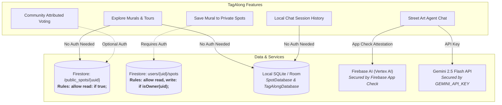
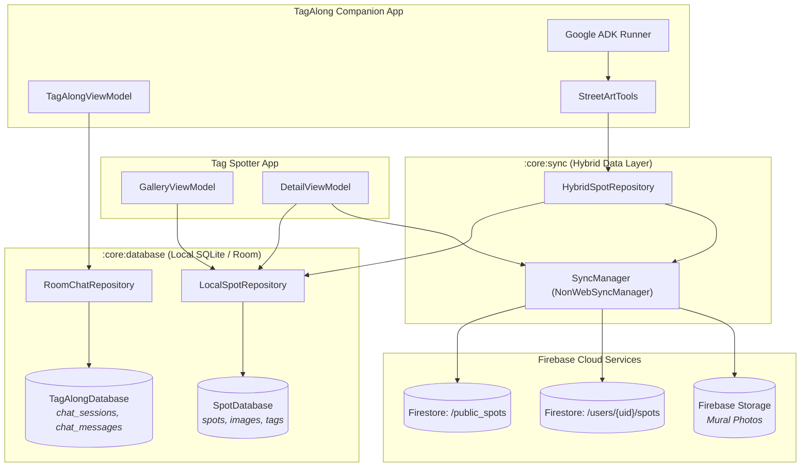
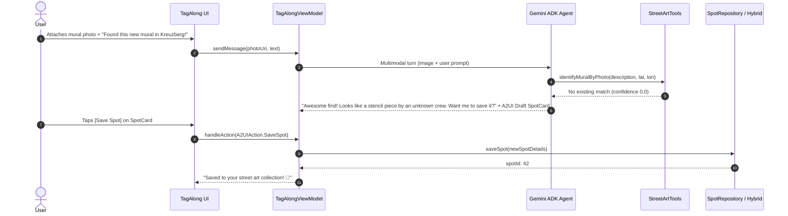
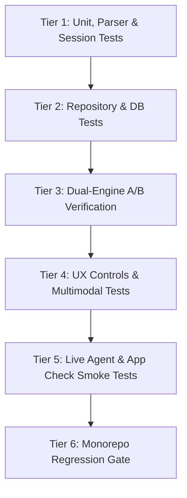

# Phase 4 and Beyond: TagAlong & A2UI Next Steps, Architecture & Test Plan

> **Document:** `docs/a2ui-phase-4-and-more.md`  
> **Master Intent Document:** [a2ui-kmp-intent-document.md](file:///Users/maia/workspace/maiatoday/tag-spotter/docs/a2ui-kmp-intent-document.md)  
> **Task Tracker:** [tagalong-task-tracker.md](file:///Users/maia/workspace/maiatoday/tag-spotter/docs/tagalong-task-tracker.md)  
> **ADK Runtime Guide:** [tagalong-adk-runtime-guide.md](file:///Users/maia/workspace/maiatoday/tag-spotter/docs/tagalong-adk-runtime-guide.md)  
> **Date:** 2026-11-15  
> **Workspace:** `/Users/maia/workspace/maiatoday/tag-spotter`

---

## 📑 Table of Contents

1. [Executive Summary & Baseline Status](#1-executive-summary--baseline-status)
2. [Strategic Question: Does TagAlong Need Login?](#2-strategic-question-does-tagalong-need-login)
   - [2.1 Current Architecture & Security Model](#21-current-architecture--security-model)
   - [2.2 Read vs. Write & App Check vs. Auth](#22-read-vs-write--app-check-vs-auth)
   - [2.3 Recommendation: Zero-Friction Guest-First with Optional Sign-In](#23-recommendation-zero-friction-guest-first-with-optional-sign-in)
3. [TagAlong Key UX Features & Session Architecture](#3-tagalong-key-ux-features--session-architecture)
   - [3.1 Light and Dark Mode Switching](#31-light-and-dark-mode-switching)
   - [3.2 "New Conversation" Lifecycle](#32-new-conversation-lifecycle)
   - [3.3 Conversation History Plan & Multi-Session Architecture](#33-conversation-history-plan--multi-session-architecture)
4. [UI Component Reuse & Design System Audit](#4-ui-component-reuse--design-system-audit)
   - [4.1 Current Component Inventory & Sharing Matrix](#41-current-component-inventory--sharing-matrix)
   - [4.2 Opportunities for Unification (`:core:ui`)](#42-opportunities-for-unification-coreui)
   - [4.3 Bi-directional Reuse (Tag Spotter using A2UI)](#43-bi-directional-reuse-tag-spotter-using-a2ui)
5. [Data Access Architecture: Database, Remote Sync & Hybrid Data Layer](#5-data-access-architecture-database-remote-sync--hybrid-data-layer)
   - [5.1 Local Storage Layer (`SpotDatabase` & `TagAlongDatabase`)](#51-local-storage-layer-spotdatabase--tagalongdatabase)
   - [5.2 Remote Cloud Layer (Firestore & Cloud Storage)](#52-remote-cloud-layer-firestore--cloud-storage)
   - [5.3 Hybrid Data Bridge (`HybridSpotRepository`)](#53-hybrid-data-bridge-hybridspotrepository)
   - [5.4 Complete End-to-End Data Flow Diagram](#54-complete-end-to-end-data-flow-diagram)
6. [Agent Prompt Architecture & Dynamic Catalog Passing](#6-agent-prompt-architecture--dynamic-catalog-passing)
   - [6.1 Audit of Current State (The Hardcoding Risk)](#61-audit-of-current-state-the-hardcoding-risk)
   - [6.2 Dynamic A2UI Schema Generation from Catalog](#62-dynamic-a2ui-schema-generation-from-catalog)
   - [6.3 Dynamic Spatial & Spots Context Injection](#63-dynamic-spatial--spots-context-injection)
   - [6.4 Verification Checklist for Prompt Generation](#64-verification-checklist-for-prompt-generation)
7. [Spot Creation Architecture: How to Add a New Spot](#7-spot-creation-architecture-how-to-add-a-new-spot)
   - [7.1 Baseline: How Tag Spotter Adds Spots Today](#71-baseline-how-tag-spotter-adds-spots-today)
   - [7.2 Workflow 1: Conversational / Agentic Spot Creation (AI-Assisted)](#72-workflow-1-conversational--agentic-spot-creation-ai-assisted)
   - [7.3 Workflow 2: Interactive A2UI Card Action (`A2UIAction.SaveSpot`)](#73-workflow-2-interactive-a2ui-card-action-a2uiactionsavespot)
   - [7.4 Workflow 3: Cross-App Deep Link Handoff to Tag Spotter](#74-workflow-3-cross-app-deep-link-handoff-to-tag-spotter)
   - [7.5 Spot Creation Comparison Matrix](#75-spot-creation-comparison-matrix)
8. [Phase 4 Implementation Roadmap & Next Steps](#8-phase-4-implementation-roadmap--next-steps)
   - [Step 4.1: Android Firebase Configuration & App Check Setup](#step-41-android-firebase-configuration--app-check-setup)
   - [Step 4.2: Shared UI Primitives Consolidation (`:core:ui`)](#step-42-shared-ui-primitives-consolidation-coreui)
   - [Step 4.3: Theme Switching & New Conversation Controls](#step-43-theme-switching--new-conversation-controls)
   - [Step 4.4: Dynamic Prompt & Catalog Generation Refactor](#step-44-dynamic-prompt--catalog-generation-refactor)
   - [Step 4.5: Cross-App Deep Linking & Handoff Contract](#step-45-cross-app-deep-linking--handoff-contract)
   - [Step 4.6: Agentic "Save as New Spot" & Interactive Action Callbacks](#step-46-agentic-save-as-new-spot--interactive-action-callbacks)
   - [Step 4.7: Conversation History Drawer / Sheet Implementation](#step-47-conversation-history-drawer--sheet-implementation)
   - [Step 4.8: Full Monorepo Multi-App Regression Gate](#step-48-full-monorepo-multi-app-regression-gate)
9. [Future Phases Horizon (Phase 5+)](#9-future-phases-horizon-phase-5)
10. [Comprehensive Test Plan for TagAlong Companion App](#10-comprehensive-test-plan-for-tagalong-companion-app)
   - [Tier 1: Unit, Parser & Session Tests](#tier-1-unit-parser--session-tests)
   - [Tier 2: Repository & Persistence Tests](#tier-2-repository--persistence-tests)
   - [Tier 3: Dual-Engine A/B Verification Test Suite](#tier-3-dual-engine-ab-verification-test-suite)
   - [Tier 4: UX Controls & Multimodal Tests (Theme, Session, Photo)](#tier-4-ux-controls--multimodal-tests-theme-session-photo)
   - [Tier 5: Live Agent & App Check Smoke Tests](#tier-5-live-agent--app-check-smoke-tests)
   - [Tier 6: Monorepo Regression Gate](#tier-6-monorepo-regression-gate)
11. [Clean Context Handoff & Execution Prompt](#11-clean-context-handoff--execution-prompt)

---

## 1. Executive Summary & Baseline Status

Phases 1 through 3 of the A2UI and Google ADK migration are complete:
- **Phase 1 (Foundation):** Model schema updated with `isPublic`, Room migration `MIGRATION_13_14` implemented, Firestore dual-write to `/public_spots/{uuid}` operational with security rules, and `HybridSpotRepository` active.
- **Phase 2 (Regression Gate):** Full Tag Spotter regression suite passed completely across Android, Desktop JVM, and Wasm targets.
- **Phase 3 (TagAlong Companion App):**
  - Architecture skeleton established across `:core:a2ui`, `:core:agent`, `:feature:tagalong`, `:tagalongApp:desktop`, and `:tagalongApp:android`.
  - Neon A2UI Urban Suite catalog implemented (`SpotCard`, `TourCard`, `ArtistBioCard`, `StyleQuizWidget`, `CommunityVotingCard`, `MapPinOverlayWidget`).
  - Dual-engine adapter functional (`a2ui-kmp` in `commonMain` + Google's official `androidx.a2ui` in `androidMain`).
  - Desktop JVM companion app runs with responsive 2-pane layout, photo picker, and live `GEMINI_API_KEY` runner or offline mock catalog.
  - Android companion app runs with top-bar dual-engine toggle, interactive mock catalog, and graceful offline fallback when unconfigured.

**Phase 4** focuses on:
1. Production configuration of Android Firebase App Check + live Gemini ADK inference.
2. Dynamic catalog passing in LLM prompts (eliminating hardcoded schemas and hardcoded mock data).
3. Clear data access architecture separating local Room caches from remote Firestore public spots.
4. Implementing multi-path spot creation ("Add New Spot" via chat, generative UI card, and deep link).
5. Systematic UI component consolidation into `:core:ui`.
6. Theme switching (Light/Dark mode) and multi-session Conversation History.
7. Establishing a comprehensive, repeatable test plan for TagAlong.

---

## 2. Strategic Question: Does TagAlong Need Login?

### 2.1 Current Architecture & Security Model

To determine if TagAlong needs user authentication, we examine where data is read and written, and how LLM inference is authorized:



### 2.2 Read vs. Write & App Check vs. Auth

1. **Reading Public Spots (Open Read):**
   - In [firestore.rules](file:///Users/maia/workspace/maiatoday/tag-spotter/firebase/firestore.rules#L31-L34), `/public_spots/{uuid}` has:
     ```javascript
     match /public_spots/{spotId} {
       allow read: if true;
       allow write: if request.auth != null;
     }
     ```
   - Anyone (anonymous or unauthenticated) can read public community murals and walking tours without logging in.

2. **Chat Persistence (Local Room SQLite):**
   - TagAlong stores chat history, conversation sessions, and local card state in `TagAlongDatabase.kt` locally on-device. No cloud login is required to persist or browse past conversations.

3. **Gemini LLM Inference Authorization:**
   - **On Android (`AndroidTagAlongAgent.kt`):** Inference uses Firebase AI (`com.google.firebase.ai`). Firebase AI is secured via **Firebase App Check** (Play Integrity on physical devices, Debug Provider on emulators). App Check validates that the request originates from an authentic, untampered TagAlong application binary—**not** user identity.
   - **On Desktop (`DesktopTagAlongAgent.kt`):** Inference uses Google GenAI SDK (`com.google.genai.Client`) authorized via `GEMINI_API_KEY`. No end-user sign-in is required.

4. **When IS Authentication Required?**
   - **Writing to Private User Spots (`/users/{uid}/spots`):** If a user wants to synchronize their saved spots across devices in Tag Spotter.
   - **Direct Public Mural Publishing:** Directly publishing a new public spot from TagAlong to Firestore `/public_spots/{uuid}` requires `request.auth != null`.
   - **Attributed Community Voting:** If voting needs to prevent duplicate votes per user ID.

### 2.3 Recommendation: Zero-Friction Guest-First with Optional Sign-In

> [!IMPORTANT]
> **Conclusion:** TagAlong should **NOT** mandate user sign-in on launch.
>
> 1. **Default Mode (Guest / Anonymous Explorer):**
>    - Full access to conversational AI guide, local chat history, walking tour generation, interactive style quizzes, public spot discovery, and local offline caching.
> 2. **Optional Sign-In (Triggered Just-In-Time):**
>    - Trigger sign-in only when the user explicitly taps *"Sync to My Tag Spotter Account"* or *"Publish to Community Catalog"*.
>    - Provide Firebase Anonymous Auth or Google Sign-In via `GoogleSignInHelper` when write synchronization is initiated.

---

## 3. TagAlong Key UX Features & Session Architecture

### 3.1 Light and Dark Mode Switching

TagAlong currently defaults to the urban dark neon palette. Support for light mode is already architected in `:core:ui`.

#### Color System Status:
- [Theme.kt](file:///Users/maia/workspace/maiatoday/tag-spotter/core/ui/src/commonMain/kotlin/net/maiatoday/tagspotter/core/ui/theme/Theme.kt) already contains:
  - `UrbanDarkColorScheme` (Dark background `#0D0E15`, Neon Pink `#FF2A85`, Electric Blue `#00E5FF`, Neon Lime `#39FF14`, Dark Surface `#161926`).
  - `UrbanLightColorScheme` (Light background `#F8F9FE`, Deep Violet `#7000FF`, Crisp Magenta `#D80064`, High-contrast surfaces).
- `MyApplicationTheme` accepts a boolean parameter `darkTheme: Boolean = isSystemInDarkTheme()`.

#### UX Implementation Plan:
1. **Theme Mode State:** Introduce an enum in `:core:settings`:
   ```kotlin
   enum class ThemeMode { SYSTEM, LIGHT, DARK }
   ```
2. **TopAppBar Toggle:**
   - Add a theme toggle button in `TagAlongScreen`'s top app bar (Moon icon for dark mode, Sun icon for light mode).
3. **Card Contrast Verification:**
   - Ensure A2UI component borders and neon chip glows adapt appropriately:
     - In Dark mode: Glowing borders (`Color(0x3300E5FF)`), deep slate surfaces.
     - In Light mode: Clean drop shadows, crisp border strokes (`Color(0x227000FF)`), dark readable typography.

---

### 3.2 "New Conversation" Lifecycle

Users need a quick way to clear the current chat context and start exploring a new neighborhood or art style without discarding past conversations.

#### Proposed UX Flow:
1. **Top Bar Action:** A prominent `+` ("New Chat") button in the `TagAlongScreen` top bar.
2. **Action Dispatch:**
   - Calls `TagAlongViewModel.startNewConversation()`.
3. **Lifecycle Actions:**
   - Generates a fresh `newSessionId = "session-${epochMillis()}"`.
   - Inserts a new `ChatSession` record into `TagAlongDatabase`.
   - Updates `_uiState` with the new `sessionId` and clears the message stream.
   - Posts a fresh welcome message from TagAlong tailored to the user's current GPS location.
   - Clears any pending photo attachment or active tour waypoint selection.
   - The previous session remains fully persisted in `TagAlongDatabase` for retrieval in Conversation History.

---

### 3.3 Conversation History Plan & Multi-Session Architecture

TagAlong's persistence layer in [TagAlongDatabase.kt](file:///Users/maia/workspace/maiatoday/tag-spotter/core/database/src/nonWebMain/kotlin/net/maiatoday/tagspotter/core/database/TagAlongDatabase.kt) was engineered from Day 1 to support multiple sessions with cascading foreign keys:

```kotlin
@Entity(tableName = "chat_sessions")
data class ChatSessionEntity(
    @PrimaryKey val sessionId: String,
    val title: String,
    val createdAt: Long,
    val lastActiveAt: Long = createdAt
)
```

The underlying `ChatDao` already exposes:
- `getAllSessions(): Flow<List<ChatSessionEntity>>`
- `getSessionById(sessionId: String): ChatSessionEntity?`
- `deleteSessionById(sessionId: String)`
- `getMessagesForSession(sessionId: String): Flow<List<ChatMessageEntity>>`

#### Planned Conversation History UI Architecture:
1. **Drawer / History Sheet:**
   - **Desktop (JVM):** A collapsible Left Navigation Sidebar showing previous conversation sessions grouped by date (*"Today"*, *"Yesterday"*, *"Last 7 Days"*).
   - **Android:** A slide-out `NavigationDrawer` or `ModalBottomSheet` triggered by a History icon (`Icons.Default.History`) in the `TopAppBar`.
2. **History Item Interactions:**
   - **Tap Session:** Invokes `viewModel.switchSession(sessionId)`. Loads past conversation turns and any associated A2UI cards from SQLite into memory.
   - **Delete Session:** Swipe-to-dismiss or trash icon triggers `chatRepository.deleteSessionById(sessionId)`, cascading removal of all stored messages.
   - **Rename Session:** Optional inline edit for conversation titles.
3. **Session Switching Logic (`TagAlongViewModel`):**
   ```kotlin
   fun switchSession(targetSessionId: String) {
       viewModelScope.launch {
           val messages = chatRepository.getMessagesListForSession(targetSessionId)
           _uiState.update { current ->
               current.copy(
                   sessionId = targetSessionId,
                   messages = messages.map { it.toTagAlongMessage() }
               )
           }
       }
   }
   ```

---

## 4. UI Component Reuse & Design System Audit

A primary objective is ensuring maximum reuse of Compose UI components between **Tag Spotter** and **TagAlong**, preventing duplicated code and fragmented styling.

### 4.1 Current Component Inventory & Sharing Matrix

| UI Component | Current Location | Tag Spotter Uses? | TagAlong Uses? | Sharing Status | Action Plan |
| :--- | :--- | :---: | :---: | :---: | :--- |
| **`SpotMapView` / `MapMarker`** | `:core:ui` | ✅ Yes (`:feature:map`, `:feature:detail`) | ✅ Yes (`:feature:tagalong`) | 🟢 Fully Reused | Maintain in `:core:ui`. Add polyline route overlay support for walking tours. |
| **Theme & Color Tokens** | `:core:ui` (`theme/`) | ✅ Yes | ✅ Yes | 🟢 Fully Reused | Standardized Dark Neon Palette (`DarkBackground`, `DarkPrimaryContainer`, etc.). |
| **Category Colors & Names** | `:core:ui` (`CategoryExtensions.kt`) | ✅ Yes | ⚠️ Partial | 🟡 Needs Adoption | TagAlong should use `CategoryExtensions.getDisplayName()` and `categoryColor()` inside `NeonSpotCard`. |
| **`ZoomableImageOverlay`** | `:feature:detail` | ✅ Yes | ❌ No (inline only) | 🔴 Duplication Risk | **Move to `:core:ui`** so TagAlong chat and cards can trigger full-screen photo zoom. |
| **`DetailMiniMapCard`** | `:feature:detail` | ✅ Yes | ⚠️ Custom Card | 🟡 Needs Unification | Merge concepts with `MapPinOverlayWidget` in `:core:a2ui` or `:core:ui`. |
| **Category Filter Chips** | `:feature:gallery` | ✅ Yes | ⚠️ Custom Chips | 🟡 Needs Unification | Extract `NeonFilterChip` into `:core:ui`. |
| **Neon A2UI Component Suite** | `:core:a2ui` (`NeonA2UIComponents.kt`) | ❌ No | ✅ Yes | 🟣 Opportunity | Export components to `:core:ui` so Tag Spotter's `DetailScreen` can render rich artist/tour cards! |

### 4.2 Opportunities for Unification (`:core:ui`)

To achieve complete visual cohesion and eliminate duplication, the following components should be moved or promoted into `:core:ui`:

1. **`ZoomableImageOverlay.kt`:**
   - *Current:* Embedded in `feature/detail/src/commonMain/.../ZoomableImageOverlay.kt`.
   - *Target:* Move to `core/ui/src/commonMain/.../image/ZoomableImageOverlay.kt`.
   - *Benefit:* Both Tag Spotter detail screens and TagAlong chat message photo previews can open high-resolution mural images with pinch-to-zoom and pan gestures.

2. **`NeonBadge` & `NeonTagChip`:**
   - *Current:* Re-implemented inline with custom `Surface` and `BorderStroke` across `DetailMetadataCard.kt`, `GalleryScreen.kt`, and `NeonA2UIComponents.kt`.
   - *Target:* Create standardized `NeonTagChip(text, color, onClick)` and `NeonCategoryBadge(category)` in `:core:ui`.

3. **`SpotSummaryCard`:**
   - *Current:* `SpotCardData` in `:core:a2ui` renders mural details, while `GalleryScreen` renders grid cards.
   - *Target:* Ensure `NeonSpotCard` can accept a domain `Spot` model directly, serving as a unified preview card across both apps.

### 4.3 Bi-directional Reuse (Tag Spotter using A2UI)

A2UI shouldn't be a one-way street for TagAlong. Tag Spotter can leverage A2UI components directly:
- **Detail Screen Suggestions:** In `DetailScreen`, Tag Spotter can render an `ArtistBioCard` or related `TourCard` generated by Gemini using the same A2UI renderer engine.
- **Mural History & Attribution:** When Tag Spotter's single-shot AI analyzes a mural, it can produce an A2UI JSON payload that renders interactive style attribution and trivia directly in the detail view.

---

## 5. Data Access Architecture: Database, Remote Sync & Hybrid Data Layer

Understanding how data flows between on-device SQLite databases and remote Firebase services is essential for both apps:

### 5.1 Local Storage Layer (`SpotDatabase` & `TagAlongDatabase`)

The on-device storage lives in `:core:database` using AndroidX Room with SQLite:

1. **`SpotDatabase` (`SpotDao.kt`):**
   - **`spots` table:** Core mural entity (`id`, `uuid`, `description`, `latitude`, `longitude`, `category`, `isStarred`, `isPublic`, `ownerUid`, `updatedAt`, `isImported`).
   - **`images` table:** Mural photos (`id`, `spotId`, `imagePath`, `thumbnailPath`, `isMain`, `rating`).
   - **`tags` & `artists` tables:** Normalized tags and artist associations linked by `spotId`.
   - **Access Repository:** `LocalSpotRepository` encapsulates DAO operations, photo processing, and reactive Flow emissions.

2. **`TagAlongDatabase` (`ChatDao.kt`):**
   - **`chat_sessions` table:** High-level conversation threads (`sessionId`, `title`, `createdAt`, `lastActiveAt`).
   - **`chat_messages` table:** Individual turns (`id`, `sessionId`, `sender` ["user" | "agent"], `text`, `a2uiPayloadJson`, `imagePath`, `timestamp`). Cascading foreign key deletes all messages if a session is deleted.
   - **Access Repository:** `RoomChatRepository` exposes reactive Flows (`getMessagesForSession`, `getAllSessions`) and suspend mutation methods.

### 5.2 Remote Cloud Layer (Firestore & Cloud Storage)

Remote data lives in Google Firebase and is synchronized via `:core:sync`:

1. **Firestore Collections:**
   - **`/public_spots/{uuid}`:** Community mural discovery feed.
     - Security: `allow read: if true;`, `allow write: if request.auth != null;`.
     - Serialized format: Full `SpotDetails` JSON.
   - **`/users/{uid}/spots/{uuid}`:** Authenticated user personal cloud backup.
     - Security: `allow read, write: if isOwner(uid);`.
   - **`/shared_packs/{code}`:** Bundled spot packs for import/export.

2. **Firebase Storage:**
   - Full resolution photos and compressed thumbnails: `/users/{uid}/images/{uuid}.jpg`.

3. **`SyncManager` (`NonWebSyncManager.kt`):**
   - Provides background sync (`syncNow()`), real-time Firestore listeners (`startRealtimeSync(uid)`), and public spot querying (`fetchPublicSpots(minLat, maxLat, minLon, maxLon)`).

### 5.3 Hybrid Data Bridge (`HybridSpotRepository`)

[HybridSpotRepository.kt](file:///Users/maia/workspace/maiatoday/tag-spotter/core/sync/src/commonMain/kotlin/net/maiatoday/tagspotter/core/sync/HybridSpotRepository.kt) acts as the single source of truth for street art spots by combining local SQLite cache with remote Firestore queries:

- **`getNearbySpots(lat, lon, radiusKm)`:**
  1. Computes latitude/longitude bounding box coordinates from `radiusKm`.
  2. Queries `localRepository.getAllSpots()`.
  3. Queries `syncManager.fetchPublicSpots(minLat, maxLat, minLon, maxLon)` from Firestore.
  4. Merges both collections, deduplicating by `uuid`.
  5. Prioritizes local high-res image file paths over remote HTTP URLs when a spot is present in both.
  6. Calculates exact Haversine distance, filters within `radiusKm`, and sorts closest first.
- **`getAllSpots()`:** Returns union of all local spots + remote public spots.
- **`getSpotByUuid(uuid)`:** Checks local DB first, then falls back to remote `/public_spots`.

### 5.4 Complete End-to-End Data Flow Diagram



---

## 6. Agent Prompt Architecture & Dynamic Catalog Passing

### 6.1 Audit of Current State (The Hardcoding Risk)

Currently in [TagAlongPrompts.kt](file:///Users/maia/workspace/maiatoday/tag-spotter/core/agent/src/commonMain/kotlin/net/maiatoday/tagspotter/core/agent/TagAlongPrompts.kt), the system instruction contains:
1. **Hardcoded JSON Schemas:** Full JSON examples for `SpotCard`, `TourCard`, `ArtistBioCard`, `StyleQuiz`, `CommunityVoting`, and `MapPinOverlay` are embedded as raw multiline strings inside `SYSTEM_INSTRUCTION`.
   - *Risk:* If a property is added or altered in `A2UIComponent` models (e.g. adding `distanceMeters` or `isStarred`), the prompt becomes stale, leading to LLM hallucinating deprecated schemas.
2. **Zero Injected Spots Context:** The prompt gives the agent zero awareness of what spots exist locally until a tool is explicitly called.
3. **Hardcoded Berlin Mock Fallbacks:** In `TagAlongViewModel.defaultBerlinMarkers()` and `TagAlongMockFixtures`, Berlin spots ("Cosmic Chameleon", "Teufelsberg") are hardcoded as static fallbacks.

### 6.2 Dynamic A2UI Schema Generation from Catalog

Instead of maintaining brittle raw strings in `TagAlongPrompts`, the catalog should programmatically define and export its prompt schemas:

```kotlin
// In :core:a2ui or :core:agent
interface A2UIPromptDescriptor {
    val componentName: String
    val description: String
    val jsonSchemaExample: String
}

class NeonA2UICatalog {
    // Returns dynamic schema guidance for all registered cards
    fun generateAgentPromptInstructions(): String {
        return buildString {
            appendLine("The available A2UI generative UI components and their schemas are:")
            registeredDescriptors.forEach { desc ->
                appendLine("### ${desc.componentName} (${desc.description})")
                appendLine("```json")
                appendLine(desc.jsonSchemaExample)
                appendLine("```")
            }
        }
    }
}
```

### 6.3 Dynamic Spatial & Spots Context Injection

When the agent runner is spun up in `TagAlongViewModel`, dynamic spatial context should be injected into the system prompt:

```kotlin
data class AgentContextConfig(
    val cityName: String = "Berlin",
    val latitude: Double = 52.4972,
    val longitude: Double = 13.2415,
    val activePackName: String? = null,
    val localSpotCount: Int = 0
)

object TagAlongPrompts {
    fun buildSystemInstruction(
        catalog: NeonA2UICatalog,
        context: AgentContextConfig
    ): String {
        return buildString {
            appendLine("You are TagAlong, an enthusiastic, knowledgeable urban street art guide.")
            appendLine()
            appendLine("CURRENT CONTEXT:")
            appendLine("- Active Location: ${context.cityName} (${context.latitude}, ${context.longitude})")
            appendLine("- Local spots in database: ${context.localSpotCount}")
            context.activePackName?.let { appendLine("- Active Pack: $it") }
            appendLine()
            appendLine("ALWAYS USE YOUR TOOLS to fetch actual spots and artists.")
            appendLine()
            appendLine(catalog.generateAgentPromptInstructions())
        }
    }
}
```

### 6.4 Verification Checklist for Prompt Generation

- [ ] Ensure `TagAlongPrompts.buildSystemInstruction()` reflects all active components from `NeonA2UICatalog`.
- [ ] Add unit test `DynamicPromptGenerationTest` in `:core:agent` verifying that every component in `NeonA2UICatalog` has a corresponding JSON schema section in the prompt.
- [ ] Verify that GPS updates dynamically refresh or inform tool calls rather than falling back to hardcoded coordinates.

---

## 7. Spot Creation Architecture: How to Add a New Spot

Street art spots can be created and logged through multiple pathways depending on whether the user is in **Tag Spotter** (curator camera workflow) or **TagAlong** (conversational multimodal companion).

### 7.1 Baseline: How Tag Spotter Adds Spots Today

1. **User Action:** User taps `+` on the Map or Gallery screen in Tag Spotter.
2. **Camera / Gallery:** User captures a mural image or selects from photo library.
3. **Draft Initialization:** `DetailViewModel` creates a draft `SpotDetails`:
   - Auto-populates GPS latitude and longitude from EXIF metadata or `LocationProvider`.
   - Generates a new `UUID.randomUUID().toString()`.
4. **Metadata Editing:** User enters title, description, artist name(s), category chips, and toggles `isPublic` (community vs. private).
5. **Persistence:**
   - `PhotoProcessor.saveOriginalAndThumbnail()` creates optimized local files.
   - `LocalSpotRepository.saveSpot(...)` saves `SpotEntity` and `ImageEntity` records via `SpotDao.insertSpot()`.
6. **Cloud Sync:** `SyncManager.syncNow()` uploads the image to Firebase Storage, writes `/users/{uid}/spots/{uuid}`, and copies to `/public_spots/{uuid}` if `isPublic == true`.

---

### 7.2 Workflow 1: Conversational / Agentic Spot Creation (AI-Assisted)

In TagAlong, a user can log a spot conversationally:



#### New Tool Required for Full Autonomy:
Add a `saveNewSpot` tool directly to `StreetArtTools`:
```kotlin
@Tool(
    name = "saveNewSpot",
    description = "Saves a newly discovered street art mural to the local spots database."
)
suspend fun saveNewSpot(
    @Param(description = "Title or description of the mural") title: String,
    @Param(description = "Primary artist name") artist: String,
    @Param(description = "Category: mural, graffiti, stencil, or sticker") category: String,
    @Param(description = "Latitude coordinates") latitude: Double,
    @Param(description = "Longitude coordinates") longitude: Double,
    @Param(description = "Comma-separated style tags") tags: String,
    @Param(description = "Whether to publish to public community feed") isPublic: Boolean = true
): String
```

---

### 7.3 Workflow 2: Interactive A2UI Card Action (`A2UIAction.SaveSpot`)

When the agent presents a `SpotCard`, the card can feature an interactive action:
- Button: `[+ Add to My Collection]`.
- Action payload:
  ```json
  {
    "action": "save_spot",
    "spotId": "generated-uuid",
    "title": "Cosmic Chameleon",
    "artist": "AeroFlux",
    "latitude": 52.4972,
    "longitude": 13.2415
  }
  ```
- **Handler in `TagAlongViewModel`:**
  ```kotlin
  fun handleAction(action: A2UIAction) {
      when (action) {
          is A2UIAction.SaveSpot -> {
              viewModelScope.launch {
                  val newSpot = Spot(
                      uuid = action.spotId.ifBlank { generateUuid() },
                      description = action.title,
                      latitude = action.latitude,
                      longitude = action.longitude,
                      isPublic = true,
                      category = action.category
                  )
                  localSpotRepository.saveSpot(newSpot, imagePath = action.imageUrl, thumbnailPath = "")
                  _uiState.update { it.copy(messages = it.messages + agentConfirmationMessage) }
              }
          }
          // ...
      }
  }
  ```

---

### 7.4 Workflow 3: Cross-App Deep Link Handoff to Tag Spotter

When a user in TagAlong wants full manual control (taking multiple photos, adding custom artist tags, manual EXIF editing):
1. TagAlong displays an action button on the card: `[Open in Tag Spotter Editor]`.
2. Tapping dispatches deep link URI:
   ```
   tagspotter://capture?imageUri={uri}&lat={lat}&lon={lon}&title={title}&artist={artist}&category={category}
   ```
3. Tag Spotter's `MainActivity` parses the URI and immediately opens `DetailScreen` in `Draft` mode with all AI-suggested fields pre-filled.

---

### 7.5 Spot Creation Comparison Matrix

| Capability | Tag Spotter Workflow | TagAlong Agentic Workflow | TagAlong Deep Link Workflow |
| :--- | :--- | :--- | :--- |
| **Trigger** | Camera icon / FAB | Natural language chat + photo | "Edit in Tag Spotter" card action |
| **Metadata Entry** | Manual form inputs | AI vision suggestion + 1-tap confirm | AI suggested, manually editable in form |
| **Location Source** | Device GPS / Photo EXIF | Current GPS or conversation context | TagAlong GPS passed via URI parameter |
| **Offline Support** | 100% offline (Room SQLite) | Offline mock card or online Gemini | 100% offline |
| **Cloud Publishing** | Syncs to `/public_spots` on sync | Local save + background sync | Standard Tag Spotter sync |

---

## 8. Phase 4 Implementation Roadmap & Next Steps

```mermaid
flowchart TD
    subgraph Phase 4: Production Integration, UX Features & Architecture
        S41[Step 4.1: Android Firebase & App Check Setup]
        S42[Step 4.2: UI Primitives Consolidation in :core:ui]
        S43[Step 4.3: Theme Switching & New Conversation Controls]
        S44[Step 4.4: Dynamic Prompt & Catalog Generation Refactor]
        S45[Step 4.5: Cross-App Deep Linking Contracts]
        S46[Step 4.6: Agentic Spot Saving & SaveSpot Action]
        S47[Step 4.7: Conversation History Drawer / Sheet]
        S48[Step 4.8: Monorepo Multi-App Regression Gate]
    end

    S41 --> S42
    S42 --> S43
    S43 --> S44
    S44 --> S45
    S45 --> S46
    S46 --> S47
    S47 --> S48
```

### Step 4.1: Android Firebase Configuration & App Check Setup
- **Goal:** Enable live Google ADK Gemini agent execution on Android emulators and physical devices without falling back to mock catalog mode.
- **Work Items:**
  1. Add Android package `net.maiatoday.tagalong.android` to the Firebase project in Firebase Console.
  2. Download updated `google-services.json` (containing both `net.maiatoday.tagspotter` and `net.maiatoday.tagalong.android` client definitions) and place in `tagalongApp/android/google-services.json` (or root/shared config).
  3. Apply `alias(libs.plugins.google.services)` in `tagalongApp/android/build.gradle.kts`.
  4. In `TagAlongApplication.kt`, configure `DebugAppCheckProviderFactory` for debug builds and output the App Check debug secret token to `Logcat` (`adb logcat -s TagAlongApplication:D`). Register this token in Firebase Console > App Check > Apps > TagAlong Debug Provider.
- **Verification:**
  - Launch `:tagalongApp:android` on emulator.
  - Verify in Logcat: `AppCheck: Debug secret token registered successfully` and `ADK Runner initialized with Firebase model`.
  - Send message *"Tell me about street art near Mitte"* and verify live streaming response from Gemini.

### Step 4.2: Shared UI Primitives Consolidation (`:core:ui`)
- **Goal:** Extract repeated UI widgets into `:core:ui` and ensure both Tag Spotter and TagAlong share identical styling.
- **Work Items:**
  1. Move `ZoomableImageOverlay.kt` from `:feature:detail` to `:core:ui`.
  2. Create `NeonTagChip` and `NeonCategoryBadge` in `:core:ui/src/commonMain/.../chips/`.
  3. Refactor `DetailMetadataCard.kt`, `GalleryScreen.kt`, and `NeonA2UIComponents.kt` to consume the unified chips.
  4. Ensure `CategoryExtensions.kt` colors are consumed uniformly by `NeonA2UIComponents.kt`.
- **Verification:**
  - `./gradlew :core:ui:allTests :feature:detail:allTests :core:a2ui:allTests`

### Step 4.3: Theme Switching & New Conversation Controls
- **Goal:** Provide seamless user control over Light/Dark modes and starting fresh conversation sessions from the UI.
- **Work Items:**
  1. Introduce `ThemeMode { SYSTEM, LIGHT, DARK }` and theme toggle icon in the `TagAlongScreen` / `MainActivity` TopAppBar.
  2. Wire theme toggle state to `MyApplicationTheme` in `MainActivity.kt` and Desktop `Main.kt`.
  3. Add `+` ("New Chat") button in `TagAlongScreen` top bar calling `TagAlongViewModel.startNewConversation()`.
  4. Implement `startNewConversation()` to create a fresh session in `TagAlongDatabase`, reset the message stream with greeting, and clear attached photos.
- **Verification:**
  - `./gradlew :feature:tagalong:allTests :tagalongApp:desktop:assemble :tagalongApp:android:assembleDebug`
  - Toggle theme icon in running app: verify UI switches between `UrbanDarkColorScheme` and `UrbanLightColorScheme`.
  - Tap `+`: verify message list resets to fresh welcome state and new `sessionId` is assigned.

### Step 4.4: Dynamic Prompt & Catalog Generation Refactor
- **Goal:** Ensure A2UI component schemas in system prompts are dynamically derived from `NeonA2UICatalog` instead of hardcoded strings in `TagAlongPrompts.kt`.
- **Work Items:**
  1. Add `generateAgentPromptInstructions()` to `NeonA2UICatalog` dynamically outputting card schemas.
  2. Implement `TagAlongPrompts.buildSystemInstruction(catalog, contextConfig)` accepting dynamic spatial bounds and catalog counts.
  3. Update `createDesktopTagAlongRunner` and `createAndroidTagAlongRunner` to pass dynamic catalog instructions.
  4. Write unit test `DynamicPromptGenerationTest` in `:core:agent`.
- **Verification:**
  - `./gradlew :core:agent:allTests :feature:tagalong:allTests`

### Step 4.5: Cross-App Deep Linking & Handoff Contract
- **Goal:** Enable smooth navigation between Tag Spotter and TagAlong.
- **Work Items:**
  1. Define URI scheme in `:core:model` or `:core:ui`:
     - `tagalong://spot/{uuid}?lat={lat}&lon={lon}` (opens TagAlong focused on a spot).
     - `tagspotter://capture?lat={lat}&lon={lon}` (opens Tag Spotter's camera to log a new piece).
     - `tagspotter://detail/{uuid}` (opens Tag Spotter's full detail screen).
  2. Register intent filters in `tagalongApp/android/src/main/AndroidManifest.xml` and `androidApp/src/main/AndroidManifest.xml`.
  3. Handle `A2UIAction.ViewSpotDetail(spotId)` by triggering the deep link to Tag Spotter if installed, or expanding an inline sheet if standalone.
- **Verification:**
  - `adb shell am start -W -a android.intent.action.VIEW -d "tagalong://spot/test-uuid" net.maiatoday.tagalong.android`

### Step 4.6: Agentic "Save as New Spot" & Interactive Action Callbacks
- **Goal:** Allow the user to take/attach a photo in TagAlong chat, have the agent identify the artist/style, and click a button on the generated A2UI card to save it directly into `SpotRepository`.
- **Work Items:**
  1. Add `saveNewSpot` tool to `StreetArtTools.kt` delegating to `SpotRepository`.
  2. Add `A2UIAction.SaveSpot(spotData)` handling to `TagAlongViewModel`.
  3. Wire `HybridSpotRepository.saveSpot(...)` to persist the new spot locally (and to `/public_spots` if `isPublic` is selected).
  4. Provide instant visual feedback in chat: *"Saved to your murals collection!"* with a direct link to view it.
- **Verification:**
  - Test via mock payload and live chat: click "Save Mural", verify spot appears in `SpotRepository.getAllSpots()`.

### Step 4.7: Conversation History Drawer / Sheet Implementation
- **Goal:** Enable users to browse, switch between, and manage past chat sessions saved in `TagAlongDatabase`.
- **Work Items:**
  1. Expose `val allSessions: StateFlow<List<ChatSession>>` in `TagAlongViewModel` collected from `ChatDao.getAllSessions()`.
  2. Implement a `NavigationDrawer` (Desktop left pane) and `ModalBottomSheet` (Android) listing sessions ordered by `lastActiveAt DESC`.
  3. Wire tap on history item to `viewModel.switchSession(sessionId)`.
  4. Add delete icon / swipe-to-delete calling `chatRepository.deleteSessionById(sessionId)`.
  5. Include "Start New Chat" shortcut at the top of the history list.
- **Verification:**
  - Test session switching in ViewModel test: verify messages for selected session load into `uiState.messages`.
  - Delete session test: verify session and all associated messages are removed from SQLite.

### Step 4.8: Full Monorepo Multi-App Regression Gate
- **Goal:** Ensure all targets across the entire monorepo compile, pass tests, and assemble without regression.
- **Command:**
  ```bash
  ./gradlew allTests :androidApp:assembleDebug :tagalongApp:android:assembleDebug :desktopApp:assemble :tagalongApp:desktop:assemble
  ```

---

## 9. Future Phases Horizon (Phase 5+)

| Phase | Title | Key Deliverables |
| :--- | :--- | :--- |
| **Phase 5** | **Offline Tour Caching & Geofenced Alerts** | Offline bundle download for walking routes, background GPS proximity triggers (25m alert when nearing a mural), reactive location stream. |
| **Phase 6** | **Audio Tour Guide (TTS Narration)** | Real-time spoken tour narration using platform speech synthesis (Text-to-Speech) as user reaches tour waypoints. |
| **Phase 7** | **Curated Community Tour Packs** | Cloud pack publishing (`/shared_packs/{code}`) directly from agent-generated walking tours with QR code sharing. |
| **Phase 8** | **iOS & Web Targets for TagAlong** | Expand TagAlong to iOS and Wasm once `google/adk-kotlin` publishes Kotlin/Native and Kotlin/Wasm artifacts. |

---

## 10. Comprehensive Test Plan for TagAlong Companion App

To ensure stability across platforms, engines, and multimodal inputs, TagAlong utilizes a 6-tier test plan:



### Tier 1: Unit, Parser & Session Tests
- **Module:** `:core:a2ui`, `:core:agent`, `:feature:tagalong`
- **Scope:**
  - A2UI JSON payload deserialization (`A2UIPayloadParserTest`).
  - Validation of all catalog component types: `SpotCard`, `TourCard`, `ArtistBioCard`, `StyleQuizWidget`, `CommunityVotingCard`, `MapPinOverlayWidget`.
  - Fallback error resilience: verify malformed JSON or unknown component tags cleanly produce a `FallbackComponentData` without throwing exceptions.
  - Action serialization and roundtrip parsing (`A2UIAction`).
  - Dynamic prompt generation test: verify `NeonA2UICatalog.generateAgentPromptInstructions()` matches catalog component definitions.
  - `TagAlongViewModelTest`: verify `startNewConversation()` creates new session, loads welcome message, and clears inputs.
  - Verify `switchSession(targetSessionId)` updates state messages from repository.
- **Command:**
  ```bash
  ./gradlew :core:a2ui:allTests :feature:tagalong:allTests :core:agent:allTests
  ```

### Tier 2: Repository & Persistence Tests
- **Module:** `:core:database`, `:core:sync`
- **Scope:**
  - `TagAlongDatabase` Room operations: create session, append user/agent messages, query chat history ordered by timestamp.
  - Multi-session queries: `getAllSessions()`, `getSessionById()`, cascading delete via `deleteSessionById()`.
  - `RoomChatRepository` flow emissions when new messages are stored.
  - `HybridSpotRepository` spot merging and deduplication: local spots + remote public Firestore spots.
  - Spot persistence via `LocalSpotRepository.saveSpot(...)` and `saveSpotDetails(...)`.
- **Command:**
  ```bash
  ./gradlew :core:database:allTests :core:sync:allTests
  ```

### Tier 3: Dual-Engine A/B Verification Test Suite
- **Module:** `:core:a2ui`, `:tagalongApp:android`
- **Scope:**
  - **Engine 1 (`a2ui-kmp`):** Verify full catalog rendering via Compose Multiplatform runtime on both JVM and Android.
  - **Engine 2 (`androidx.a2ui`):** Verify official Jetpack Compose rendering on Android.
  - **Live Runtime Switching:** Verify that toggling between engines in Dev Settings / Top Bar dynamically recomposes the active chat view without state loss or memory leaks.
- **Execution:**
  - Manual verification on Android emulator running Pixel 9 (API 35).
  - Tap gear/toggle icon in top bar -> Switch from `a2ui-kmp` to `androidx.a2ui` -> Confirm all 6 mock catalog cards render crisply.

### Tier 4: UX Controls & Multimodal Tests (Theme, Session, Photo)
- **Module:** `:feature:tagalong`, `:tagalongApp:desktop`, `:tagalongApp:android`
- **Scope:**
  - **Theme Toggle:** Switch between Light and Dark mode; confirm text legibility, card borders, and map pin contrast.
  - **New Conversation Action:** Tap `+` button; confirm chat stream resets cleanly while past session remains intact in SQLite.
  - **Conversation History Drawer:** Open history; select previous session; confirm past cards and chat turns restore accurately.
  - **Image Attachment Workflow:** Attach local file URI (`file://` or `content://`), verify preview thumbnail appears above chat input, and clear button resets state.
  - **Map Synchronization:** Verify clicking *"View on Map"* on a `SpotCard` or tour waypoint updates `mapCenterLat`, `mapCenterLng`, and focuses the target pin on `SpotMapView`.
- **Command:**
  ```bash
  ./gradlew :feature:tagalong:allTests
  ```

### Tier 5: Live Agent & App Check Smoke Tests
- **Target:** `:tagalongApp:desktop`, `:tagalongApp:android`
- **Scope:**
  - **Desktop JVM Smoke Test:**
    1. Set `export GEMINI_API_KEY="your-key"`.
    2. Run `./gradlew :tagalongApp:desktop:run`.
    3. Type *"What street art is nearby?"* -> Verify agent executes `getNearbySpots` tool and streams an A2UI `SpotCard`.
    4. Run without API key -> Verify offline catalog mode banner displays cleanly and mock cards remain interactive.
  - **Android Smoke Test:**
    1. Build and install: `./gradlew :tagalongApp:android:installDebug`.
    2. Launch: `adb shell am start -n net.maiatoday.tagalong.android/.MainActivity`.
    3. Verify zero crashes on boot.
    4. Verify App Check debug attestation token in Logcat.

### Tier 6: Monorepo Regression Gate
- **Target:** Full Monorepo
- **Scope:**
  - Verify Tag Spotter (`:androidApp`, `:desktopApp`, `:webApp`, `:wear`) is 100% intact.
  - All automated test suites across all 14 modules must pass.
- **Command:**
  ```bash
  ./gradlew allTests :androidApp:assembleDebug :tagalongApp:android:assembleDebug :desktopApp:assemble :tagalongApp:desktop:assemble
  ```

---

## 11. Clean Context Handoff & Execution Prompt

When beginning Phase 4 in a fresh session, copy and paste the prompt below to resume work with exact alignment:

```markdown
Resume the Tag Spotter / TagAlong monorepo project at Phase 4.
Refer to docs/a2ui-phase-4-and-more.md and docs/tagalong-task-tracker.md.

Baseline Status:
- Phase 1, Phase 2, and Phase 3 are 100% complete.
- TagAlong runs on Desktop JVM and Android emulator (offline/mock catalog mode).
- Tag Spotter is 100% regression-free.

Immediate Next Tasks:
1. Implement Step 4.3: Add Light/Dark Mode toggle and "New Conversation" (+) control in TagAlong TopAppBar and ViewModel.
2. Implement Step 4.2: Consolidate shared UI primitives into :core:ui (move ZoomableImageOverlay, unify NeonTagChip / NeonCategoryBadge).
3. Implement Step 4.4: Refactor system prompt generation to dynamically derive A2UI component schemas from NeonA2UICatalog.
4. Stage Step 4.6 & 4.7: Implement agentic spot saving (saveNewSpot tool + SaveSpot A2UI action) and Conversation History Drawer.
5. Prepare Step 4.1: Configure Android Firebase App Check and Google Services for net.maiatoday.tagalong.android.
6. Execute Tier 1 & Tier 2 tests from the TagAlong Test Plan.
```
