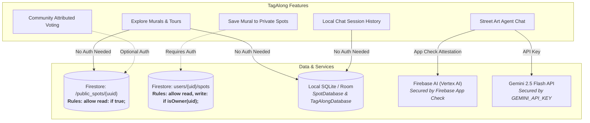
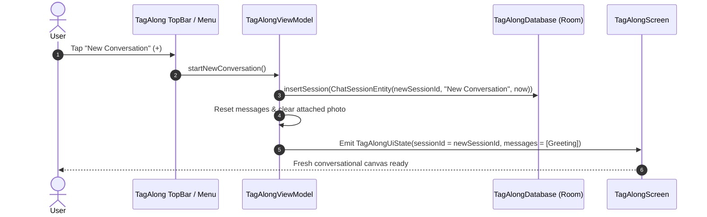
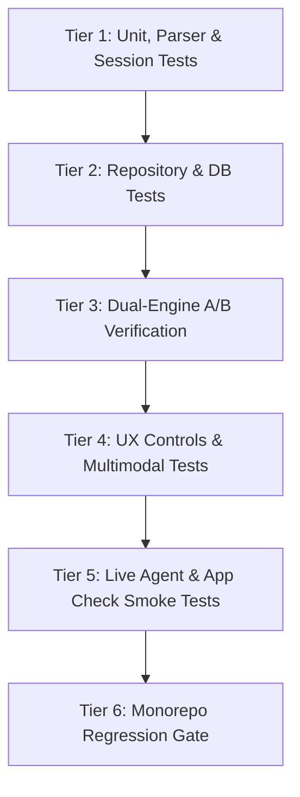

# Phase 4 and Beyond: TagAlong & A2UI Next Steps, Architecture & Test Plan

> **Document:** `docs/a2ui-phase-4-and-more.md`  
> **Master Intent Document:** [a2ui-kmp-intent-document.md](file:///Users/maia/workspace/maiatoday/tag-spotter/docs/a2ui-kmp-intent-document.md)  
> **Task Tracker:** [tagalong-task-tracker.md](file:///Users/maia/workspace/maiatoday/tag-spotter/docs/tagalong-task-tracker.md)  
> **ADK Runtime Guide:** [tagalong-adk-runtime-guide.md](file:///Users/maia/workspace/maiatoday/tag-spotter/docs/tagalong-adk-runtime-guide.md)  
> **Date:** 2026-11-15  
> **Workspace:** `/Users/maia/workspace/maiatoday/tag-spotter`

---

## 📑 Table of Contents

1. [Executive Summary & Baseline Status](#1-executive-summary--baseline-status)
2. [Strategic Question: Does TagAlong Need Login?](#2-strategic-question-does-tagalong-need-login)
   - [2.1 Current Architecture & Security Model](#21-current-architecture--security-model)
   - [2.2 Read vs. Write & App Check vs. Auth](#22-read-vs-write--app-check-vs-auth)
   - [2.3 Recommendation: Zero-Friction Guest-First with Optional Sign-In](#23-recommendation-zero-friction-guest-first-with-optional-sign-in)
3. [TagAlong Key UX Features & Session Architecture](#3-tagalong-key-ux-features--session-architecture)
   - [3.1 Light and Dark Mode Switching](#31-light-and-dark-mode-switching)
   - [3.2 "New Conversation" Lifecycle](#32-new-conversation-lifecycle)
   - [3.3 Conversation History Plan & Multi-Session Architecture](#33-conversation-history-plan--multi-session-architecture)
4. [UI Component Reuse & Design System Audit](#4-ui-component-reuse--design-system-audit)
   - [4.1 Current Component Inventory & Sharing Matrix](#41-current-component-inventory--sharing-matrix)
   - [4.2 Opportunities for Unification (`:core:ui`)](#42-opportunities-for-unification-coreui)
   - [4.3 Bi-directional Reuse (Tag Spotter using A2UI)](#43-bi-directional-reuse-tag-spotter-using-a2ui)
5. [Phase 4 Implementation Roadmap & Next Steps](#5-phase-4-implementation-roadmap--next-steps)
   - [Step 4.1: Android Firebase Configuration & App Check Setup](#step-41-android-firebase-configuration--app-check-setup)
   - [Step 4.2: Shared UI Primitives Consolidation (`:core:ui`)](#step-42-shared-ui-primitives-consolidation-coreui)
   - [Step 4.3: Theme Switching & New Conversation Controls](#step-43-theme-switching--new-conversation-controls)
   - [Step 4.4: Cross-App Deep Linking & Handoff Contract](#step-44-cross-app-deep-linking--handoff-contract)
   - [Step 4.5: Agentic "Save as New Spot" & Interactive Action Callbacks](#step-45-agentic-save-as-new-spot--interactive-action-callbacks)
   - [Step 4.6: Conversation History Drawer / Sheet Implementation](#step-46-conversation-history-drawer--sheet-implementation)
   - [Step 4.7: Full Monorepo Multi-App Regression Gate](#step-47-full-monorepo-multi-app-regression-gate)
6. [Future Phases Horizon (Phase 5+)](#6-future-phases-horizon-phase-5)
7. [Comprehensive Test Plan for TagAlong Companion App](#7-comprehensive-test-plan-for-tagalong-companion-app)
   - [Tier 1: Unit, Parser & Session Tests](#tier-1-unit-parser--session-tests)
   - [Tier 2: Repository & Persistence Tests](#tier-2-repository--persistence-tests)
   - [Tier 3: Dual-Engine A/B Verification Test Suite](#tier-3-dual-engine-ab-verification-test-suite)
   - [Tier 4: UX Controls & Multimodal Tests (Theme, Session, Photo)](#tier-4-ux-controls--multimodal-tests-theme-session-photo)
   - [Tier 5: Live Agent & App Check Smoke Tests](#tier-5-live-agent--app-check-smoke-tests)
   - [Tier 6: Monorepo Regression Gate](#tier-6-monorepo-regression-gate)
8. [Clean Context Handoff & Execution Prompt](#8-clean-context-handoff--execution-prompt)

---

## 1. Executive Summary & Baseline Status

Phases 1 through 3 of the A2UI and Google ADK migration are complete:
- **Phase 1 (Foundation):** Model schema updated with `isPublic`, Room migration `MIGRATION_13_14` implemented, Firestore dual-write to `/public_spots/{uuid}` operational with security rules, and `HybridSpotRepository` active.
- **Phase 2 (Regression Gate):** Full Tag Spotter regression suite passed completely across Android, Desktop JVM, and Wasm targets.
- **Phase 3 (TagAlong Companion App):**
  - Architecture skeleton established across `:core:a2ui`, `:core:agent`, `:feature:tagalong`, `:tagalongApp:desktop`, and `:tagalongApp:android`.
  - Neon A2UI Urban Suite catalog implemented (`SpotCard`, `TourCard`, `ArtistBioCard`, `StyleQuizWidget`, `CommunityVotingCard`, `MapPinOverlayWidget`).
  - Dual-engine adapter functional (`a2ui-kmp` in `commonMain` + Google's official `androidx.a2ui` in `androidMain`).
  - Desktop JVM companion app runs with responsive 2-pane layout, photo picker, and live `GEMINI_API_KEY` runner or offline mock catalog.
  - Android companion app runs with top-bar dual-engine toggle, interactive mock catalog, and graceful offline fallback when unconfigured.

**Phase 4** focuses on:
1. Production configuration of Android Firebase App Check + live Gemini ADK inference.
2. Systematic UI component consolidation and maximal code reuse across both apps.
3. Defining the user identity / authentication strategy for TagAlong.
4. Implementing cross-app deep linking and action dispatching.
5. Establishing a comprehensive, repeatable test plan for TagAlong.

---

## 2. Strategic Question: Does TagAlong Need Login?

### 2.1 Current Architecture & Security Model

To determine if TagAlong needs user authentication, we examine where data is read and written, and how LLM inference is authorized:



### 2.2 Read vs. Write & App Check vs. Auth

1. **Reading Public Spots (Open Access):**
   In [firestore.rules](file:///Users/maia/workspace/maiatoday/tag-spotter/firestore.rules#L107-L109):
   ```javascript
   match /public_spots/{uuid} {
     allow read: if true;
   }
   ```
   Anyone can read public spots without signing in. TagAlong queries `/public_spots` to answer user questions, display nearby murals, and build walking tours. **No login required.**

2. **Local Chat Persistence (On-Device):**
   `TagAlongDatabase` (`ChatSessionEntity`, `ChatMessageEntity`) lives in the local app container. **No login required.**

3. **LLM Inference Security (App Check vs. User Auth):**
   - On Android, `com.google.firebase.ai` uses **Firebase App Check** (Play Integrity provider), which verifies that requests originate from your authentic, untampered app binary. **App Check does not require a logged-in user.**
   - On Desktop JVM, the runner uses `GEMINI_API_KEY`. **No user login required.**

4. **When IS Login Required?**
   - **Personal Spot Access:** If a user wants TagAlong to see their *private* unshared spots from Tag Spotter on another device (reading `users/{userId}/spots`), Firebase Auth is required (`isOwner(userId)`).
   - **Spot Creation / Modification from Chat:** If the agent offers a *"Save this mural to my collection"* button and syncs it to the cloud, the user must be authenticated.
   - **Attributed Community Contributions:** If voting on mural styles or submitting artist attributions requires verified community identity rather than anonymous votes.

### 2.3 Recommendation: Zero-Friction Guest-First with Optional Sign-In

> [!IMPORTANT]
> **Recommended Decision: Guest-First (No mandatory login).**
> - **Default Experience:** TagAlong opens immediately into the chat/map interface. Users can immediately chat, browse murals, generate walking tours, and test style quizzes without any registration barrier.
> - **Optional Account Linking (Phase 4.4 / Phase 5):** Provide an optional profile/account icon in the top bar. If the user signs in with Google or Email (reusing `AuthService` from `:core:sync`), TagAlong connects their personal collection and unlocks private spot sync and author attribution.

---

## 3. TagAlong Key UX Features & Session Architecture

### 3.1 Light and Dark Mode Switching

TagAlong's visual aesthetic is anchored around the **Urban Neon** palette. Both light and dark palettes already exist in [Theme.kt](file:///Users/maia/workspace/maiatoday/tag-spotter/core/ui/src/commonMain/kotlin/net/maiatoday/tagspotter/core/ui/theme/Theme.kt):
- **`UrbanDarkColorScheme`:** High-contrast pitch-black and deep carbon backgrounds with electric cyan (`#00FFCC`), hot magenta (`#FF007F`), and lime green accents.
- **`UrbanLightColorScheme`:** Clean light surfaces with deep charcoal typography and vibrant urban saturated accents.

#### Architectural Specification:
1. **Theme Mode Enum:** Introduce `ThemeMode { SYSTEM, LIGHT, DARK }` in `:core:ui` or `:feature:tagalong`.
2. **Top Bar Quick Toggle:** Add a Sun / Moon toggle icon in the `TagAlongScreen` / `MainActivity` TopAppBar:
   - When in Dark: displays Sun icon (`Icons.Default.LightMode`) -> switches to Light.
   - When in Light: displays Moon icon (`Icons.Default.DarkMode`) -> switches to Dark.
3. **Reactive Re-theming:**
   - In `MainActivity.kt` and Desktop `Main.kt`, bind `MyApplicationTheme(darkTheme = when(themeMode) { ... })`.
   - Ensure A2UI component cards in `:core:a2ui` use semantic theme tokens (`MaterialTheme.colorScheme.surfaceVariant`, `LocalCategoryColors.current`) so cards look vibrant and readable in both modes.

---

### 3.2 "New Conversation" Lifecycle

A conversational companion app must make starting a fresh thread effortless without forcing the user to delete or overwrite past context.



#### Implementation Details:
1. **Action in Top Bar:** Place a distinct `+` ("New Chat") button in the `TopAppBar` on both Android and Desktop.
2. **ViewModel Implementation:**
   ```kotlin
   fun startNewConversation() {
       val newSessionId = "session-${epochMillis()}"
       viewModelScope.launch {
           val initialSession = ChatSession(
               sessionId = newSessionId,
               title = "New Conversation",
               createdAt = epochMillis(),
               lastActiveAt = epochMillis()
           )
           chatRepository.insertSession(initialSession)
           _uiState.update { current ->
               current.copy(
                   sessionId = newSessionId,
                   messages = listOf(createDefaultAgentWelcomeMessage()),
                   inputText = "",
                   attachedPhotoUri = null
               )
           }
       }
   }
   ```
3. **Session Auto-titling:** When the user sends their first message in this new session, update `ChatSessionEntity.title` using the first 30 characters of their prompt (or a concise agent-generated summary).

---

### 3.3 Conversation History Plan & Multi-Session Architecture

TagAlong's persistence layer in [TagAlongDatabase.kt](file:///Users/maia/workspace/maiatoday/tag-spotter/core/database/src/nonWebMain/kotlin/net/maiatoday/tagspotter/core/database/TagAlongDatabase.kt) was engineered from Day 1 to support multiple sessions with cascading foreign keys:

```kotlin
@Entity(tableName = "chat_sessions")
data class ChatSessionEntity(
    @PrimaryKey val sessionId: String,
    val title: String,
    val createdAt: Long,
    val lastActiveAt: Long = createdAt
)
```

The underlying `ChatDao` already exposes:
- `getAllSessions(): Flow<List<ChatSessionEntity>>`
- `getSessionById(sessionId: String): ChatSessionEntity?`
- `deleteSessionById(sessionId: String)`
- `getMessagesForSession(sessionId: String): Flow<List<ChatMessageEntity>>`

#### Planned Conversation History UI Architecture:
1. **Drawer / History Sheet:**
   - **Desktop (JVM):** A collapsible Left Navigation Sidebar showing previous conversation sessions grouped by date (*"Today"*, *"Yesterday"*, *"Last 7 Days"*).
   - **Android:** A slide-out `NavigationDrawer` or `ModalBottomSheet` triggered by a History icon (`Icons.Default.History`) in the `TopAppBar`.
2. **History Item Interactions:**
   - **Tap Session:** Invokes `viewModel.switchSession(sessionId)`. Loads past conversation turns and any associated A2UI cards from SQLite into memory.
   - **Delete Session:** Swipe-to-dismiss or trash icon triggers `chatRepository.deleteSessionById(sessionId)`, cascading removal of all stored messages.
   - **Rename Session:** Optional inline edit for conversation titles.
3. **Session Switching Logic (`TagAlongViewModel`):**
   ```kotlin
   fun switchSession(targetSessionId: String) {
       viewModelScope.launch {
           val messages = chatRepository.getMessagesListForSession(targetSessionId)
           _uiState.update { current ->
               current.copy(
                   sessionId = targetSessionId,
                   messages = messages.map { it.toTagAlongMessage() }
               )
           }
       }
   }
   ```

---

## 4. UI Component Reuse & Design System Audit

A primary objective is ensuring maximum reuse of Compose UI components between **Tag Spotter** and **TagAlong**, preventing duplicated code and fragmented styling.

### 3.1 Current Component Inventory & Sharing Matrix

| UI Component | Current Location | Tag Spotter Uses? | TagAlong Uses? | Sharing Status | Action Plan |
| :--- | :--- | :---: | :---: | :---: | :--- |
| **`SpotMapView` / `MapMarker`** | `:core:ui` | ✅ Yes (`:feature:map`, `:feature:detail`) | ✅ Yes (`:feature:tagalong`) | 🟢 Fully Reused | Maintain in `:core:ui`. Add polyline route overlay support for walking tours. |
| **Theme & Color Tokens** | `:core:ui` (`theme/`) | ✅ Yes | ✅ Yes | 🟢 Fully Reused | Standardized Dark Neon Palette (`DarkBackground`, `DarkPrimaryContainer`, etc.). |
| **Category Colors & Names** | `:core:ui` (`CategoryExtensions.kt`) | ✅ Yes | ⚠️ Partial | 🟡 Needs Adoption | TagAlong should use `CategoryExtensions.getDisplayName()` and `categoryColor()` inside `NeonSpotCard`. |
| **`ZoomableImageOverlay`** | `:feature:detail` | ✅ Yes | ❌ No (inline only) | 🔴 Duplication Risk | **Move to `:core:ui`** so TagAlong chat and cards can trigger full-screen photo zoom. |
| **`DetailMiniMapCard`** | `:feature:detail` | ✅ Yes | ⚠️ Custom Card | 🟡 Needs Unification | Merge concepts with `MapPinOverlayWidget` in `:core:a2ui` or `:core:ui`. |
| **Category Filter Chips** | `:feature:gallery` | ✅ Yes | ⚠️ Custom Chips | 🟡 Needs Unification | Extract `NeonFilterChip` into `:core:ui`. |
| **Neon A2UI Component Suite** | `:core:a2ui` (`NeonA2UIComponents.kt`) | ❌ No | ✅ Yes | 🟣 Opportunity | Export components to `:core:ui` so Tag Spotter's `DetailScreen` can render rich artist/tour cards! |

### 4.2 Opportunities for Unification (`:core:ui`)

To achieve complete visual cohesion and eliminate duplication, the following components should be moved or promoted into `:core:ui`:

1. **`ZoomableImageOverlay.kt`:**
   - *Current:* Embedded in `feature/detail/src/commonMain/.../ZoomableImageOverlay.kt`.
   - *Target:* Move to `core/ui/src/commonMain/.../image/ZoomableImageOverlay.kt`.
   - *Benefit:* Both Tag Spotter detail screens and TagAlong chat message photo previews can open high-resolution mural images with pinch-to-zoom and pan gestures.

2. **`NeonBadge` & `NeonTagChip`:**
   - *Current:* Re-implemented inline with custom `Surface` and `BorderStroke` across `DetailMetadataCard.kt`, `GalleryScreen.kt`, and `NeonA2UIComponents.kt`.
   - *Target:* Create standardized `NeonTagChip(text, color, onClick)` and `NeonCategoryBadge(category)` in `:core:ui`.

3. **`SpotSummaryCard`:**
   - *Current:* `SpotCardData` in `:core:a2ui` renders mural details, while `GalleryScreen` renders grid cards.
   - *Target:* Ensure `NeonSpotCard` can accept a domain `Spot` model directly, serving as a unified preview card across both apps.

### 4.3 Bi-directional Reuse (Tag Spotter using A2UI)

A2UI shouldn't be a one-way street for TagAlong. Tag Spotter can leverage A2UI components directly:
- **Detail Screen Suggestions:** In `DetailScreen`, Tag Spotter can render an `ArtistBioCard` or related `TourCard` generated by Gemini using the same A2UI renderer engine.
- **Mural History & Attribution:** When Tag Spotter's single-shot AI analyzes a mural, it can produce an A2UI JSON payload that renders interactive style attribution and trivia directly in the detail view.

---

## 5. Phase 4 Implementation Roadmap & Next Steps

```mermaid
flowchart TD
    subgraph Phase 4: Production Integration, UX Features & Component Consolidation
        S41[Step 4.1: Android Firebase & App Check Setup]
        S42[Step 4.2: UI Primitives Consolidation in :core:ui]
        S43[Step 4.3: Theme Switching & New Conversation Controls]
        S44[Step 4.4: Cross-App Deep Linking Contracts]
        S45[Step 4.5: Agentic Actions & Spot Saving]
        S46[Step 4.6: Conversation History Drawer / Sheet]
        S47[Step 4.7: Monorepo Multi-App Regression Gate]
    end

    S41 --> S42
    S42 --> S43
    S43 --> S44
    S44 --> S45
    S45 --> S46
    S46 --> S47
```

### Step 4.1: Android Firebase Configuration & App Check Setup
- **Goal:** Enable live Google ADK Gemini agent execution on Android emulators and physical devices without falling back to mock catalog mode.
- **Work Items:**
  1. Add Android package `net.maiatoday.tagalong.android` to the Firebase project in Firebase Console.
  2. Download updated `google-services.json` (containing both `net.maiatoday.tagspotter` and `net.maiatoday.tagalong.android` client definitions) and place in `tagalongApp/android/google-services.json` (or root/shared config).
  3. Apply `alias(libs.plugins.google.services)` in `tagalongApp/android/build.gradle.kts`.
  4. In `TagAlongApplication.kt`, configure `DebugAppCheckProviderFactory` for debug builds and output the App Check debug secret token to `Logcat` (`adb logcat -s TagAlongApplication:D`). Register this token in Firebase Console > App Check > Apps > TagAlong Debug Provider.
- **Verification:**
  - Launch `:tagalongApp:android` on emulator.
  - Verify in Logcat: `AppCheck: Debug secret token registered successfully` and `ADK Runner initialized with Firebase model`.
  - Send message *"Tell me about street art near Mitte"* and verify live streaming response from Gemini.

### Step 4.2: Shared UI Primitives Consolidation (`:core:ui`)
- **Goal:** Extract repeated UI widgets into `:core:ui` and ensure both Tag Spotter and TagAlong share identical styling.
- **Work Items:**
  1. Move `ZoomableImageOverlay.kt` from `:feature:detail` to `:core:ui`.
  2. Create `NeonTagChip` and `NeonCategoryBadge` in `:core:ui/src/commonMain/.../chips/`.
  3. Refactor `DetailMetadataCard.kt`, `GalleryScreen.kt`, and `NeonA2UIComponents.kt` to consume the unified chips.
  4. Ensure `CategoryExtensions.kt` colors are consumed uniformly by `NeonA2UIComponents.kt`.
- **Verification:**
  - `./gradlew :core:ui:allTests :feature:detail:allTests :core:a2ui:allTests`

### Step 4.3: Theme Switching & New Conversation Controls
- **Goal:** Provide seamless user control over Light/Dark modes and starting fresh conversation sessions from the UI.
- **Work Items:**
  1. Introduce `ThemeMode { SYSTEM, LIGHT, DARK }` and theme toggle icon in the `TagAlongScreen` / `MainActivity` TopAppBar.
  2. Wire theme toggle state to `MyApplicationTheme` in `MainActivity.kt` and Desktop `Main.kt`.
  3. Add `+` ("New Chat") button in `TagAlongScreen` top bar calling `TagAlongViewModel.startNewConversation()`.
  4. Implement `startNewConversation()` to create a fresh session in `TagAlongDatabase`, reset the message stream with greeting, and clear attached photos.
- **Verification:**
  - `./gradlew :feature:tagalong:allTests :tagalongApp:desktop:assemble :tagalongApp:android:assembleDebug`
  - Toggle theme icon in running app: verify UI switches between `UrbanDarkColorScheme` and `UrbanLightColorScheme`.
  - Tap `+`: verify message list resets to fresh welcome state and new `sessionId` is assigned.

### Step 4.4: Cross-App Deep Linking & Handoff Contract
- **Goal:** Enable smooth navigation between Tag Spotter and TagAlong.
- **Work Items:**
  1. Define URI scheme in `:core:model` or `:core:ui`:
     - `tagalong://spot/{uuid}?lat={lat}&lon={lon}` (opens TagAlong focused on a spot).
     - `tagspotter://capture?lat={lat}&lon={lon}` (opens Tag Spotter's camera to log a new piece).
     - `tagspotter://detail/{uuid}` (opens Tag Spotter's full detail screen).
  2. Register intent filters in `tagalongApp/android/src/main/AndroidManifest.xml` and `androidApp/src/main/AndroidManifest.xml`.
  3. Handle `A2UIAction.ViewSpotDetail(spotId)` by triggering the deep link to Tag Spotter if installed, or expanding an inline sheet if standalone.
- **Verification:**
  - `adb shell am start -W -a android.intent.action.VIEW -d "tagalong://spot/test-uuid" net.maiatoday.tagalong.android`

### Step 4.5: Agentic "Save as New Spot" & Interactive Action Callbacks
- **Goal:** Allow the user to take/attach a photo in TagAlong chat, have the agent identify the artist/style, and click a button on the generated A2UI card to save it directly into `SpotRepository`.
- **Work Items:**
  1. Add `A2UIAction.SaveSpot(spotData)` handling to `TagAlongViewModel`.
  2. Wire `HybridSpotRepository.saveSpot(...)` to persist the new spot locally (and to `/public_spots` if `isPublic` is selected).
  3. Provide instant visual feedback in chat: *"Saved to your murals collection!"* with a direct link to view it.
- **Verification:**
  - Test via mock payload and live chat: click "Save Mural", verify spot appears in `SpotRepository.getAllSpots()`.

### Step 4.6: Conversation History Drawer / Sheet Implementation
- **Goal:** Enable users to browse, switch between, and manage past chat sessions saved in `TagAlongDatabase`.
- **Work Items:**
  1. Expose `val allSessions: StateFlow<List<ChatSession>>` in `TagAlongViewModel` collected from `ChatDao.getAllSessions()`.
  2. Implement a `NavigationDrawer` (Desktop left pane) and `ModalBottomSheet` (Android) listing sessions ordered by `lastActiveAt DESC`.
  3. Wire tap on history item to `viewModel.switchSession(sessionId)`.
  4. Add delete icon / swipe-to-delete calling `chatRepository.deleteSessionById(sessionId)`.
  5. Include "Start New Chat" shortcut at the top of the history list.
- **Verification:**
  - Test session switching in ViewModel test: verify messages for selected session load into `uiState.messages`.
  - Delete session test: verify session and all associated messages are removed from SQLite.

### Step 4.7: Full Monorepo Multi-App Regression Gate
- **Goal:** Ensure all targets across the entire monorepo compile, pass tests, and assemble without regression.
- **Command:**
  ```bash
  ./gradlew allTests :androidApp:assembleDebug :tagalongApp:android:assembleDebug :desktopApp:assemble :tagalongApp:desktop:assemble
  ```

---

## 6. Future Phases Horizon (Phase 5+)

| Phase | Title | Key Deliverables |
| :--- | :--- | :--- |
| **Phase 5** | **Offline Tour Caching & Geofenced Alerts** | Offline bundle download for walking routes, background GPS proximity triggers (25m alert when nearing a mural), reactive location stream. |
| **Phase 6** | **Audio Tour Guide (TTS Narration)** | Real-time spoken tour narration using platform speech synthesis (Text-to-Speech) as user reaches tour waypoints. |
| **Phase 7** | **Curated Community Tour Packs** | Cloud pack publishing (`/shared_packs/{code}`) directly from agent-generated walking tours with QR code sharing. |
| **Phase 8** | **iOS & Web Targets for TagAlong** | Expand TagAlong to iOS and Wasm once `google/adk-kotlin` publishes Kotlin/Native and Kotlin/Wasm artifacts. |

---

## 7. Comprehensive Test Plan for TagAlong Companion App

To ensure stability across platforms, engines, and multimodal inputs, TagAlong utilizes a 6-tier test plan:



### Tier 1: Unit, Parser & Session Tests
- **Module:** `:core:a2ui`, `:core:agent`, `:feature:tagalong`
- **Scope:**
  - A2UI JSON payload deserialization (`A2UIPayloadParserTest`).
  - Validation of all catalog component types: `SpotCard`, `TourCard`, `ArtistBioCard`, `StyleQuizWidget`, `CommunityVotingCard`, `MapPinOverlayWidget`.
  - Fallback error resilience: verify malformed JSON or unknown component tags cleanly produce a `FallbackComponentData` without throwing exceptions.
  - Action serialization and roundtrip parsing (`A2UIAction`).
  - `TagAlongViewModelTest`: verify `startNewConversation()` creates new session, loads welcome message, and clears inputs.
  - Verify `switchSession(targetSessionId)` updates state messages from repository.
- **Command:**
  ```bash
  ./gradlew :core:a2ui:allTests :feature:tagalong:allTests :core:agent:allTests
  ```

### Tier 2: Repository & Persistence Tests
- **Module:** `:core:database`, `:core:sync`
- **Scope:**
  - `TagAlongDatabase` Room operations: create session, append user/agent messages, query chat history ordered by timestamp.
  - Multi-session queries: `getAllSessions()`, `getSessionById()`, cascading delete via `deleteSessionById()`.
  - `RoomChatRepository` flow emissions when new messages are stored.
  - `HybridSpotRepository` spot merging and deduplication: local spots + remote public Firestore spots.
- **Command:**
  ```bash
  ./gradlew :core:database:allTests :core:sync:allTests
  ```

### Tier 3: Dual-Engine A/B Verification Test Suite
- **Module:** `:core:a2ui`, `:tagalongApp:android`
- **Scope:**
  - **Engine 1 (`a2ui-kmp`):** Verify full catalog rendering via Compose Multiplatform runtime on both JVM and Android.
  - **Engine 2 (`androidx.a2ui`):** Verify official Jetpack Compose rendering on Android.
  - **Live Runtime Switching:** Verify that toggling between engines in Dev Settings / Top Bar dynamically recomposes the active chat view without state loss or memory leaks.
- **Execution:**
  - Manual verification on Android emulator running Pixel 9 (API 35).
  - Tap gear/toggle icon in top bar -> Switch from `a2ui-kmp` to `androidx.a2ui` -> Confirm all 6 mock catalog cards render crisply.

### Tier 4: UX Controls & Multimodal Tests (Theme, Session, Photo)
- **Module:** `:feature:tagalong`, `:tagalongApp:desktop`, `:tagalongApp:android`
- **Scope:**
  - **Theme Toggle:** Switch between Light and Dark mode; confirm text legibility, card borders, and map pin contrast.
  - **New Conversation Action:** Tap `+` button; confirm chat stream resets cleanly while past session remains intact in SQLite.
  - **Conversation History Drawer:** Open history; select previous session; confirm past cards and chat turns restore accurately.
  - **Image Attachment Workflow:** Attach local file URI (`file://` or `content://`), verify preview thumbnail appears above chat input, and clear button resets state.
  - **Map Synchronization:** Verify clicking *"View on Map"* on a `SpotCard` or tour waypoint updates `mapCenterLat`, `mapCenterLng`, and focuses the target pin on `SpotMapView`.
- **Command:**
  ```bash
  ./gradlew :feature:tagalong:allTests
  ```

### Tier 5: Live Agent & App Check Smoke Tests
- **Target:** `:tagalongApp:desktop`, `:tagalongApp:android`
- **Scope:**
  - **Desktop JVM Smoke Test:**
    1. Set `export GEMINI_API_KEY="your-key"`.
    2. Run `./gradlew :tagalongApp:desktop:run`.
    3. Type *"What street art is nearby?"* -> Verify agent executes `getNearbySpots` tool and streams an A2UI `SpotCard`.
    4. Run without API key -> Verify offline catalog mode banner displays cleanly and mock cards remain interactive.
  - **Android Smoke Test:**
    1. Build and install: `./gradlew :tagalongApp:android:installDebug`.
    2. Launch: `adb shell am start -n net.maiatoday.tagalong.android/.MainActivity`.
    3. Verify zero crashes on boot.
    4. Verify App Check debug attestation token in Logcat.

### Tier 6: Monorepo Regression Gate
- **Target:** Full Monorepo
- **Scope:**
  - Verify Tag Spotter (`:androidApp`, `:desktopApp`, `:webApp`, `:wear`) is 100% intact.
  - All automated test suites across all 14 modules must pass.
- **Command:**
  ```bash
  ./gradlew allTests :androidApp:assembleDebug :tagalongApp:android:assembleDebug :desktopApp:assemble :tagalongApp:desktop:assemble
  ```

---

## 8. Clean Context Handoff & Execution Prompt

When beginning Phase 4 in a fresh session, copy and paste the prompt below to resume work with exact alignment:

```markdown
Resume the Tag Spotter / TagAlong monorepo project at Phase 4.
Refer to docs/a2ui-phase-4-and-more.md and docs/tagalong-task-tracker.md.

Baseline Status:
- Phase 1, Phase 2, and Phase 3 are 100% complete.
- TagAlong runs on Desktop JVM and Android emulator (offline/mock catalog mode).
- Tag Spotter is 100% regression-free.

Immediate Next Tasks:
1. Implement Step 4.3: Add Light/Dark Mode toggle and "New Conversation" (+) control in TagAlong TopAppBar and ViewModel.
2. Implement Step 4.2: Consolidate shared UI primitives into :core:ui (move ZoomableImageOverlay, unify NeonTagChip / NeonCategoryBadge).
3. Plan & Stage Step 4.6: Conversation History Drawer / Sheet using existing TagAlongDatabase multi-session support.
4. Prepare Step 4.1: Configure Android Firebase App Check and Google Services for net.maiatoday.tagalong.android.
5. Execute Tier 1 & Tier 2 tests from the TagAlong Test Plan.
```