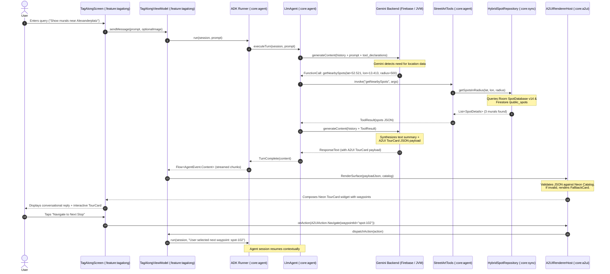

# TagAlong: Google ADK Runtime Architecture & Lifecycle Guide

> **Date:** 2026-11-12  
> **Target Project:** TagAlong Companion App (Tag Spotter Monorepo)  
> **Companion Intent Document:** [a2ui-kmp-intent-document.md](a2ui-kmp-intent-document.md)  
> **Task Tracker:** [tagalong-task-tracker.md](tagalong-task-tracker.md)

---

## 1. Overview & Purpose

This document explains the runtime lifecycle, execution loops, and architectural contracts of the **Google Agent Development Kit (ADK) for Kotlin** (`google/adk-kotlin`) within the **TagAlong** companion app.

TagAlong is an agentic street art guide that allows users to ask open-ended questions (*"Show me murals near Alexanderplatz"*, *"What style is this piece?"*), inspect nearby spots, and interact with dynamically rendered generative widgets (A2UI).

---

## 2. End-to-End Runtime Sequence Diagram

The following sequence diagram details the full multi-turn execution loop: from user input, through the ADK reasoning engine and local tool execution, to generative A2UI widget rendering and interactive upstream action callbacks.



---

## 3. Core ADK Concepts in Kotlin

### 3.1 `LlmAgent` Definition
An agent is declared in `:core:agent` as an immutable definition combining:
1. **Instruction (System Prompt)**: Defines the persona, bounds what tools the agent can use, and dictates strict output contracts for emitting A2UI JSON payloads conforming to the Neon Urban Catalog.
2. **Model Backend**: Pluggable backend driver:
   * **Android**: `FirebaseModel("gemini-4-hydrogen")` backed by **Firebase AI Logic** and protected by **Firebase App Check** (Play Integrity in release, Debug Provider in debug builds).
   * **Desktop JVM**: Direct `Gemini` model driver authenticated via `local.properties` API keys or `SecretsProvider`.
3. **Tools**: List of POJO instances containing methods annotated with `@Tool` and `@Param`.

### 3.2 Compile-Time Tool Schemas (KSP Processor)
Instead of relying on runtime reflection (which degrades mobile startup performance and breaks under R8/ProGuard code shrinking), Google ADK uses a Kotlin Symbol Processor (`com.google.adk:google-adk-kotlin-processor`):
* Annotating a method with `@Tool(name, description)` generates compile-time descriptor metadata.
* Function parameter types and `@Param` docstrings are converted directly into standard OpenAPI / Gemini Function Declaration schemas during `./gradlew assemble`.

### 3.3 Session Management & Multi-Turn Memory
* **`InMemoryRunner`**: Maintains an active in-memory session graph tracking multi-turn conversation context and compaction.
* **`TagAlongDatabase`**: An isolated SQLite/Room database in `:core:database` persisting chat messages (`ChatMessageEntity`) and sessions (`ChatSessionEntity`) so conversational history survives app restarts.

---

## 4. Tool Execution & Data Isolation

The ADK agent does not access device databases or networks directly. All data access is mediated through registered tools:

```
StreetArtTools (@Tool methods)
      │
      ▼
HybridSpotRepository (:core:sync)
      ├──► SpotDatabase v14 (:core:database - Local User Murals)
      └──► Cloud Firestore (/public_spots - Community Murals)
```

* **Zero Schema Leaks**: Private user murals (`users/{userId}/spots`) are never exposed directly to the model. The tool only receives sanitized domain models via `HybridSpotRepository`.
* **Safe Local Execution**: The model emits a function call name and parameter dictionary; the ADK engine dispatches the call on the client device inside coroutine dispatchers.

---

## 5. The A2UI Boundary & Resilience Safeguards

> [!WARNING]
> The ADK engine evaluates LLM generation strictly from a text/reasoning perspective. It has no intrinsic knowledge of Android Jetpack Compose or UI component trees.

1. **Downstream Isolation**:
   * The agent generates a declarative JSON payload matching the A2UI specification.
   * `:core:a2ui` (`A2UIRendererHost`) acts as the defensive gatekeeper. If Gemini outputs malformed JSON or references an unknown card type, the host renders a **Neon Fallback Card** (with textual fallback and an expandable debug JSON inspector in debug builds) rather than throwing an exception or crashing the Compose tree.
2. **Upstream Action Dispatch**:
   * A2UI widgets are not passive text. Interactive chips and buttons emit `A2UIAction` callbacks (e.g. selecting a quiz answer, voting on tag styles, or navigating waypoints).
   * `TagAlongViewModel` translates these callbacks into synthetic user inputs or resumes the active ADK session, creating a complete bidirectional agentic loop.
