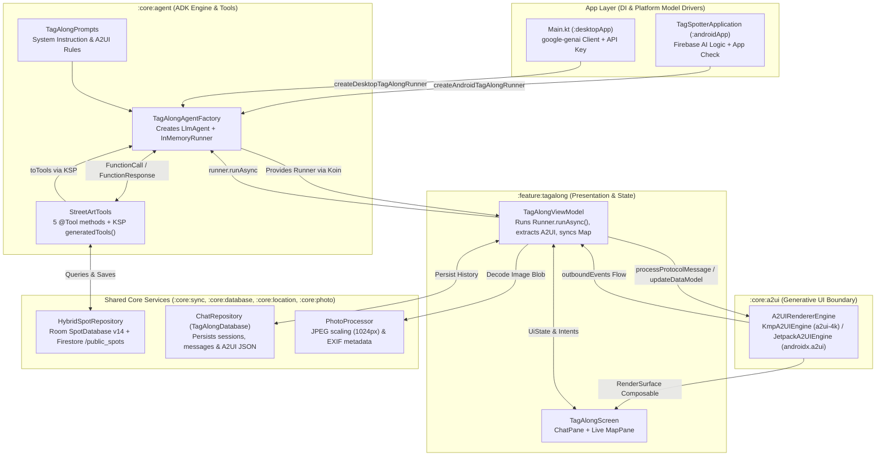
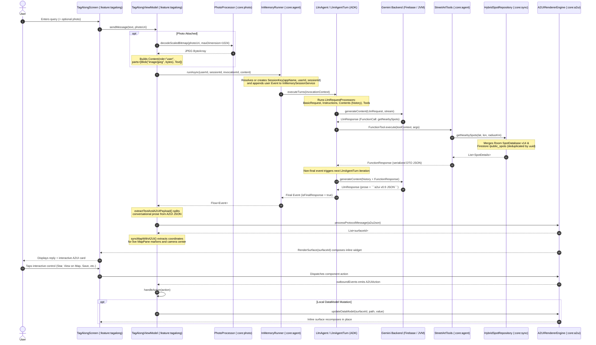
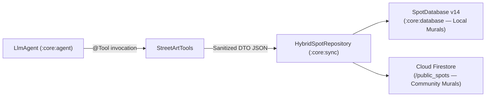

# TagAlong: Google ADK Runtime Architecture & Lifecycle Guide

> **Updated:** 2026-11-21  
> **Target Project:** TagAlong Mode (Tag Spotter Monorepo — `:androidApp` & `:desktopApp`)  
> **Companion Intent Document:** [a2ui-kmp-intent-document.md](a2ui-kmp-intent-document.md)  
> **Phase 4 Architecture:** [a2ui-phase-4-and-more.md](a2ui-phase-4-and-more.md)  
> **Task Tracker:** [tagalong-task-tracker.md](tagalong-task-tracker.md)

---

## 1. Overview & Purpose

This document explains the runtime lifecycle, execution loops, and architectural contracts of the **Google Agent Development Kit (ADK) for Kotlin** (`com.google.adk:google-adk-kotlin-*` v`0.2.0`) within **TagAlong**.

TagAlong is an agentic street art companion embedded directly inside the Tag Spotter Android and Desktop apps. It lets users ask open-ended questions (*"Show me murals near Alexanderplatz"*, *"Plan a 45-minute walking tour"*, *"What style is this piece?"*), attach mural photos for multimodal analysis, query local and community spots, and interact with dynamically rendered **A2UI v0.9** generative widgets.

---

## 2. High-Level Component Architecture

TagAlong cleanly separates **platform model provisioning** (App layer), **agent orchestration & tools** (`:core:agent`), **generative UI rendering** (`:core:a2ui`), and **state/UI presentation** (`:feature:tagalong`).



---

## 3. End-to-End Runtime Sequence Diagram

The following sequence diagram details a complete turn: from user prompt (with optional photo) through the ADK `InMemoryRunner` and `LlmAgentTurn` loop, local tool execution against `HybridSpotRepository`, A2UI v0.9 surface rendering, map synchronization, and reactive UI actions.



---

## 4. Core ADK Concepts & Internals in Kotlin

### 4.1 `LlmAgent` & `TagAlongAgentFactory`
Agents are constructed in [TagAlongAgentFactory.kt](file:///Users/maia/workspace/maiatoday/tag-spotter/core/agent/src/commonMain/kotlin/net/maiatoday/tagspotter/core/agent/TagAlongAgentFactory.kt) using `com.google.adk.kt.agents.LlmAgent`:

1. **System Instructions (`instruction` vs. `staticInstruction`)**:
   * `InstructionsProcessor` in `google-adk-kotlin` processes two instruction fields:
     * **`staticInstruction`** (`Content`): Sent verbatim as the system instruction prefix with **no** template substitution (ideal for static prompts, JSON schemas, or JSON examples containing `{...}`).
     * **`instruction`** (`Instruction`): Supports `{variable_name}` session-state interpolation via `InstructionStateInjector` before being appended to the system instruction (or as user content when `staticInstruction` is also set).
   * [TagAlongPrompts.kt](file:///Users/maia/workspace/maiatoday/tag-spotter/core/agent/src/commonMain/kotlin/net/maiatoday/tagspotter/core/agent/TagAlongPrompts.kt) builds the persona, tool usage guidance, and A2UI v0.9 protocol instructions.
2. **Pluggable Model Backends** (default model: `"gemini-4-hydrogen"`, temperature `0.7f`):
   * **Android** ([AndroidTagAlongAgent.kt](file:///Users/maia/workspace/maiatoday/tag-spotter/core/agent/src/androidMain/kotlin/net/maiatoday/tagspotter/core/agent/AndroidTagAlongAgent.kt)): Uses `com.google.adk.firebase.models.Firebase.create(modelName, Firebase.ai)` backed by **Firebase AI Logic** (`com.google.firebase:firebase-ai`) and protected by **Firebase App Check** (`DebugAppCheckProviderFactory` in debug builds, `PlayIntegrityAppCheckProviderFactory` in release builds). In ADK `0.2.0`, the Firebase driver executes unary (`generateContent`) calls.
   * **Desktop JVM** ([DesktopTagAlongAgent.kt](file:///Users/maia/workspace/maiatoday/tag-spotter/core/agent/src/jvmMain/kotlin/net/maiatoday/tagspotter/core/agent/DesktopTagAlongAgent.kt)): Uses `com.google.adk.kt.models.Gemini(client, name)` backed by the unified **Google Gen AI SDK** (`com.google.genai:google-genai`) authenticated via API key.
   * **Offline Mode**: When no `Runner` is provided by DI (e.g., no API key configured on Desktop), `TagAlongViewModel` gracefully falls back to an inline Offline Mode banner while still allowing users to inspect local spots and test A2UI mock fixtures.
3. **Multi-Turn Agent Loop (`LlmAgentTurn`)**:
   * On each `runner.runAsync(...)` call, `LlmAgent.executeTurns()` runs a `do { ... } while (!context.isEndOfInvocation && lastEvent?.isFinalResponse == false)` loop.
   * Each iteration builds an `LlmRequest` through the processor pipeline (`BasicRequestProcessor`, `RequestConfirmationProcessor`, `InstructionsProcessor`, `ContentsProcessor`, `AgentTransferProcessor`), registers tool declarations, calls `agent.model.generateContent(...)`, and automatically executes any returned `FunctionCall`s before looping back to the model with the `FunctionResponse`.

### 4.2 Compile-Time Tool Schemas (KSP Processor)
Rather than using runtime reflection (which hurts mobile startup time and breaks under R8/ProGuard), `:core:agent` uses the ADK Kotlin Symbol Processor (`com.google.adk:google-adk-kotlin-processor`) wired to `kspAndroid` and `kspJvm`:

* Methods on [StreetArtTools.kt](file:///Users/maia/workspace/maiatoday/tag-spotter/core/agent/src/commonMain/kotlin/net/maiatoday/tagspotter/core/agent/StreetArtTools.kt) are annotated with `@Tool(name, description)` and `@Param(description)`.
* At compile time, KSP generates a `FunctionTool` subclass per method (with typed argument extraction and `FunctionDeclaration` schemas) plus an extension `StreetArtTools.generatedTools(): List<FunctionTool>`.
* An `expect` / `actual` bridge (`expect fun StreetArtTools.toTools(): List<BaseTool>`) exposes the KSP-generated tools to `commonMain`.

| Tool Name | Purpose | Data Layer Operation |
| :--- | :--- | :--- |
| `getNearbySpots` | Finds street art near a GPS coordinate within a radius (default 500m). | `HybridSpotRepository.getNearbySpots(lat, lon, radiusKm)` |
| `generateWalkingTour` | Builds a sequenced walking tour (stops, duration, distance) from a starting GPS coordinate. | `HybridSpotRepository.getNearbySpots(lat, lon, 3.0)` |
| `getArtistBio` | Aggregates styles, mural counts, and notable works for an artist or crew. | `HybridSpotRepository.getAllSpots()` filtered by artist |
| `identifyMuralByPhoto` | Matches visual descriptions/keywords and optional coordinates against known murals. | Keyword scoring over nearby or all `HybridSpotRepository` spots |
| `saveNewSpot` | Persists a newly discovered spot, enforcing `Spot.CATEGORIES` (`graffiti`, `sculpture`, `nature`, `architecture`, `public_place`, `food`) and routing style subtypes into `tags`. | `HybridSpotRepository.saveSpot(spot, imagePath, thumbnailPath)` |

### 4.3 Session Management & Persistence
* **`InMemoryRunner` & `InMemorySessionService`**: Tracks active conversation sessions in memory keyed by `SessionKey(appName = "TagAlongRunner", userId = "tagalong-user", id = sessionId)`. Each user turn, tool call, tool result, and model response is appended as an `Event` to the session and replayed into `ContentsProcessor` on subsequent turns.
* **`TagAlongDatabase` (`ChatRepository`)**: An isolated Room SQLite database in `:core:database` storing `ChatSessionEntity` and `ChatMessageEntity` (including persisted `a2uiPayloadJson` per agent turn). On Desktop JVM, databases are stored under `~/.tagspotter/`. Switching sessions in the History sheet replays stored A2UI envelopes into the active `A2UIRendererEngine`.

---

## 5. Multimodal Input & Data Isolation

### 5.1 Multimodal Photo Pipeline
When a user attaches a photo in `TagAlongScreen`:
1. `PhotoProcessor.extractMetadataFromUri(uri)` extracts EXIF GPS coordinates (recentering the map if available) and `createThumbnailFromUri(uri)` prepares a local thumbnail.
2. On send, `TagAlongViewModel` calls `PhotoProcessor.decodeScaledBitmap(uri, maxDimension = 1024)` to produce compressed JPEG bytes and packages them as `Part(inlineData = Blob(mimeType = "image/jpeg", data = bytes))` alongside the text prompt `Part` in the ADK `Content`.

### 5.2 Tool-Mediated Data Isolation
The ADK agent never accesses SQLite or Firestore directly. All reads and writes go through `StreetArtTools` → `HybridSpotRepository`:



* **Sanitized DTOs**: `StreetArtTools` serializes compact DTOs (`SpotSummaryDto`, `TourPlanDto`, `ArtistBioDto`, `MuralIdentificationDto`, `SavedSpotConfirmationDto`) rather than raw database entities.
* **Privacy Boundary**: Private user subcollections (`users/{uid}/spots`) are never queried remotely by the agent; only the user's own local Room cache and public community spots (`/public_spots`) are merged and deduplicated by `uuid`.

---

## 6. The A2UI Boundary & Dual-Engine Rendering

> [!NOTE]
> The ADK engine operates strictly on conversation content, tool schemas, and text/multimodal parts. It has no dependency on Jetpack Compose or UI component trees.

### 6.1 Unified `A2UIRendererEngine` Contract
`:core:a2ui` defines a common [A2UIRendererEngine](file:///Users/maia/workspace/maiatoday/tag-spotter/core/a2ui/src/commonMain/kotlin/net/maiatoday/tagspotter/core/a2ui/A2UIRendererEngine.kt) interface backed by two real A2UI v0.9 libraries sharing the same stateless Neon composables from `:core:ui`:

* **`KmpA2UIEngine`** (`commonMain`, Android & Desktop): Backed by `com.contextable:a2ui-4k` (`SurfaceStateManager`, `CoreCatalog` + 4 custom domain items: `SpotCard`, `TourCard`, `ArtistBioCard`, `MapPinOverlay`).
* **`JetpackA2UIEngine`** (`androidMain`, Android only): Backed by official `androidx.a2ui` (`A2uiMessageProcessor`, `A2uiMessageParser`, `materialA2uiBasicCatalogV1` + 4 custom `A2uiComponent` wrappers + client `A2uiFunction`s `focusMap` and `openSpotDetail`).

On Android, `TagAlongScreen` provides a runtime 2-state switcher (`ANDROIDX_JETPACK_OFFICIAL` ↔ `A2UI_KMP_4K`) that clears active surfaces and replays the current session's A2UI JSON payloads into the newly selected engine.

### 6.2 Inline Surface Rendering & Bidirectional Actions
1. **Protocol Extraction**: `TagAlongViewModel.extractTextAndA2UIPayload()` separates conversational prose from ```a2ui / ```json fenced blocks (or trailing A2UI JSON objects/arrays).
2. **Inline Hydration**: `engine.processProtocolMessage(json)` parses A2UI v0.9 envelopes (`createSurface`, `updateDataModel`, `updateComponents`), returning `surfaceIds` stored on the `TagAlongMessage` so `ChatMessageItem` renders each surface inline via `engine.RenderSurface(surfaceId)`.
3. **Map Synchronization**: `syncMapWithA2UI()` inspects `SpotCard`, `TourCard`, and `MapPinOverlay` components to drop pins and recenter the live `SpotMapView`.
4. **Outbound Action Flow**: Interactive controls emit `A2UIAction` events on `engine.outboundEvents`, collected by `TagAlongViewModel.handleAction()` to update map focus, toggle stars or save spots in `HybridSpotRepository`, and mutate the surface's reactive data model in place via `engine.updateDataModel(surfaceId, path, value)`.

---

## 7. Salient Files Reference

| Module | File | Responsibility |
| :--- | :--- | :--- |
| `:core:agent` | [build.gradle.kts](file:///Users/maia/workspace/maiatoday/tag-spotter/core/agent/build.gradle.kts) | Configures `google-adk-kotlin-core`, `google-adk-kotlin-firebase-android`, `google-genai`, and KSP (`google-adk-kotlin-processor`). |
| `:core:agent` | [TagAlongAgentFactory.kt](file:///Users/maia/workspace/maiatoday/tag-spotter/core/agent/src/commonMain/kotlin/net/maiatoday/tagspotter/core/agent/TagAlongAgentFactory.kt) | Builds `LlmAgent` (`gemini-4-hydrogen`, temp `0.7f`) and wraps it in `InMemoryRunner`. |
| `:core:agent` | [StreetArtTools.kt](file:///Users/maia/workspace/maiatoday/tag-spotter/core/agent/src/commonMain/kotlin/net/maiatoday/tagspotter/core/agent/StreetArtTools.kt) | Declares the 5 `@Tool` methods, serializable DTOs, and `expect fun StreetArtTools.toTools()`. |
| `:core:agent` | [TagAlongPrompts.kt](file:///Users/maia/workspace/maiatoday/tag-spotter/core/agent/src/commonMain/kotlin/net/maiatoday/tagspotter/core/agent/TagAlongPrompts.kt) | Builds the system instruction for persona, tool usage, and A2UI v0.9 output. |
| `:core:agent` | [AndroidTagAlongAgent.kt](file:///Users/maia/workspace/maiatoday/tag-spotter/core/agent/src/androidMain/kotlin/net/maiatoday/tagspotter/core/agent/AndroidTagAlongAgent.kt) | Android `actual toTools()` and `Firebase.create(...)` ADK runner factory. |
| `:core:agent` | [DesktopTagAlongAgent.kt](file:///Users/maia/workspace/maiatoday/tag-spotter/core/agent/src/jvmMain/kotlin/net/maiatoday/tagspotter/core/agent/DesktopTagAlongAgent.kt) | Desktop JVM `actual toTools()` and `Gemini(client, name)` ADK runner factory. |
| `:feature:tagalong` | [TagAlongViewModel.kt](file:///Users/maia/workspace/maiatoday/tag-spotter/feature/tagalong/src/commonMain/kotlin/net/maiatoday/tagspotter/feature/tagalong/ui/TagAlongViewModel.kt) | Calls `runner.runAsync()`, packages photo `Blob`s, extracts A2UI payloads, syncs map state, persists history, and handles `A2UIAction`s. |
| `:feature:tagalong` | [TagAlongScreen.kt](file:///Users/maia/workspace/maiatoday/tag-spotter/feature/tagalong/src/commonMain/kotlin/net/maiatoday/tagspotter/feature/tagalong/ui/TagAlongScreen.kt) | Adaptive UI (2-pane on Desktop, single-pane on Mobile), engine switcher, mock fixture bar, and history sheet. |
| `:feature:tagalong` | [TagAlongModule.kt](file:///Users/maia/workspace/maiatoday/tag-spotter/feature/tagalong/src/commonMain/kotlin/net/maiatoday/tagspotter/feature/tagalong/di/TagAlongModule.kt) | Koin DI module injecting `Runner`, `ChatRepository`, `LocationProvider`, `HybridSpotRepository`, and `PhotoProcessor`. |
| `:core:a2ui` | [A2UIRendererEngine.kt](file:///Users/maia/workspace/maiatoday/tag-spotter/core/a2ui/src/commonMain/kotlin/net/maiatoday/tagspotter/core/a2ui/A2UIRendererEngine.kt) | Shared engine contract implemented by `KmpA2UIEngine` and `JetpackA2UIEngine`. |
| `:androidApp` | [TagSpotterApplication.kt](file:///Users/maia/workspace/maiatoday/tag-spotter/androidApp/src/main/java/net/maiatoday/tagspotter/TagSpotterApplication.kt) | Initializes Firebase + App Check and provides `androidAgentModule` (`Runner`). |
| `:desktopApp` | [Main.kt](file:///Users/maia/workspace/maiatoday/tag-spotter/desktopApp/src/jvmMain/kotlin/net/maiatoday/tagspotter/desktop/Main.kt) | Loads Desktop API key and provides `desktopAgentModule` (`Runner`). |
