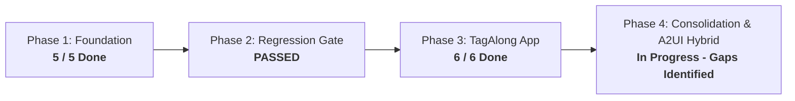

# TagAlong Implementation Task Tracker & Orchestration Board

> **Project:** TagAlong Agentic Street Art Companion (Google ADK + A2UI + KMP)  
> **Date:** 2026-11-21 (Updated with full library & manual-config audit)  
> **Master Intent Document:** [a2ui-kmp-intent-document.md](a2ui-kmp-intent-document.md)  
> **Phase 4 & More Document:** [a2ui-phase-4-and-more.md](a2ui-phase-4-and-more.md)  
> **ADK Runtime Guide:** [tagalong-adk-runtime-guide.md](tagalong-adk-runtime-guide.md)  
> **Cross-Platform QA Plan:** [tagalong-qa-plan.md](tagalong-qa-plan.md)  
> **Workspace:** `/Users/maia/workspace/maiatoday/tag-spotter`

---

## 📊 Overall Progress Summary



- **Current Active Phase:** **Phase 4 Remediation (Fixing Identified Integration & Wiring Gaps)**
- **Total Tasks:** Phase 1 (5) + Gate + Phase 3 (6) + Phase 4 (8)
- **TagAlong Target Platforms:** Android + Desktop (JVM)
- **Status:** 🟡 Phase 1–3 Complete | Phase 4 Partially Complete (Steps 4.3, 4.4, 4.5, 4.6, 4.7 have remaining wiring gaps)

---

## 🟢 PHASE 1: Foundation, Schema & Architecture Evolution

| Status | Step ID | Task Name | Module | Prerequisite | Parallel? | Verification Command |
| :---: | :--- | :--- | :--- | :--- | :---: | :--- |
| ✅ | **Step 1.1** | Model Schema Evolution (`isPublic`) | `:core:model` | None | Sequential | `./gradlew :core:model:allTests` |
| ✅ | **Step 1.2** | Room Migration v13→v14 & TagAlong DB | `:core:database` | Step 1.1 | 🔀 *Parallel with 1.4* | `./gradlew :core:database:allTests` |
| ✅ | **Step 1.3** | Tag Spotter Detail Screen UI Switch | `:feature:detail` | Step 1.2 | 🔀 *Parallel with 1.4* | `./gradlew :feature:detail:allTests` |
| ✅ | **Step 1.4** | Firestore Dual-Write & Public Queries | `:core:sync` | Step 1.1 | 🔀 *Parallel with 1.2/1.3* | `./gradlew :core:sync:allTests` |
| ✅ | **Step 1.5** | Hybrid Spot Repository | `:core:sync` | Steps 1.2, 1.4 | Sequential | `./gradlew :core:sync:allTests` |

### Detailed Phase 1 Checklist:

- [x] **Step 1.1: Model Schema Evolution**
  - **Module:** `:core:model`
  - **Goal:** Add `val isPublic: Boolean = false` to `Spot` with backward-compatible defaults.
  - **Files:** `core/model/src/commonMain/kotlin/net/maiatoday/tagspotter/core/model/Spot.kt`
  - **Test:** `./gradlew :core:model:allTests`

- [x] **Step 1.2: Room Database Migration v13→v14 & TagAlong DB**
  - **Module:** `:core:database`
  - **Goal:** Migrate `SpotDatabase` (`version = 13` → `14`) with manual `MIGRATION_13_14` adding `isPublic`, update `SpotRepository` across `commonMain`, `nonWebMain`, and `wasmJsMain`, and create isolated `TagAlongDatabase` in `nonWebMain`.
  - **Files:**
    - `core/database/src/commonMain/kotlin/net/maiatoday/tagspotter/core/database/SpotRepository.kt`
    - `core/database/src/nonWebMain/kotlin/net/maiatoday/tagspotter/core/database/SpotEntity.kt`
    - `core/database/src/nonWebMain/kotlin/net/maiatoday/tagspotter/core/database/SpotDao.kt`
    - `core/database/src/nonWebMain/kotlin/net/maiatoday/tagspotter/core/database/SpotDatabase.kt`
    - `core/database/src/nonWebMain/kotlin/net/maiatoday/tagspotter/core/database/TagAlongDatabase.kt` (`ChatSessionEntity`, `ChatMessageEntity`)
    - `core/database/src/wasmJsMain/kotlin/net/maiatoday/tagspotter/core/database/...` (update `SpotRepository` implementation)
  - **Test:** `./gradlew :core:database:allTests`

- [x] **Step 1.3: Tag Spotter Detail Screen UI Switch**
  - **Module:** `:feature:detail`
  - **Goal:** Add neon-styled "Share as Public Spot" Switch to `DetailMetadataCard.kt` and bind to `DetailViewModel.togglePublic()`.
  - **Files:**
    - `feature/detail/src/commonMain/kotlin/net/maiatoday/tagspotter/feature/detail/DetailMetadataCard.kt`
    - `feature/detail/src/commonMain/kotlin/net/maiatoday/tagspotter/feature/detail/DetailViewModel.kt`
    - `feature/detail/src/commonMain/kotlin/net/maiatoday/tagspotter/feature/detail/DetailScreen.kt`
  - **Test:** `./gradlew :feature:detail:allTests`

- [x] **Step 1.4: Firestore Dual-Write & Public Spot Queries**
  - **Module:** `:core:sync`
  - **Goal:** Dual-write public spots (`spot.isPublic == true`) to top-level `/public_spots/{uuid}` (and thumbnails to `/public_spots/{uuid}/thumbnails/{imageUuid}.jpg`), remove when toggled off/deleted, and implement `fetchPublicSpots(...)` in both `NonWebSyncManager` (GitLive) and `JvmSyncManager` (Ktor REST).
  - **Files:**
    - `core/sync/src/commonMain/kotlin/net/maiatoday/tagspotter/core/sync/SyncManager.kt`
    - `core/sync/src/nonWebMain/kotlin/net/maiatoday/tagspotter/core/sync/NonWebSyncManager.kt`
    - `core/sync/src/jvmMain/kotlin/net/maiatoday/tagspotter/core/sync/JvmSyncManager.kt`
    - `firestore.rules` (via `firestore-rules-author` subagent)
  - **Test:** `./gradlew :core:sync:allTests`

- [x] **Step 1.5: Hybrid Spot Repository**
  - **Module:** `:core:sync`
  - **Goal:** Implement `HybridSpotRepository` in `:core:sync` merging local `SpotRepository` spots with remote `SyncManager.fetchPublicSpots(...)`, deduplicating by `uuid`, and register in `syncModule`.
  - **Files:**
    - `core/sync/src/commonMain/kotlin/net/maiatoday/tagspotter/core/sync/HybridSpotRepository.kt`
    - `core/sync/src/nonWebMain/kotlin/net/maiatoday/tagspotter/core/sync/SyncModule.kt`
  - **Test:** `./gradlew :core:sync:allTests`

---

## 🛑 PHASE 2: Tag Spotter Comprehensive Regression Gate

> [!CAUTION]
> **Strict Gate:** No Phase 3 code or TagAlong module may be written until this gate passes completely.

- [x] **Tag Spotter Full Monorepo Regression Gate**
  - **Goal:** Prove Tag Spotter offline capture, CameraX, EXIF picker, single-shot AI tagging, and sync are 100% intact across all targets.
  - **Verification Commands:**
    ```bash
    ./gradlew allTests
    ./gradlew :androidApp:assembleDebug
    ./gradlew :desktopApp:assemble
    ```
  - **Result:** ✅ Passed

---

## 🚀 PHASE 3: TagAlong Companion App Implementation (Android & Desktop JVM)

| Status | Step ID | Task Name | Module | Prerequisite | Parallel? | Verification Command |
| :---: | :--- | :--- | :--- | :--- | :---: | :--- |
| ✅ | **Step 3.1** | Monorepo Gradle & Module Skeletons | Root Gradle | Phase 2 Gate | Sequential | `./gradlew projects :core:a2ui:assemble :core:agent:assemble :feature:tagalong:assemble :tagalongApp:desktop:assemble :tagalongApp:android:assembleDebug` |
| ✅ | **Step 3.2** | Neon A2UI Catalog & Dual Engine | `:core:a2ui` | Step 3.1 | 🔀 *Parallel with 3.4* | `./gradlew :core:a2ui:allTests` (Passed ✅) |
| ✅ | **Step 3.3** | Mock Desktop TagAlong Runner | `:tagalongApp:desktop` | Step 3.2 | Sequential after 3.2 | `./gradlew :tagalongApp:desktop:assemble :feature:tagalong:allTests` (Passed ✅) |
| ✅ | **Step 3.4** | Google ADK Agent & Street Art Tools | `:core:agent` | Step 3.1, Step 1.5 | 🔀 *Parallel with 3.2/3.3* | `./gradlew :core:agent:allTests` (Passed ✅) |
| ✅ | **Step 3.5** | End-to-End Chat & Map Sync | `:feature:tagalong` | Steps 3.2, 3.4 | Sequential | `./gradlew :feature:tagalong:allTests :tagalongApp:desktop:assemble` (Passed ✅) |
| ✅ | **Step 3.6** | Android Dual-Engine App | `:tagalongApp:android` | Step 3.5 | Final | `./gradlew :tagalongApp:android:assembleDebug` (Passed ✅) |

### Detailed Phase 3 Checklist:

- [x] **Step 3.1: Monorepo Gradle Setup & Module Skeletons**
  - **Goal:** Register `:core:a2ui`, `:core:agent`, `:feature:tagalong`, `:tagalongApp:desktop`, `:tagalongApp:android` in `settings.gradle.kts` targeting **Android + Desktop JVM** only.
  - **Test:** `./gradlew projects :core:a2ui:assemble :core:agent:assemble :feature:tagalong:assemble :tagalongApp:desktop:assemble :tagalongApp:android:assembleDebug` (Passed ✅)

- [x] **Step 3.2: Neon Catalog & Dual-Engine Adapter**
  - **Goal:** Implement Full Urban Suite (`SpotCard`, `TourCard`, `ArtistBioCard`, `StyleQuizWidget`, `CommunityVotingCard`, `MapPinOverlayWidget`) with `A2UIRendererEngine` adapter (`a2ui-kmp` in `commonMain` + `androidx.a2ui` in `androidMain`).
  - **Test:** `./gradlew :core:a2ui:allTests` (Passed ✅)

- [x] **Step 3.3: Mock Desktop TagAlong Runner**
  - **Goal:** Standalone Desktop JVM runner rendering mock A2UI JSON fixtures with two-pane adaptive layout.
  - **Test:** `./gradlew :tagalongApp:desktop:assemble :feature:tagalong:allTests` (Passed ✅)

- [x] **Step 3.4: Google ADK Agent & Tools Engine**
  - **Goal:** Implement `@Tool` annotations with KSP for `getNearbySpots`, `generateWalkingTour`, `getArtistBio`, `identifyMuralByPhoto`, driving Gemini Flash (Firebase AI + App Check on Android; API Key via `SecretsProvider` on Desktop JVM).
  - **Test:** `./gradlew :core:agent:allTests` (Passed ✅)

- [x] **Step 3.5: End-to-End Multimodal Chat & Map Sync**
  - **Goal:** Connect chat stream, `TagAlongDatabase` conversation storage, mini map synchronization, and action callbacks (`onAction`).
  - **Test:** `./gradlew :feature:tagalong:allTests :tagalongApp:desktop:assemble` (Passed ✅)

- [x] **Step 3.6: Android Dual-Engine App**
  - **Goal:** Dual-engine runtime switcher in Android Dev Settings and Firebase App Check setup in `:tagalongApp:android`.
  - **Test:** `./gradlew :tagalongApp:android:assembleDebug` (Passed ✅)

---

## 🚀 PHASE 4: Single-App Consolidation, Real A2UI Libraries & UX Features

> Detailed specifications, library gotchas, and `[PROMPT USER]` gates in [a2ui-phase-4-and-more.md](a2ui-phase-4-and-more.md).

| Status | Step ID | Task Name | Module | Prerequisite | Parallel? | Verification Command |
| :---: | :--- | :--- | :--- | :--- | :---: | :--- |
| ✅ | **Step 4.1** | Retire `:tagalongApp:*`, Integrate Tab & Single `SpotDatabase` | `:feature:main`, Apps | Phase 3 | Sequential | `./gradlew :feature:main:allTests :androidApp:assembleDebug :desktopApp:assemble` (Passed ✅) |
| ✅ | **Step 4.2** | Shared UI Primitives Consolidation & 1-Tap Save UI | `:core:ui`, `:feature:detail` | Step 4.1 | 🔀 *Parallel with 4.3* | `./gradlew :core:ui:allTests :feature:detail:allTests :feature:gallery:allTests` (Passed ✅) |
| ✅ | **Step 4.3** | Hybrid `androidx.a2ui` & `a2ui-4k` Engines & Fixture Parity | `:core:a2ui`, `:feature:tagalong` | Step 4.1 | 🔀 *Parallel with 4.2* | `./gradlew :core:a2ui:allTests :feature:tagalong:allTests` (Passed ✅) |
| ✅ | **Step 4.4** | ADK `staticInstruction`, Schema Injection, Event Filter & API Keys | `:core:agent`, `:feature:tagalong`, Apps | Steps 4.2, 4.3 | Sequential | `./gradlew :core:agent:allTests :core:photo:allTests :feature:tagalong:allTests :androidApp:assembleDebug :desktopApp:assemble` (Passed ✅) |
| ✅ | **Step 4.5** | Theme-Aware Colors, Markdown Formatting & Desktop DB Fix | `:core:settings`, `:core:database`, `:core:ui`, `:feature:tagalong` | Step 4.4 | 🔀 *Parallel with 4.6* | `./gradlew :core:ui:allTests :core:database:allTests :core:settings:allTests :feature:tagalong:allTests :androidApp:assembleDebug :desktopApp:assemble` (Passed ✅) |
| 🟡 | **Step 4.6** | 1-Tap Spot Saving, Navigation Bridge (`uuid` → `Long`), Permissions & `ClientEvent`s | `:core:agent`, `:feature:tagalong`, `:androidApp` | Step 4.4 | 🔀 *Parallel with 4.5* | `./gradlew :core:agent:allTests :feature:tagalong:allTests :core:sync:allTests` (Inline surfaces bypass `onViewOnMainMap`/`onOpenSpotDetail`; `uuid.toLongOrNull()` fails; `ACCESS_MEDIA_LOCATION` missing) |
| 🟡 | **Step 4.7** | Conversation History Sheet & ADK `InMemoryRunner` Continuity | `:feature:tagalong`, `:core:database` | Steps 4.5, 4.6 | Sequential | `./gradlew :feature:tagalong:allTests` (ADK `InMemoryRunner` session not re-seeded on switch/restart or deleted on `deleteSession`) |
| ⏳ | **Step 4.8** | Manual Config Verification (`[PROMPT USER]`) + Monorepo Regression Gate | Full Monorepo | Steps 4.1-4.7 | Final Gate | `./gradlew allTests :androidApp:assembleDebug :desktopApp:assemble` (Pending gap fixes & manual config prompts) |

### Detailed Phase 4 Checklist & Remaining Work Items:

- [x] **Step 4.1: Retire `:tagalongApp:*`, Integrate TagAlong Tab & Unify `SpotDatabase`**
  - **Goal:** Consolidate TagAlong into the main Tag Spotter app on Android and Desktop so both modes share **one single `SpotDatabase` instance**, one photo storage directory, and one Firebase App Check configuration.
  - **Work Items:**
    - [x] Add `Tab.TagAlong` and an optional `tagAlongContent` composable slot to `MainContainer` and `MainNavigation` in `:feature:main` (`commonMain`), keeping `iOS` and `wasmJs` untouched.
    - [x] Wire `:feature:tagalong`, `:core:a2ui`, and `:core:agent` dependencies and Koin modules into `:androidApp` and `:desktopApp`, passing `TagAlongScreen` into `MainNavigation`'s `tagAlongContent` slot.
    - [x] Remove redundant inner `"Live Map"` `TabRow` on mobile viewports (`< 760.dp`) in `TagAlongScreen.kt`, routing mobile *"View on Map"* actions to `MainContainer`'s `Tab.Map`.
    - [x] Add static Android App Shortcut (`res/xml/shortcuts.xml` for `tagspotter://tagalong`) in `:androidApp`.
    - [x] Remove `:tagalongApp:android` and `:tagalongApp:desktop` from `settings.gradle.kts`.
    - [x] Delegate `TagSpotterApplication.database`, `repository`, and `settingsRepository` to Koin (`GlobalContext.get().get()`) so Room's invalidation tracker is shared across the entire process.
    - [x] Delete leftover `tagalongApp/` build directories on disk.

- [x] **Step 4.2: Shared UI Primitives & Stateless Card Consolidation (`:core:ui`)**
  - **Goal:** Move all reusable Compose UI components into `:core:ui` as stateless, library-agnostic composables shared between Tag Spotter mode, TagAlong mode, `androidx.a2ui`, and `a2ui-4k`.
  - **Work Items:**
    - [x] Move `ZoomableImageOverlay.kt` from `:feature:detail` to `:core:ui/src/commonMain/.../image/`.
    - [x] Create `NeonTagChip` and `NeonCategoryBadge` in `:core:ui/src/commonMain/.../chips/` using `CategoryExtensions.kt`.
    - [x] Move 4 custom domain composables (`NeonSpotCard`, `NeonTourCard`, `NeonArtistBioCard`, `NeonMapPinOverlayWidget`) from `:core:a2ui` into `:core:ui/src/commonMain/.../components/`, refactored to take pure primitive parameters and event lambdas.
    - [x] Refactor `DetailMetadataCard.kt` and `GalleryScreen.kt` to use `NeonTagChip` and `NeonCategoryBadge`.
    - [x] Add `isSaved: Boolean = false` and `onSaveSpot: (() -> Unit)? = null` to `NeonSpotCard` so users have a 1-tap **"Save Spot"** / **"✓ Saved"** button on discovered spots (updating `/spot/isSaved` in the reactive data model).

- [x] **Step 4.3: Replace Hand-Rolled A2UI with Hybrid `androidx.a2ui` & `a2ui-4k` Engines (`:core:a2ui`)**
  - **Goal:** Delete all hand-rolled A2UI parsing/routing code and implement both real A2UI libraries side-by-side with full schema/action parity.
  - **Work Items:**
    - [x] Add `a2ui-4k = { module = "com.contextable:a2ui-4k", version = "0.10.0" }` to `gradle/libs.versions.toml` and `commonMain` of `:core:a2ui/build.gradle.kts` (alongside `androidx.a2ui:*:1.0.0-alpha02` in `androidMain`).
    - [x] Delete `A2UIPayloadParser.kt`, `A2UIComponents.kt`, and `NeonA2UICatalog.kt`.
    - [x] Implement `JetpackHybridCatalog` & `JetpackA2UIEngine` (`androidMain`) and `KmpHybridCatalog` & `KmpA2UIEngine` (`commonMain`).
    - [x] Wire `onFocusMap` and `onOpenSpotDetail` lambdas in `JetpackA2UIEngine` when constructing `createJetpackHybridCatalog` so local `A2uiFunction` calls emit `A2UIAction.ViewOnMap` / `A2UIAction.OpenSpotDetail` via `emitAction(...)`.
    - [x] Bind `isSaved` (`{"path": "/spot/isSaved"}`) and `onSaveSpot` (`save_spot` event) in both `SpotCardA2uiComponent` (`JetpackHybridCatalog.kt`) and `spotCardItem` (`KmpHybridCatalog.kt`).
    - [x] Update `TagAlongMockFixtures.MAP_OVERLAY_JSON` to `"MapPinOverlay"` and normalize `"MapPinOverlayWidget"` → `"MapPinOverlay"` in both engines.
    - [x] Align `Button` actions, `ChoicePicker` `options`/`value`, and `Text` `variant` across both engines and test all 6 valid fixtures in both `KmpA2UIEngineTest` and `JetpackA2UIEngineTest`.

- [ ] **Step 4.4: Wire Agent Prompts to `toJsonSchemaString()`, Fix ADK `staticInstruction`, Photo Bytes & API Keys**
  - **Goal:** Feed library-generated catalog JSON Schema safely into Google ADK `LlmAgent`, filter streaming/tool events, send real image bytes, and resolve platform credentials cleanly.
  - **Work Items:**
    - [x] In `TagAlongViewModel`, launch `engine.runRenderLoop()` and `engine.outboundEvents.collect { ... }`.
    - [x] When photo is attached, use `PhotoProcessor` to load compressed image bytes and pass binary image `Part` (`Blob("image/jpeg", bytes)`) to `runner.runAsync(...)`.
    - [x] Support 2-state engine toggle (`ANDROIDX_JETPACK_OFFICIAL` ↔ `A2UI_KMP_4K`) in Android TagAlong header by replaying session envelopes into the newly selected engine.
    - [x] Updated all flash models across `:core:agent`, `:core:ai` (`AndroidFirebaseAiService.kt`), and `iosApp` (`SwiftFirebaseAiService.swift`) to `"gemini-4-hydrogen"`, and migrated `SwiftFirebaseAiService.swift` off deprecated `FirebaseVertexAI` to `FirebaseAI`.
    - [ ] **Missing (Schema Injection):** Pass `catalogSchemaJson` (`createJetpackHybridCatalog().toJsonSchemaString()` on Android; `KmpA2UIEngine().getCatalogSchemaJson()` on Desktop) into `createAndroidTagAlongRunner` and `createDesktopTagAlongRunner` instead of leaving `catalogSchemaJson = null`.
    - [ ] **Missing (ADK `staticInstruction` Bug):** `TagAlongAgentFactory.createAgent` passes `systemInstruction` via `instruction = Instruction(systemInstruction)`. In `google-adk-kotlin:0.2.0`, `InstructionStateInjector` parses `{...}` in `instruction` as session variables and throws `IllegalArgumentException: Context variable not found` on JSON schemas/examples. Change to `staticInstruction = Content(parts = listOf(Part(text = systemInstruction)))` on `LlmAgent` and add a `RunnerCallTest` with non-null `catalogSchemaJson`.
    - [ ] **Missing (Concrete A2UI v0.9 Examples & `saveNewSpot` in Prompt):** Add clear A2UI v0.9 envelope rules (`createSurface`, `updateDataModel`, `updateComponents` with `"id": "root"`, `"event"` vs `"functionCall"`), `saveNewSpot` tool guidance, and missing-field A2UI form instructions to `TagAlongPrompts.kt`.
    - [ ] **Missing (ADK Event Stream Filtering):** In `TagAlongViewModel.sendMessage()`, filter `runner.runAsync()` events so intermediate tool-call turns, function responses, or final non-partial aggregated events (when streaming) do not overwrite or duplicate chat prose/surfaces.
    - [ ] **Missing (Desktop `RealPhotoProcessor` URI & JPEG Scaling):** `core/photo/src/jvmMain/.../RealPhotoProcessor.kt` does not URL-decode `file:` URIs (breaking filenames with spaces like `%20`) and returns raw unscaled bytes from `decodeScaledBitmap` instead of downscaling (`<= 1024px`) and encoding as JPEG (`image/jpeg`) for `Blob` uploads.
    - [ ] **Missing (Desktop API Key Path & Live Settings Reload):** Fix `DesktopSecretsProvider` in `desktopApp/src/jvmMain/.../Main.kt` to check `GEMINI_API_KEY` env var → `local.properties` → **`../local.properties`** (since `:desktopApp:run` executes with `workingDir = desktopApp/`) → **`SettingsRepository.geminiApiKey`**, dynamically provisioning/updating `Runner` when the user enters a key in Settings without requiring an app restart.

- [x] **Step 4.5: Theme Switching, Markdown Formatting, New Conversation Controls & Desktop DB Persistence Fix**
  - **Goal:** Provide Light/Dark mode fidelity, clean Markdown text bubbles, fresh conversation controls, and persistent Desktop SQLite storage.
  - **Work Items:**
    - [x] Update `JvmSpotDatabase.kt` to store databases in `File(System.getProperty("user.home"), ".tagspotter/")` instead of `java.io.tmpdir`.
    - [x] Introduce `ThemeMode { SYSTEM, LIGHT, DARK }` in `:core:settings` and wire theme toggle in app bar / settings.
    - [x] Add `+` ("New Chat") button in `TagAlongScreen` top bar calling `TagAlongViewModel.startNewConversation()`.
    - [x] Replace hardcoded `DarkBackground`, `DarkPrimaryContainer`, `DarkSecondaryContainer`, and `DarkTertiaryContainer` in `TagAlongScreen.kt` and `:core:ui` Neon cards with `MaterialTheme.colorScheme` tokens (and theme-aware `useDarkMap` in `MapPane`).
    - [x] Render inline Markdown (`**bold**`, `*italic*`, `` `code` ``) via `AnnotatedString` and attached photo `AsyncImage` thumbnails (tappable for `ZoomableImageOverlay`) in `ChatMessageItem`; add `imePadding()` and wire `ImeAction.Send` / Enter-to-send.

- [ ] **Step 4.6: 1-Tap Agentic Spot Saving, Navigation Bridge (`uuid` → `Long`), Permissions & DataModel Actions**
  - **Goal:** Allow 1-tap spot saving, working inline-card navigation to `DetailScreen` and Mobile `Tab.Map`, preserved Android photo EXIF GPS, and conversational `ClientEvent`s.
  - **Work Items:**
    - [x] Add `@Tool saveNewSpot` to `StreetArtTools.kt` validating `category in Spot.CATEGORIES` (mapping style subtypes like `"mural"` to `tags`).
    - [x] Wire `PhotoProcessor.extractMetadataFromUri` and `createThumbnailFromUri` into photo-attachment flow.
    - [x] Handle outbound `save_spot` and `toggle_star` events from `engine.outboundEvents` in `TagAlongViewModel`, persisting to `SpotRepository` and updating surface data model.
    - [ ] **Missing (Inline Surface Navigation Bypass + `uuid` → `Spot.id: Long` Bug):** Inline surfaces render via `engine.RenderSurface(surfaceId)` and emit events onto `engine.outboundEvents` directly into `TagAlongViewModel.handleAction()`, bypassing `TagAlongScreenContent`'s `wrappedOnAction` so `onViewOnMainMap` and `onOpenSpotDetail` are never invoked! In addition, A2UI cards pass `spotId: String` (`Spot.uuid`), whereas `onOpenSpotDetail: (Long) -> Unit` requires Room's `Spot.id: Long` (`uuid.toLongOrNull()` always returns `null`). Add `navigationEvents: SharedFlow<TagAlongNavEvent>` on `TagAlongViewModel` (resolving `uuid` → `spot.id: Long` via `HybridSpotRepository`) and collect it in `TagAlongScreen`.
    - [ ] **Missing (Android `ACCESS_MEDIA_LOCATION` Permission on TagAlong Photo Picker):** In `MainActivity.kt`, `TagAlongScreen`'s `onPickPhoto` launches `pickTagAlongMedia` without requesting `Manifest.permission.ACCESS_MEDIA_LOCATION` (unlike `triggerFiles`), causing Android 10+ to strip EXIF GPS coordinates from picked mural photos. Gate `pickTagAlongMedia` behind `ACCESS_MEDIA_LOCATION`.
    - [ ] **Missing (Device GPS & Photo EXIF Context):** Use `locationProvider.getCurrentLocation()` in `StreetArtTools` / `TagAlongViewModel` as coordinate fallback when the user asks for *"nearby murals"*, and include extracted photo EXIF GPS + local thumbnail path in the turn context.
    - [ ] **Missing (Conversational `ClientEvent` Forwarding):** Handle `answer_quiz`, `vote_option`, and form submit `ClientEvent`s in `TagAlongViewModel.handleAction()`, forwarding conversational client events back to the ADK `Runner` for server-side `updateDataModel` updates.

- [ ] **Step 4.7: Conversation History Drawer / Sheet & ADK Session Continuity**
  - **Goal:** Enable users to browse, switch between, and delete past chat sessions saved in `TagAlongDatabase` with full ADK memory continuity.
  - **Work Items:**
    - [x] Expose `allSessions: StateFlow<List<ChatSession>>` in `TagAlongViewModel`.
    - [x] Add History Drawer / `ModalBottomSheet` in `TagAlongScreen`.
    - [x] Replay stored A2UI v0.9 messages into active `A2UIRendererEngine` when switching sessions.
    - [ ] **Missing (ADK Session Context Continuity):** Seed `InMemoryRunner` (`runner.sessionService`) with persisted `ChatRepository` turns when restoring a session on app restart or calling `switchSession()`, and delete the session from `runner.sessionService` in `deleteSession()`.

- [ ] **Step 4.8: Full Monorepo Regression Gate**
  - **Goal:** Pass all tests and assemble all targets across the unified monorepo after fixing all Phase 4 gaps and running manual config verification prompts.
  - **Command:** `./gradlew clean allTests :androidApp:assembleDebug :desktopApp:assemble`

---

## 🛠️ Manual Configuration & `[PROMPT USER]` Gates

> [!IMPORTANT]
> **Agent Prompting Rule:** Never fabricate secrets, never print secret values, and **never commit API keys or `local.properties`**. When executing live verification or when any item below is unconfigured, **stop and prompt the user** with the exact instructions from [Section 9 of a2ui-phase-4-and-more.md](a2ui-phase-4-and-more.md#9-manual-configuration--developer-action-prompts-prompt-user-gates)!

- [x] **`androidApp/google-services.json`:** Present in workspace.
- [x] **Desktop Firebase Sync Properties (`firebase.api.key`, `firebase.project.id`, `firebase.storage.bucket`):** Present in root `local.properties`.
- [ ] **`[PROMPT USER — Gate M1]` Desktop Gemini API Key (`gemini.api.key`):** Currently **missing** from `local.properties`. Prompt user to add `gemini.api.key=<KEY>` to root `local.properties`, export `GEMINI_API_KEY`, or enter it in **Settings → Gemini API Key** in the Desktop app before live Desktop chat testing.
- [ ] **`[PROMPT USER — Gate M2]` Firebase Console AI Logic & `gemini-4-hydrogen` Model Check:** Prompt user to confirm **Firebase AI Logic** is enabled in Firebase Console and that `gemini-4-hydrogen` is available for the project (or provide an alternate model ID if needed).
- [ ] **`[PROMPT USER — Gate M3]` Android Firebase App Check Debug Token (`firebase.appcheck.debug_token`):** Currently **missing** from `local.properties`. Prompt user to register the debug secret UUID in **Firebase Console → App Check → Apps (`net.maiatoday.tagspotter`) → Manage debug tokens** and add `firebase.appcheck.debug_token=<UUID>` to root `local.properties` before live Android debug chat testing.
- [ ] **`[PROMPT USER — Gate M4]` Deploy Firestore & Storage Rules (`/public_spots`):** Prompt user to confirm whether `firestore.rules` and `storage.rules` have been deployed (`firebase deploy --only firestore:rules,storage`) before testing live community `/public_spots` sharing/discovery.
- [ ] **`[PROMPT USER — Gate M5]` Android Runtime Permissions & Emulator Mock GPS:** Prompt user to grant **Location** and **Photos & media location** permissions on the device/emulator (and set mock GPS coordinates if testing on an emulator).
