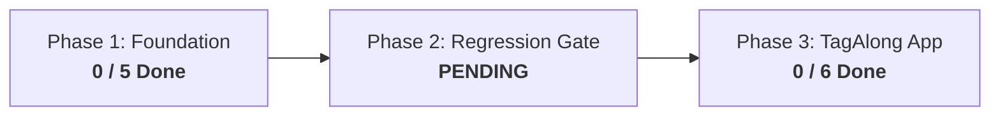

# TagAlong Implementation Task Tracker & Orchestration Board

> **Project:** TagAlong Agentic Street Art Companion (Google ADK + A2UI + KMP)  
> **Date:** 2026-11-11  
> **Master Intent Document:** [a2ui-kmp-intent-document.md](a2ui-kmp-intent-document.md)  
> **Workspace:** `/Users/maia/workspace/maiatoday/tag-spotter`

---

## 📊 Overall Progress Summary



- **Current Active Phase:** **Phase 1 (Step 1.1)**
- **Total Tasks:** 11 steps + 1 Regression Gate
- **TagAlong Target Platforms:** Android + Desktop (JVM) *(Phase 1 preserves all existing Tag Spotter targets including iOS & Wasm)*
- **Status:** ⏳ Not Started

---

## 🟢 PHASE 1: Foundation, Schema & Architecture Evolution

| Status | Step ID | Task Name | Module | Prerequisite | Parallel? | Verification Command |
| :---: | :--- | :--- | :--- | :--- | :---: | :--- |
| ⏳ | **Step 1.1** | Model Schema Evolution (`isPublic`) | `:core:model` | None | Sequential | `./gradlew :core:model:allTests` |
| ⏳ | **Step 1.2** | Room Migration v13→v14 & TagAlong DB | `:core:database` | Step 1.1 | 🔀 *Parallel with 1.4* | `./gradlew :core:database:allTests` |
| ⏳ | **Step 1.3** | Tag Spotter Detail Screen UI Switch | `:feature:detail` | Step 1.2 | 🔀 *Parallel with 1.4* | `./gradlew :feature:detail:allTests` |
| ⏳ | **Step 1.4** | Firestore Dual-Write & Public Queries | `:core:sync` | Step 1.1 | 🔀 *Parallel with 1.2/1.3* | `./gradlew :core:sync:allTests` |
| ⏳ | **Step 1.5** | Hybrid Spot Repository | `:core:sync` | Steps 1.2, 1.4 | Sequential | `./gradlew :core:sync:allTests` |

### Detailed Phase 1 Checklist:

- [ ] **Step 1.1: Model Schema Evolution**
  - **Module:** `:core:model`
  - **Goal:** Add `val isPublic: Boolean = false` to `Spot` with backward-compatible defaults.
  - **Files:** `core/model/src/commonMain/kotlin/net/maiatoday/tagspotter/core/model/Spot.kt`
  - **Test:** `./gradlew :core:model:allTests`

- [ ] **Step 1.2: Room Database Migration v13→v14 & TagAlong DB**
  - **Module:** `:core:database`
  - **Goal:** Migrate `SpotDatabase` (`version = 13` → `14`) with manual `MIGRATION_13_14` adding `isPublic`, update `SpotRepository` across `commonMain`, `nonWebMain`, and `wasmJsMain`, and create isolated `TagAlongDatabase` in `nonWebMain`.
  - **Files:**
    - `core/database/src/commonMain/kotlin/net/maiatoday/tagspotter/core/database/SpotRepository.kt`
    - `core/database/src/nonWebMain/kotlin/net/maiatoday/tagspotter/core/database/SpotEntity.kt`
    - `core/database/src/nonWebMain/kotlin/net/maiatoday/tagspotter/core/database/SpotDao.kt`
    - `core/database/src/nonWebMain/kotlin/net/maiatoday/tagspotter/core/database/SpotDatabase.kt`
    - `core/database/src/nonWebMain/kotlin/net/maiatoday/tagspotter/core/database/TagAlongDatabase.kt` (`ChatSessionEntity`, `ChatMessageEntity`)
    - `core/database/src/wasmJsMain/kotlin/net/maiatoday/tagspotter/core/database/...` (update `SpotRepository` implementation)
  - **Test:** `./gradlew :core:database:allTests`

- [ ] **Step 1.3: Tag Spotter Detail Screen UI Switch**
  - **Module:** `:feature:detail`
  - **Goal:** Add neon-styled "Share as Public Spot" Switch to `DetailMetadataCard.kt` and bind to `DetailViewModel.togglePublic()`.
  - **Files:**
    - `feature/detail/src/commonMain/kotlin/net/maiatoday/tagspotter/feature/detail/DetailMetadataCard.kt`
    - `feature/detail/src/commonMain/kotlin/net/maiatoday/tagspotter/feature/detail/DetailViewModel.kt`
    - `feature/detail/src/commonMain/kotlin/net/maiatoday/tagspotter/feature/detail/DetailScreen.kt`
  - **Test:** `./gradlew :feature:detail:allTests`

- [ ] **Step 1.4: Firestore Dual-Write & Public Spot Queries**
  - **Module:** `:core:sync`
  - **Goal:** Dual-write public spots (`spot.isPublic == true`) to top-level `/public_spots/{uuid}` (and thumbnails to `/public_spots/{uuid}/thumbnails/{imageUuid}.jpg`), remove when toggled off/deleted, and implement `fetchPublicSpots(...)` in both `NonWebSyncManager` (GitLive) and `JvmSyncManager` (Ktor REST).
  - **Files:**
    - `core/sync/src/commonMain/kotlin/net/maiatoday/tagspotter/core/sync/SyncManager.kt`
    - `core/sync/src/nonWebMain/kotlin/net/maiatoday/tagspotter/core/sync/NonWebSyncManager.kt`
    - `core/sync/src/jvmMain/kotlin/net/maiatoday/tagspotter/core/sync/JvmSyncManager.kt`
    - `firestore.rules` (via `firestore-rules-author` subagent)
  - **Test:** `./gradlew :core:sync:allTests`

- [ ] **Step 1.5: Hybrid Spot Repository**
  - **Module:** `:core:sync`
  - **Goal:** Implement `HybridSpotRepository` in `:core:sync` merging local `SpotRepository` spots with remote `SyncManager.fetchPublicSpots(...)`, deduplicating by `uuid`, and register in `syncModule`.
  - **Files:**
    - `core/sync/src/commonMain/kotlin/net/maiatoday/tagspotter/core/sync/HybridSpotRepository.kt`
    - `core/sync/src/nonWebMain/kotlin/net/maiatoday/tagspotter/core/sync/SyncModule.kt`
  - **Test:** `./gradlew :core:sync:allTests`

---

## 🛑 PHASE 2: Tag Spotter Comprehensive Regression Gate

> [!CAUTION]
> **Strict Gate:** No Phase 3 code or TagAlong module may be written until this gate passes completely.

- [ ] **Tag Spotter Full Monorepo Regression Gate**
  - **Goal:** Prove Tag Spotter offline capture, CameraX, EXIF picker, single-shot AI tagging, and sync are 100% intact across all targets.
  - **Verification Commands:**
    ```bash
    ./gradlew allTests
    ./gradlew :androidApp:assembleDebug
    ./gradlew :desktopApp:assemble
    ```

---

## 🚀 PHASE 3: TagAlong Companion App Implementation (Android & Desktop JVM)

| Status | Step ID | Task Name | Module | Prerequisite | Parallel? | Verification Command |
| :---: | :--- | :--- | :--- | :--- | :---: | :--- |
| ⏳ | **Step 3.1** | Monorepo Gradle & Module Skeletons | Root Gradle | Phase 2 Gate | Sequential | `./gradlew projects` |
| ⏳ | **Step 3.2** | Neon A2UI Catalog & Dual Engine | `:core:a2ui` | Step 3.1 | 🔀 *Parallel with 3.4* | `./gradlew :core:a2ui:allTests` |
| ⏳ | **Step 3.3** | Mock Desktop TagAlong Runner | `:tagalongApp:desktop` | Step 3.2 | Sequential after 3.2 | `./gradlew :tagalongApp:desktop:run` |
| ⏳ | **Step 3.4** | Google ADK Agent & Street Art Tools | `:core:agent` | Step 3.1, Step 1.5 | 🔀 *Parallel with 3.2/3.3* | `./gradlew :core:agent:allTests` |
| ⏳ | **Step 3.5** | End-to-End Chat & Map Sync | `:feature:tagalong` | Steps 3.2, 3.4 | Sequential | `./gradlew :feature:tagalong:allTests` |
| ⏳ | **Step 3.6** | Android Dual-Engine App | `:tagalongApp:android` | Step 3.5 | Final | `./gradlew :tagalongApp:android:assembleDebug` |

### Detailed Phase 3 Checklist:

- [ ] **Step 3.1: Monorepo Gradle Setup & Module Skeletons**
  - **Goal:** Register `:core:a2ui`, `:core:agent`, `:feature:tagalong`, `:tagalongApp:desktop`, `:tagalongApp:android` in `settings.gradle.kts` targeting **Android + Desktop JVM** only.
  - **Test:** `./gradlew projects :core:a2ui:assemble :core:agent:assemble :feature:tagalong:assemble`

- [ ] **Step 3.2: Neon Catalog & Dual-Engine Adapter**
  - **Goal:** Implement Full Urban Suite (`SpotCard`, `TourCard`, `ArtistBioCard`, `StyleQuizWidget`, `CommunityVotingCard`, `MapPinOverlayWidget`) with `A2UIRendererEngine` adapter (`a2ui-kmp` in `commonMain` + `androidx.a2ui` in `androidMain`).
  - **Test:** `./gradlew :core:a2ui:allTests`

- [ ] **Step 3.3: Mock Desktop TagAlong Runner**
  - **Goal:** Standalone Desktop JVM runner rendering mock A2UI JSON fixtures with two-pane adaptive layout.
  - **Test:** `./gradlew :tagalongApp:desktop:run`

- [ ] **Step 3.4: Google ADK Agent & Tools Engine**
  - **Goal:** Implement `@Tool` annotations with KSP for `getNearbySpots`, `generateWalkingTour`, `getArtistBio`, `identifyMuralByPhoto`, driving Gemini Flash (Firebase AI + App Check on Android; API Key via `SecretsProvider` on Desktop JVM).
  - **Test:** `./gradlew :core:agent:allTests`

- [ ] **Step 3.5: End-to-End Multimodal Chat & Map Sync**
  - **Goal:** Connect chat stream, `TagAlongDatabase` conversation storage, mini map synchronization, and action callbacks (`onAction`).
  - **Test:** `./gradlew :feature:tagalong:allTests`

- [ ] **Step 3.6: Android Dual-Engine App**
  - **Goal:** Dual-engine runtime switcher in Android Dev Settings and Firebase App Check setup in `:tagalongApp:android`.
  - **Test:** `./gradlew :tagalongApp:android:assembleDebug`
