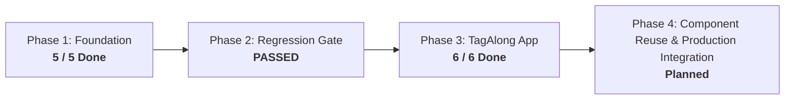

# TagAlong Implementation Task Tracker & Orchestration Board

> **Project:** TagAlong Agentic Street Art Companion (Google ADK + A2UI + KMP)  
> **Date:** 2026-11-11  
> **Master Intent Document:** [a2ui-kmp-intent-document.md](a2ui-kmp-intent-document.md)  
> **Phase 4 & More Document:** [a2ui-phase-4-and-more.md](a2ui-phase-4-and-more.md)  
> **Workspace:** `/Users/maia/workspace/maiatoday/tag-spotter`

---

## 📊 Overall Progress Summary



- **Current Active Phase:** **Phase 4 (Single-App Consolidation, Real A2UI Libraries & UX)**
- **Total Tasks:** Phase 1 (5) + Gate + Phase 3 (6) + Phase 4 (8)
- **TagAlong Target Platforms:** Android + Desktop (JVM)
- **Status:** 🟢 Phase 1, Phase 2, & Phase 3 Complete | 🟡 Phase 4 Active

---

## 🟢 PHASE 1: Foundation, Schema & Architecture Evolution

| Status | Step ID | Task Name | Module | Prerequisite | Parallel? | Verification Command |
| :---: | :--- | :--- | :--- | :--- | :---: | :--- |
| ✅ | **Step 1.1** | Model Schema Evolution (`isPublic`) | `:core:model` | None | Sequential | `./gradlew :core:model:allTests` |
| ✅ | **Step 1.2** | Room Migration v13→v14 & TagAlong DB | `:core:database` | Step 1.1 | 🔀 *Parallel with 1.4* | `./gradlew :core:database:allTests` |
| ✅ | **Step 1.3** | Tag Spotter Detail Screen UI Switch | `:feature:detail` | Step 1.2 | 🔀 *Parallel with 1.4* | `./gradlew :feature:detail:allTests` |
| ✅ | **Step 1.4** | Firestore Dual-Write & Public Queries | `:core:sync` | Step 1.1 | 🔀 *Parallel with 1.2/1.3* | `./gradlew :core:sync:allTests` |
| ✅ | **Step 1.5** | Hybrid Spot Repository | `:core:sync` | Steps 1.2, 1.4 | Sequential | `./gradlew :core:sync:allTests` |

### Detailed Phase 1 Checklist:

- [x] **Step 1.1: Model Schema Evolution**
  - **Module:** `:core:model`
  - **Goal:** Add `val isPublic: Boolean = false` to `Spot` with backward-compatible defaults.
  - **Files:** `core/model/src/commonMain/kotlin/net/maiatoday/tagspotter/core/model/Spot.kt`
  - **Test:** `./gradlew :core:model:allTests`

- [x] **Step 1.2: Room Database Migration v13→v14 & TagAlong DB**
  - **Module:** `:core:database`
  - **Goal:** Migrate `SpotDatabase` (`version = 13` → `14`) with manual `MIGRATION_13_14` adding `isPublic`, update `SpotRepository` across `commonMain`, `nonWebMain`, and `wasmJsMain`, and create isolated `TagAlongDatabase` in `nonWebMain`.
  - **Files:**
    - `core/database/src/commonMain/kotlin/net/maiatoday/tagspotter/core/database/SpotRepository.kt`
    - `core/database/src/nonWebMain/kotlin/net/maiatoday/tagspotter/core/database/SpotEntity.kt`
    - `core/database/src/nonWebMain/kotlin/net/maiatoday/tagspotter/core/database/SpotDao.kt`
    - `core/database/src/nonWebMain/kotlin/net/maiatoday/tagspotter/core/database/SpotDatabase.kt`
    - `core/database/src/nonWebMain/kotlin/net/maiatoday/tagspotter/core/database/TagAlongDatabase.kt` (`ChatSessionEntity`, `ChatMessageEntity`)
    - `core/database/src/wasmJsMain/kotlin/net/maiatoday/tagspotter/core/database/...` (update `SpotRepository` implementation)
  - **Test:** `./gradlew :core:database:allTests`

- [x] **Step 1.3: Tag Spotter Detail Screen UI Switch**
  - **Module:** `:feature:detail`
  - **Goal:** Add neon-styled "Share as Public Spot" Switch to `DetailMetadataCard.kt` and bind to `DetailViewModel.togglePublic()`.
  - **Files:**
    - `feature/detail/src/commonMain/kotlin/net/maiatoday/tagspotter/feature/detail/DetailMetadataCard.kt`
    - `feature/detail/src/commonMain/kotlin/net/maiatoday/tagspotter/feature/detail/DetailViewModel.kt`
    - `feature/detail/src/commonMain/kotlin/net/maiatoday/tagspotter/feature/detail/DetailScreen.kt`
  - **Test:** `./gradlew :feature:detail:allTests`

- [x] **Step 1.4: Firestore Dual-Write & Public Spot Queries**
  - **Module:** `:core:sync`
  - **Goal:** Dual-write public spots (`spot.isPublic == true`) to top-level `/public_spots/{uuid}` (and thumbnails to `/public_spots/{uuid}/thumbnails/{imageUuid}.jpg`), remove when toggled off/deleted, and implement `fetchPublicSpots(...)` in both `NonWebSyncManager` (GitLive) and `JvmSyncManager` (Ktor REST).
  - **Files:**
    - `core/sync/src/commonMain/kotlin/net/maiatoday/tagspotter/core/sync/SyncManager.kt`
    - `core/sync/src/nonWebMain/kotlin/net/maiatoday/tagspotter/core/sync/NonWebSyncManager.kt`
    - `core/sync/src/jvmMain/kotlin/net/maiatoday/tagspotter/core/sync/JvmSyncManager.kt`
    - `firestore.rules` (via `firestore-rules-author` subagent)
  - **Test:** `./gradlew :core:sync:allTests`

- [x] **Step 1.5: Hybrid Spot Repository**
  - **Module:** `:core:sync`
  - **Goal:** Implement `HybridSpotRepository` in `:core:sync` merging local `SpotRepository` spots with remote `SyncManager.fetchPublicSpots(...)`, deduplicating by `uuid`, and register in `syncModule`.
  - **Files:**
    - `core/sync/src/commonMain/kotlin/net/maiatoday/tagspotter/core/sync/HybridSpotRepository.kt`
    - `core/sync/src/nonWebMain/kotlin/net/maiatoday/tagspotter/core/sync/SyncModule.kt`
  - **Test:** `./gradlew :core:sync:allTests`

---

## 🛑 PHASE 2: Tag Spotter Comprehensive Regression Gate

> [!CAUTION]
> **Strict Gate:** No Phase 3 code or TagAlong module may be written until this gate passes completely.

- [x] **Tag Spotter Full Monorepo Regression Gate**
  - **Goal:** Prove Tag Spotter offline capture, CameraX, EXIF picker, single-shot AI tagging, and sync are 100% intact across all targets.
  - **Verification Commands:**
    ```bash
    ./gradlew allTests
    ./gradlew :androidApp:assembleDebug
    ./gradlew :desktopApp:assemble
    ```
  - **Result:** ✅ Passed

---

## 🚀 PHASE 3: TagAlong Companion App Implementation (Android & Desktop JVM)

| Status | Step ID | Task Name | Module | Prerequisite | Parallel? | Verification Command |
| :---: | :--- | :--- | :--- | :--- | :---: | :--- |
| ✅ | **Step 3.1** | Monorepo Gradle & Module Skeletons | Root Gradle | Phase 2 Gate | Sequential | `./gradlew projects :core:a2ui:assemble :core:agent:assemble :feature:tagalong:assemble :tagalongApp:desktop:assemble :tagalongApp:android:assembleDebug` |
| ✅ | **Step 3.2** | Neon A2UI Catalog & Dual Engine | `:core:a2ui` | Step 3.1 | 🔀 *Parallel with 3.4* | `./gradlew :core:a2ui:allTests` (Passed ✅) |
| ✅ | **Step 3.3** | Mock Desktop TagAlong Runner | `:tagalongApp:desktop` | Step 3.2 | Sequential after 3.2 | `./gradlew :tagalongApp:desktop:assemble :feature:tagalong:allTests` (Passed ✅) |
| ✅ | **Step 3.4** | Google ADK Agent & Street Art Tools | `:core:agent` | Step 3.1, Step 1.5 | 🔀 *Parallel with 3.2/3.3* | `./gradlew :core:agent:allTests` (Passed ✅) |
| ✅ | **Step 3.5** | End-to-End Chat & Map Sync | `:feature:tagalong` | Steps 3.2, 3.4 | Sequential | `./gradlew :feature:tagalong:allTests :tagalongApp:desktop:assemble` (Passed ✅) |
| ✅ | **Step 3.6** | Android Dual-Engine App | `:tagalongApp:android` | Step 3.5 | Final | `./gradlew :tagalongApp:android:assembleDebug` (Passed ✅) |

### Detailed Phase 3 Checklist:

- [x] **Step 3.1: Monorepo Gradle Setup & Module Skeletons**
  - **Goal:** Register `:core:a2ui`, `:core:agent`, `:feature:tagalong`, `:tagalongApp:desktop`, `:tagalongApp:android` in `settings.gradle.kts` targeting **Android + Desktop JVM** only.
  - **Test:** `./gradlew projects :core:a2ui:assemble :core:agent:assemble :feature:tagalong:assemble :tagalongApp:desktop:assemble :tagalongApp:android:assembleDebug` (Passed ✅)

- [x] **Step 3.2: Neon Catalog & Dual-Engine Adapter**
  - **Goal:** Implement Full Urban Suite (`SpotCard`, `TourCard`, `ArtistBioCard`, `StyleQuizWidget`, `CommunityVotingCard`, `MapPinOverlayWidget`) with `A2UIRendererEngine` adapter (`a2ui-kmp` in `commonMain` + `androidx.a2ui` in `androidMain`).
  - **Test:** `./gradlew :core:a2ui:allTests` (Passed ✅)

- [x] **Step 3.3: Mock Desktop TagAlong Runner**
  - **Goal:** Standalone Desktop JVM runner rendering mock A2UI JSON fixtures with two-pane adaptive layout.
  - **Test:** `./gradlew :tagalongApp:desktop:assemble :feature:tagalong:allTests` (Passed ✅)

- [x] **Step 3.4: Google ADK Agent & Tools Engine**
  - **Goal:** Implement `@Tool` annotations with KSP for `getNearbySpots`, `generateWalkingTour`, `getArtistBio`, `identifyMuralByPhoto`, driving Gemini Flash (Firebase AI + App Check on Android; API Key via `SecretsProvider` on Desktop JVM).
  - **Test:** `./gradlew :core:agent:allTests` (Passed ✅)

- [x] **Step 3.5: End-to-End Multimodal Chat & Map Sync**
  - **Goal:** Connect chat stream, `TagAlongDatabase` conversation storage, mini map synchronization, and action callbacks (`onAction`).
  - **Test:** `./gradlew :feature:tagalong:allTests :tagalongApp:desktop:assemble` (Passed ✅)

- [x] **Step 3.6: Android Dual-Engine App**
  - **Goal:** Dual-engine runtime switcher in Android Dev Settings and Firebase App Check setup in `:tagalongApp:android`.
  - **Test:** `./gradlew :tagalongApp:android:assembleDebug` (Passed ✅)

---

## 🚀 PHASE 4: Single-App Consolidation, Real A2UI Libraries & UX Features

> Detailed specifications in [a2ui-phase-4-and-more.md](a2ui-phase-4-and-more.md).

| Status | Step ID | Task Name | Module | Prerequisite | Parallel? | Verification Command |
| :---: | :--- | :--- | :--- | :--- | :--- | :--- |
| ⏳ | **Step 4.1** | Retire `:tagalongApp:*` & Integrate TagAlong Tab | `:feature:main`, Apps | Phase 3 | Sequential | `./gradlew :feature:main:allTests :androidApp:assembleDebug :desktopApp:assemble` |
| ⏳ | **Step 4.2** | Shared UI Primitives Consolidation | `:core:ui`, `:feature:detail` | Step 4.1 | 🔀 *Parallel with 4.3* | `./gradlew :core:ui:allTests :feature:detail:allTests :feature:gallery:allTests` |
| ⏳ | **Step 4.3** | Hybrid `androidx.a2ui` & `a2ui-4k` Engines | `:core:a2ui` | Step 4.1 | 🔀 *Parallel with 4.2* | `./gradlew :core:a2ui:allTests` |
| ⏳ | **Step 4.4** | Wire Prompts to Schema, Fix Photo Bytes & Render Loop | `:core:agent`, `:feature:tagalong` | Steps 4.2, 4.3 | Sequential | `./gradlew :core:agent:allTests :feature:tagalong:allTests` |
| ⏳ | **Step 4.5** | Theme Switching, New Chat Controls & Desktop DB Fix | `:core:settings`, `:core:database`, Apps | Step 4.4 | 🔀 *Parallel with 4.6* | `./gradlew :core:database:allTests :feature:tagalong:allTests` |
| ⏳ | **Step 4.6** | 1-Tap Spot Saving, `Spot.CATEGORIES` & DataModel Actions | `:core:agent`, `:feature:tagalong`, `:core:sync` | Step 4.4 | 🔀 *Parallel with 4.5* | `./gradlew :feature:tagalong:allTests :core:sync:allTests` |
| ⏳ | **Step 4.7** | Conversation History Drawer / Sheet with Surface Replay | `:feature:tagalong`, `:core:database` | Steps 4.5, 4.6 | Sequential | `./gradlew :feature:tagalong:allTests` |
| ⏳ | **Step 4.8** | Full Monorepo Regression Gate | Full Monorepo | Steps 4.1-4.7 | Final Gate | `./gradlew allTests :androidApp:assembleDebug :desktopApp:assemble` |

### Detailed Phase 4 Checklist:

- [ ] **Step 4.1: Retire `:tagalongApp:*` & Integrate TagAlong Tab into `:androidApp` & `:desktopApp`**
  - **Goal:** Consolidate TagAlong into the main Tag Spotter app on Android and Desktop so both modes share one `SpotDatabase`, one photo storage directory, and one Firebase App Check configuration.
  - **Work Items:**
    1. Add `Tab.TagAlong` and an optional `tagAlongContent` composable slot to `MainContainer` and `MainNavigation` in `:feature:main` (`commonMain`), keeping `iOS` and `wasmJs` untouched.
    2. Wire `:feature:tagalong`, `:core:a2ui`, and `:core:agent` dependencies and Koin modules into `:androidApp` and `:desktopApp`, passing `TagAlongScreen` into `MainNavigation`'s `tagAlongContent` slot.
    3. Remove redundant inner `"Live Map"` `TabRow` on mobile viewports (`< 760.dp`) in `TagAlongScreen.kt`, routing mobile *"View on Map"* actions to `MainContainer`'s `Tab.Map`.
    4. Add static Android App Shortcut (`res/xml/shortcuts.xml` for `tagspotter://tagalong`) in `:androidApp`.
    5. Remove `:tagalongApp:android` and `:tagalongApp:desktop` from `settings.gradle.kts` and delete their module directories.
  - **Test:** `./gradlew :feature:main:allTests :androidApp:assembleDebug :desktopApp:assemble`

- [ ] **Step 4.2: Shared UI Primitives & Stateless Card Consolidation (`:core:ui`)**
  - **Goal:** Move all reusable Compose UI components into `:core:ui` as stateless, library-agnostic composables shared between Tag Spotter mode, TagAlong mode, `androidx.a2ui`, and `a2ui-4k`.
  - **Work Items:**
    1. Move `ZoomableImageOverlay.kt` from `:feature:detail` to `:core:ui/src/commonMain/.../image/`.
    2. Create `NeonTagChip` and `NeonCategoryBadge` in `:core:ui/src/commonMain/.../chips/` using `CategoryExtensions.kt`.
    3. Move 4 custom domain composables (`NeonSpotCard`, `NeonTourCard`, `NeonArtistBioCard`, `NeonMapPinOverlayWidget`) from `:core:a2ui` into `:core:ui/src/commonMain/.../components/`, refactored to take pure primitive parameters and event lambdas.
    4. Refactor `DetailMetadataCard.kt` and `GalleryScreen.kt` to use `NeonTagChip` and `NeonCategoryBadge`.
  - **Test:** `./gradlew :core:ui:allTests :feature:detail:allTests :feature:gallery:allTests`

- [ ] **Step 4.3: Replace Hand-Rolled A2UI with Hybrid `androidx.a2ui` & `a2ui-4k` Engines (`:core:a2ui`)**
  - **Goal:** Delete all hand-rolled A2UI parsing/routing code and implement both real A2UI libraries side-by-side using the Hybrid Catalog (Built-in Basic Catalog primitives + 4 custom `:core:ui` domain components).
  - **Work Items:**
    1. Add `a2ui-4k = { module = "com.contextable:a2ui-4k", version = "0.10.0" }` to `gradle/libs.versions.toml` and `commonMain` of `:core:a2ui/build.gradle.kts` (alongside `androidx.a2ui.compose.runtime` in `androidMain`).
    2. Delete `A2UIPayloadParser.kt`, `A2UIComponents.kt`, and `NeonA2UICatalog.kt`.
    3. Implement `JetpackHybridCatalog` & `JetpackA2UIEngine` (`androidMain`): combine `materialA2uiBasicCatalogV1` with custom `A2uiComponent` wrappers and local `A2uiFunction`s (`focusMap`, `openSpotDetail`). Wire `A2uiMessageProcessor`, `A2uiSurface`, and `catalog.toJsonSchemaString()`.
    4. Implement `KmpHybridCatalog` & `KmpA2UIEngine` (`commonMain`): combine `CoreCatalog` with custom widget renderers for the 4 domain components and client functions. Wire `SurfaceStateManager` and `A2UISurface`.
    5. Update mock fixtures in `:feature:tagalong` to valid A2UI v0.9 protocol envelopes (`createSurface`, `updateDataModel`, `updateComponents`).
  - **Test:** `./gradlew :core:a2ui:allTests`

- [ ] **Step 4.4: Wire Agent Prompts to `toJsonSchemaString()`, Fix Photo Bytes & Connect Render Loop**
  - **Goal:** Feed library-generated catalog JSON Schema directly into Google ADK agent prompt, send real image bytes for attached photos, and render A2UI surfaces inline by `surfaceId`.
  - **Work Items:**
    1. Replace hardcoded schemas in `TagAlongPrompts.kt` with dynamic `buildSystemInstruction(catalogSchemaJson = engine.getCatalogSchemaJson(), ...)`.
    2. In `TagAlongViewModel`, launch `engine.runRenderLoop()` and `engine.outboundEvents.collect { ... }`.
    3. When photo is attached, use `PhotoProcessor` to load compressed image bytes and pass binary image `Part` to `runner.runAsync(...)`.
    4. Support 2-state engine toggle (`ANDROIDX_JETPACK_OFFICIAL` ↔ `A2UI_KMP_4K`) in Android TagAlong header by replaying session envelopes into the newly selected engine.
  - **Test:** `./gradlew :core:agent:allTests :feature:tagalong:allTests`

- [ ] **Step 4.5: Theme Switching, New Conversation Controls & Desktop DB Persistence Fix**
  - **Goal:** Provide user control over Light/Dark modes, starting fresh conversation sessions, and persistent Desktop SQLite storage.
  - **Work Items:**
    1. Update `JvmSpotDatabase.kt` to store databases in `File(System.getProperty("user.home"), ".tagspotter/")` instead of `java.io.tmpdir`.
    2. Introduce `ThemeMode { SYSTEM, LIGHT, DARK }` in `:core:settings` and wire theme toggle in app bar / settings.
    3. Add `+` ("New Chat") button in `TagAlongScreen` top bar calling `TagAlongViewModel.startNewConversation()`.
  - **Test:** `./gradlew :core:database:allTests :feature:tagalong:allTests`

- [ ] **Step 4.6: 1-Tap Agentic Spot Saving, `Spot.CATEGORIES` Mapping & Two-Way DataModel Actions**
  - **Goal:** Allow users to save spots discovered in chat directly into shared `SpotDatabase` when all required fields are gathered, using `Spot.CATEGORIES` for `category` and `spot.tags` for street-art styles.
  - **Work Items:**
    1. Add `@Tool saveNewSpot` to `StreetArtTools.kt` validating `category in Spot.CATEGORIES` (mapping style subtypes like `"mural"` to `tags`).
    2. Wire `PhotoProcessor.extractMetadataFromUri` and `createThumbnailFromUri` into photo-attachment flow for 1-tap saving.
    3. Handle outbound `save_spot` and `toggle_star` events from `engine.outboundEvents` in `TagAlongViewModel`, persisting to `SpotRepository` and updating surface data model.
    4. Forward conversational `A2uiClientEventMessage`s back to ADK `Runner` for server-side `updateDataModel`.
  - **Test:** `./gradlew :feature:tagalong:allTests :core:sync:allTests`

- [ ] **Step 4.7: Conversation History Drawer / Sheet Implementation**
  - **Goal:** Enable users to browse, switch between, and delete past chat sessions saved in `TagAlongDatabase`.
  - **Work Items:**
    1. Expose `allSessions: StateFlow<List<ChatSession>>` in `TagAlongViewModel`.
    2. Add History Drawer / `ModalBottomSheet` in `TagAlongScreen`.
    3. Replay stored A2UI v0.9 messages into active `A2UIRendererEngine` when switching sessions.
  - **Test:** `./gradlew :feature:tagalong:allTests`

- [ ] **Step 4.8: Full Monorepo Regression Gate**
  - **Goal:** Pass all tests and assemble all targets across the unified monorepo.
  - **Command:** `./gradlew allTests :androidApp:assembleDebug :desktopApp:assemble`
